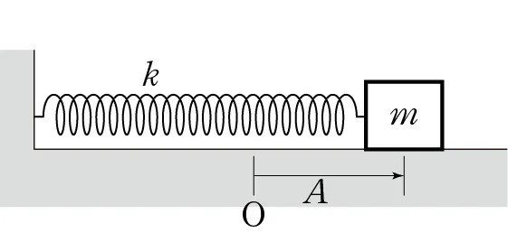
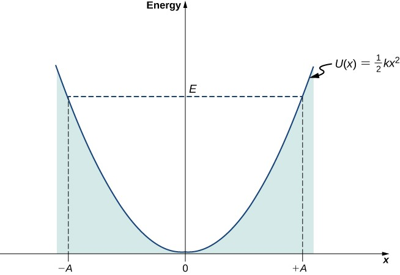
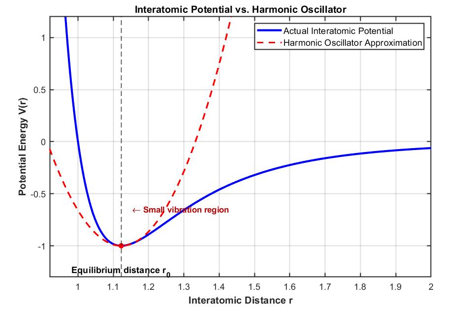
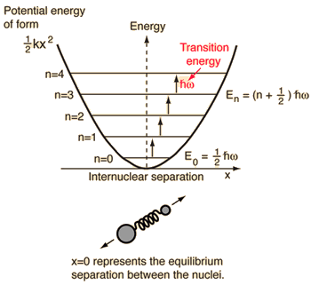

Hi! It has been a while. Lately I have been attending university classes while on leave from military service. The system will not let me formally reenroll yet, so I applied to audit the classes instead. Going to school during leave feels rewarding, but also a little lonely(?)—I wonder whether returning to university will feel like this too. Anyway, there is something from my recent studies that I wanted to organize in a post. There is a lot to cover, so I will not add a separate summary this time.

## Heat capacity

Heat capacity tells us how much a material's temperature changes when it receives energy. If the same amount of energy produces a larger temperature rise, the heat capacity is smaller. Denoting the heat capacity by $C$, we have the following relation.

$$
\left(\frac{\partial U}{\partial T}\right)_V=C_V
$$

Here $C_V$ is the heat capacity, and $\partial U/\partial T$ is the partial derivative of the internal energy $U$ with respect to temperature $T$: the change in internal energy per change in temperature. The subscript $V$ means that the volume is held constant as energy is added. The equation says that, for a given change in internal energy, a larger heat capacity means a smaller change in temperature.

Experimental measurements established the heat capacities of solids. Einstein's early quantum model then provided a theoretical expression using atomic vibrations and the harmonic oscillator. The later Debye model improved on a weakness of Einstein's model: its disagreement with experimental data at very low temperatures. Before getting to the Debye model, this post looks at harmonic oscillators and the Einstein model.

## The harmonic oscillator

A mass displaced by A from its equilibrium position O.

In the figure above, a mass initially at $O$ is attached to a spring and pulled a distance $A$. What motion would you expect? It oscillates back and forth—more precisely, about $O$ with amplitude $A$. This is a harmonic oscillator.

There are two important features to notice.

First, a **restoring force** acts on the mass. Whenever the mass is away from equilibrium, the force acts to bring it back. For a spring, this is $F=-kx$.

Second, the potential-energy graph $V$ is a parabola. The next figure shows the potential energy of a mass on a spring. If its total energy is $E$, kinetic energy plus potential energy equals $E$ by energy conservation. As the mass moves away from equilibrium, its potential energy rises and its kinetic energy falls. The graph visualizes this relationship.

The parabolic potential-energy curve of a harmonic oscillator.

Okay, but why is this so important? Because the motion associated with interatomic bonds—the motion we need to understand heat capacity—can be described using harmonic oscillators.

The potential energy of an interatomic bond has a shape like the one below.

The interatomic potential (blue) and its harmonic approximation (red dashed).

The blue curve is the actual interatomic potential. To the left of its minimum, the atoms become too close and the repulsive force increases. To the right, increasing separation weakens their attraction. The most stable arrangement is the equilibrium separation where these competing effects balance; a small displacement from that separation produces a force back toward equilibrium.

This is much like a mass attached to a spring. Compare the actual potential with the harmonic-oscillator potential, shown by the red dashed curve: near the potential minimum, they are very similar. We can therefore picture a bond between atoms as a spring whose equilibrium length is the bond length.

In the harmonic approximation, the restoring force is proportional to displacement. One of my professors once said that harmonic oscillators can explain much of the world around us. Seeing that even atomic bonds can be modeled this way makes me think I understand why.

## Quantized energy

Everyday oscillations make energy seem continuous. Give an oscillating object a tiny push, and it seems to gain a tiny amount of energy. At the microscopic scale of atomic vibrations, however, a quantum harmonic oscillator has discrete energy levels. The scale is simply too small for us to notice the steps in everyday life. Light, too, comes in quanta called photons. For a harmonic oscillator, the spacing between neighboring levels is $\hbar\omega$.

The energy levels of a microscopic harmonic oscillator are quantized as illustrated below.

Quantized energy levels of a harmonic oscillator.

Starting from the lowest level, the **zero-point energy** $\hbar\omega/2$, the levels are $3\hbar\omega/2$, $5\hbar\omega/2$, and so on, separated by $\hbar\omega$. A measurement of the oscillator's energy cannot give a value between these levels. Zero-point energy is the energy that remains even at absolute zero. Honestly, this is not yet completely intuitive to me, but the uncertainty principle gives a useful picture: a state with both a perfectly definite equilibrium position and zero momentum would violate that principle, so the oscillator retains a minimum energy.

Why did we go through all this? If the atomic vibrations are modeled as harmonic oscillators, each oscillator has quantized energy, and adding their energies gives the solid's vibrational internal energy. We have a set of allowed energy levels and a statistical distribution over them—much like the situation in the earlier discussion of the Boltzmann distribution. Einstein applied Boltzmann statistics to the quantized energies of the oscillators. Sum their average energies, differentiate with respect to $T$, and we obtain a theoretical heat capacity. That is the idea behind the Einstein model.

## The Einstein model for the heat capacity of a solid

First, recall the Boltzmann distribution.

$$
P_n=\frac{e^{-\frac{E_n}{k_BT}}}{\sum _j^{ }e^{-\frac{E_j}{k_BT}}}
$$

The probability of occupying the level with energy $E_n$ is $P_n$. Multiplying $E_n$ by $P_n$ gives that level's contribution to the expected energy. Summing over every level then gives the mean energy per oscillator. The calculation is a little involved, so I will work through it fairly briskly. If you are studying this yourself, I really recommend writing out the steps independently.

Let us first simplify $P_n$. Call its denominator $Z$. It becomes an infinite geometric series. Here we use $E_n=n\hbar\omega$, leaving out the zero-point energy. This shifts the energy reference; the omitted temperature-independent term does not affect the heat capacity.

$$
Z=\sum _{n=0}^{\infty }e^{-\frac{n\hbar \omega }{k_BT}}=\sum _{n=0}^{\infty }\left(e^{-\frac{\hbar \omega }{k_BT}}\right)^n=\frac{1}{1-e^{-\frac{\hbar \omega }{k_BT}}}
$$

$$
P_n=\frac{e^{-E_n/(k_BT)}}{Z}=\left(1-e^{-\frac{\hbar\omega}{k_BT}}\right)e^{-\frac{n\hbar\omega}{k_BT}}
$$

Now that we have $P_n$, multiply by $E_n$ and sum to find the mean oscillator energy. Substituting $x=e^{-\hbar\omega/(k_BT)}$ turns the sum into the familiar form $nx^n$ and simplifies the calculation.

$$
\left\langle \epsilon \right\rangle =\sum _{n=0}^{\infty }E_nP_n=\sum _{n=0}^{\infty }(n\hbar \omega )\frac{e^{-\frac{n\hbar \omega }{k_BT}}}{Z}
$$

$$
\sum_{n=0}^{\infty}nx^n=\frac{x}{(1-x)^2},\qquad x=e^{-\frac{\hbar\omega}{k_BT}}
$$

$$
\left\langle \epsilon \right\rangle =\frac{\hbar \omega e^{-\frac{\hbar \omega }{k_BT}}}{1-e^{-\frac{\hbar \omega }{k_BT}}}=\frac{\hbar \omega }{e^{\frac{\hbar \omega }{k_BT}}-1}
$$

This is the average energy of a one-dimensional oscillator with angular frequency $\omega$. With $N$ such oscillators, we might initially write $U=N\langle\epsilon\rangle$.

But that misses something: **three-dimensional vibration**. So far we have considered motion only along the $x$-axis. Real space also has $y$ and $z$ directions. In the Einstein model, the three Cartesian oscillations are independent, so we can calculate their energies separately and add them. For $N$ atoms, there are $3N$ one-dimensional vibrational degrees of freedom, and the internal energy is therefore $3N$ times the average energy above.

If three-dimensional oscillation is unfamiliar, this visualization may help:

[3D Lissajous Figures — Wolfram Demonstrations](https://demonstrations.wolfram.com/3DLissajousFigures/)

Thus $U=3N\langle\epsilon\rangle$. Differentiating with respect to $T$ gives the following.

$$
U=3N\left\langle \epsilon \right\rangle =\frac{3N\hbar \omega }{e^{\frac{\hbar \omega }{k_BT}}-1}
$$

$$
x=\frac{\hbar \omega }{k_BT}
$$

$$
\frac{dx}{dT}=\frac{d}{dT}\left(\frac{\hbar \omega }{k_BT}\right)=-\frac{\hbar \omega }{k_BT^2}
$$

$$
\frac{dU}{dT}=\frac{dU}{dx}\cdot \frac{dx}{dT}
$$

$$
\frac{d}{dx}\left[3N\hbar \omega (e^x-1)^{-1}\right]=3N\hbar \omega \cdot \left[-(e^x-1)^{-2}\cdot e^x\right]=-\frac{3N\hbar \omega e^x}{(e^x-1)^2}
$$

$$
\frac{dU}{dT}=\left(-\frac{3N\hbar \omega e^x}{(e^x-1)^2}\right)\cdot \left(-\frac{\hbar \omega }{k_BT^2}\right)=\frac{3N(\hbar \omega )^2}{k_BT^2}\frac{e^x}{(e^x-1)^2}
$$

$$
C_V=3Nk_B\left(\frac{\hbar \omega }{k_BT}\right)^2\frac{e^{\frac{\hbar \omega }{k_BT}}}{\left(e^{\frac{\hbar \omega }{k_BT}}-1\right)^2}
$$

Try going through the calculation once yourself, then do not worry about memorizing every step. I think understanding the idea matters more than remembering the arithmetic.

At high temperatures, set $x=\hbar\omega/(k_BT)$. Since $e^x\approx1+x$ for small $x$, the result approaches $C_V\approx3Nk_B$, in agreement with the observed high-temperature limit. As mentioned earlier, however, near absolute zero the model disagrees with experiment. The Debye model addresses that limitation; I will discuss it in a later post.

Thank you for reading this long explanation!

> **Notation note:** This post uses heat capacity, $C_V=(\partial U/\partial T)_V$, rather than heat capacity per unit mass. In the probability formula, the numerator is the Boltzmann factor $e^{-E_n/(k_BT)}$; an apparent numerator typo in the Korean equation has been corrected. Omitting the zero-point energy changes the energy reference, not the heat capacity.

## Related reading

- [Eigenmodes: Coupled Pendulums and Normal Modes](/eigenmodes/)
- [Phonons (1): Lattice Vibration](/phonons-1-lattice-vibration/)

---

*This post reflects my own understanding, so there may be errors. Questions are always welcome, so feel free to ask.*
