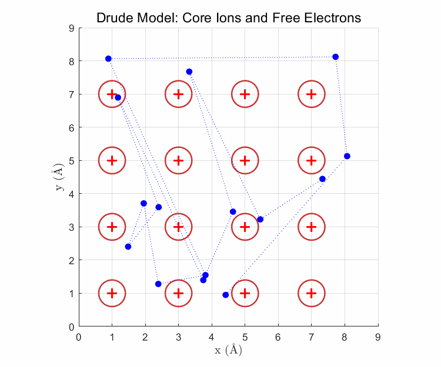
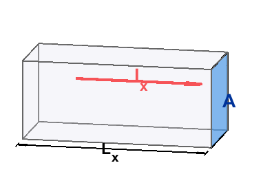
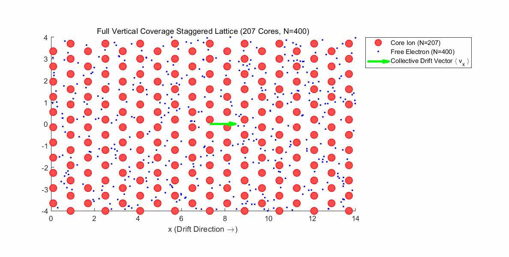
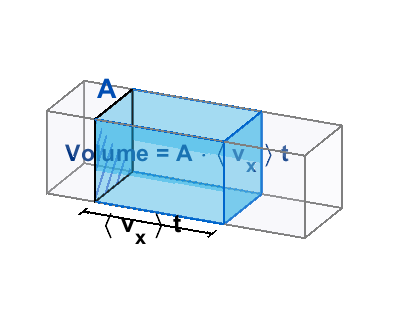
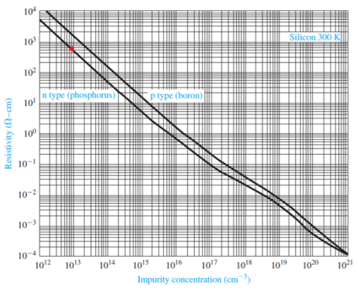

We learn early on that metals conduct electricity well. But what does high electrical conductivity actually mean? In this post, let's explore the **Drude model**, a classical description of electrical conduction.

## The idea behind the Drude model

The model distinguishes between core electrons bound to atoms and free conduction electrons.

Bound core electrons do not move freely through the material, whereas free electrons can travel between atoms. In this classical picture, scattering from the stationary atomic environment interrupts their motion and produces resistance. By analyzing electron transport, we can derive the conductivity of a solid, especially a metal.

Before doing that, let's recall two electromagnetism formulas:

$$
\mathbf{E}=-\nabla V
$$

$$
F=q(E+v\times B)
$$

The first says that the electric field points **opposite** to the potential gradient. A steeper potential gradient produces a stronger electric force on a charge. Expanding the gradient gives:

$$
\mathbf{E}=-\nabla V=-\left(\frac{\partial V}{\partial x}\mathbf{\hat{i}}+\frac{\partial V}{\partial y}\mathbf{\hat{j}}+\frac{\partial V}{\partial z}\mathbf{\hat{k}}\right)
$$

For background, see my [partial derivatives and gradient post](https://oasisforhaanee.github.io/partial-derivatives-and-gradient/).

The second formula is the Lorentz force on a charge in electric and magnetic fields. We will not need the magnetic part here, but it will be useful later. The electric contribution is charge times electric field, and the magnetic contribution is charge times the cross product of velocity and magnetic field—the mathematical form behind the familiar force-direction rule.

## Ohm's law

Start from $V=IR$ and derive the relationship between current density and electric field.

$$
V_x=I_xR\ \ \ \ \ \ \ R=\rho \frac{L_x}{A}\ \ \ \ \ V_x=E_xL_x
$$

$$
E_xL_x=I_x\cdot \rho \frac{L_x}{A}
$$

$$
E_x=\rho \frac{I_x}{A}\ =\rho J_x
$$

Resistance is resistivity times length divided by cross-sectional area. The voltage difference in the uniform-field geometry is field times length, while current density is current divided by area. Thus the electric field is resistivity times current density.

**Conductivity** is defined as the reciprocal of resistivity. High conductivity means current flows easily; high resistivity means the opposite.

$$
\ \sigma =\frac{1}{\rho }
$$

We can therefore write:

$$
J_x=\sigma E_x
$$

## The Drude model

Now let's derive the expression that determines conductivity. In a wire, an applied electric field accelerates electrons opposite to the field, producing electric current. Their motion is interrupted by collisions with the atomic environment. Let tau denote the mean time between scattering events. Then:

$$
F=qE_x=-eE_x
$$

$$
a=\frac{F}{m_e}=-\frac{eE_x}{m_e}
$$

$$
<v_x>=a\tau =-\frac{eE_x\tau }{m_e}
$$

The mean drift velocity is the acceleration multiplied by the relevant mean free-flight time. It describes the average directed motion of the electron population, not every individual electron's total velocity.

A Drude-model simulation illustrating the collective drift velocity.

We can express the current density using that mean drift velocity:

$$
J_x=-ne<v_x>
$$

Here, $n$ is the number of free electrons per unit volume, $-e$ is the electron charge, and the averaged velocity is their drift velocity.

During time $t$, the electrons move through a volume equal to the area times their mean drift displacement. Multiplying this by the electron density and charge gives the transported charge $Q$. Dividing by time gives current, and dividing again by area gives current density:

$$
Q=-neA<v_x>t
$$

$$
\frac{Q}{t}=I_x=-neA<v_x>
$$

$$
\frac{I_x}{A}=J_x=-ne<v_x>
$$

Finally, combining the drift-velocity expression with the current density lets us express conductivity through microscopic material parameters:

$$
J_x=-ne<v_x>=-ne\left(-\frac{eE_x\tau }{m_e}\right)
$$

$$
=\sigma E_x
$$

$$
\sigma =\frac{ne^2\tau }{m_e}
$$

We can also characterize how readily electrons drift. The **Drude mobility** is the magnitude of the mean electron drift velocity per unit electric-field magnitude. Its relationship to conductivity is:

$$
\mu _e=\frac{<v_x>}{E_x}=\frac{e\tau }{m_e}
$$

$$
\sigma =ne\mu _e
$$

Under fixed conditions, these parameters characterize the material. The elementary charge and bare electron mass are fixed, whereas carrier density and scattering time depend on the material and conditions. If the scattering time is also held fixed, conductivity is proportional to free-carrier density.

Semiconductors illustrate this particularly well. Comparing pure silicon with doped silicon, where doping provides additional electron or hole carriers, lets us examine how conductivity changes with carrier concentration.

The red point indicates pure silicon. The logarithmic plot compares resistivity—the reciprocal of conductivity—with impurity concentration, associated with the carrier density.

The vertical axis is resistivity and the horizontal axis is impurity concentration. If mobility is approximately constant and carrier density follows the impurity concentration, the logarithms have the following relationship. A roughly minus-one slope in the graph is broadly consistent with this simple Drude picture:

$$
\sigma =ne\mu _e
$$

$$
\frac{1}{\rho }=ne\mu _e
$$

$$
-\log (\rho )=\log (n)+\log (e\mu _e)
$$

With other parameters fixed, the Drude model explains higher conductivity through a larger density of mobile carriers and lower conductivity through fewer carriers. But it is a classical model for a reason: its limitations are clear too. I may discuss them in a future post.

Thank you for reading this long explanation!

*This post reflects my own understanding, so there may be errors. Questions are always welcome, so feel free to ask.*
