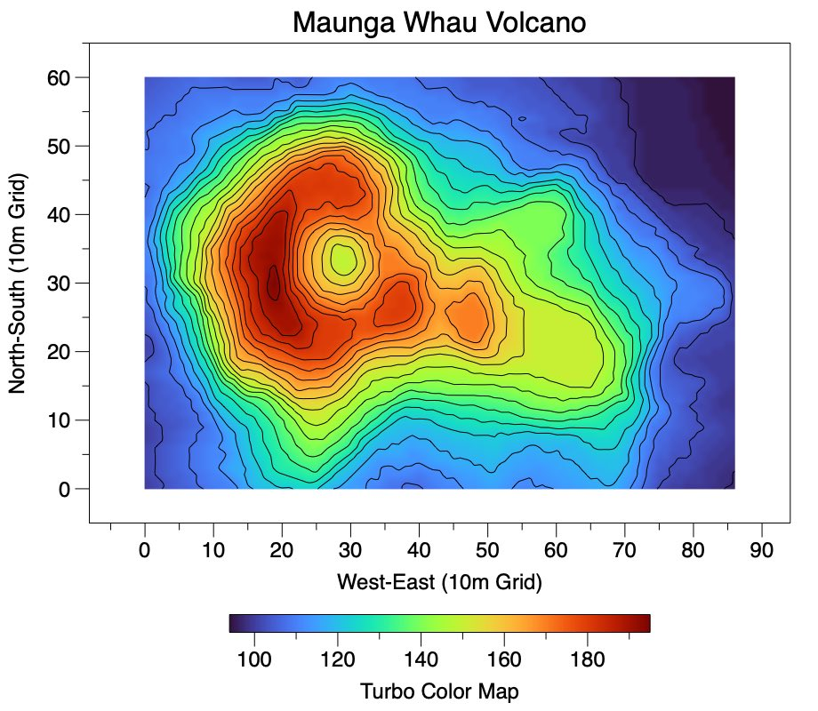
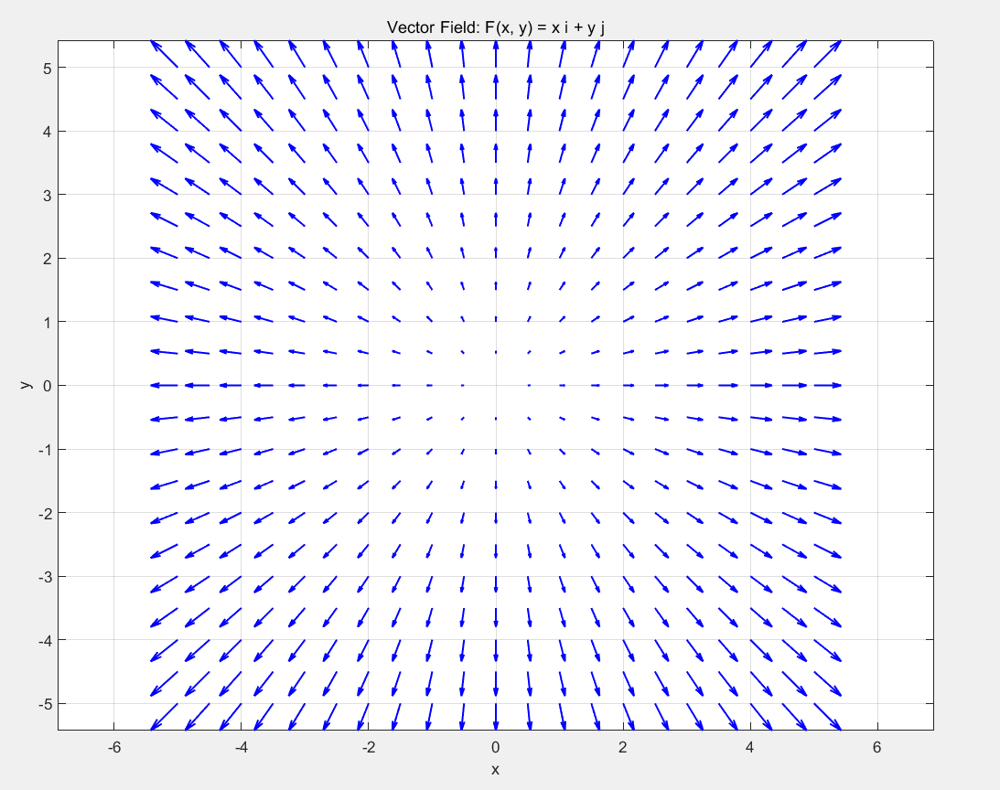
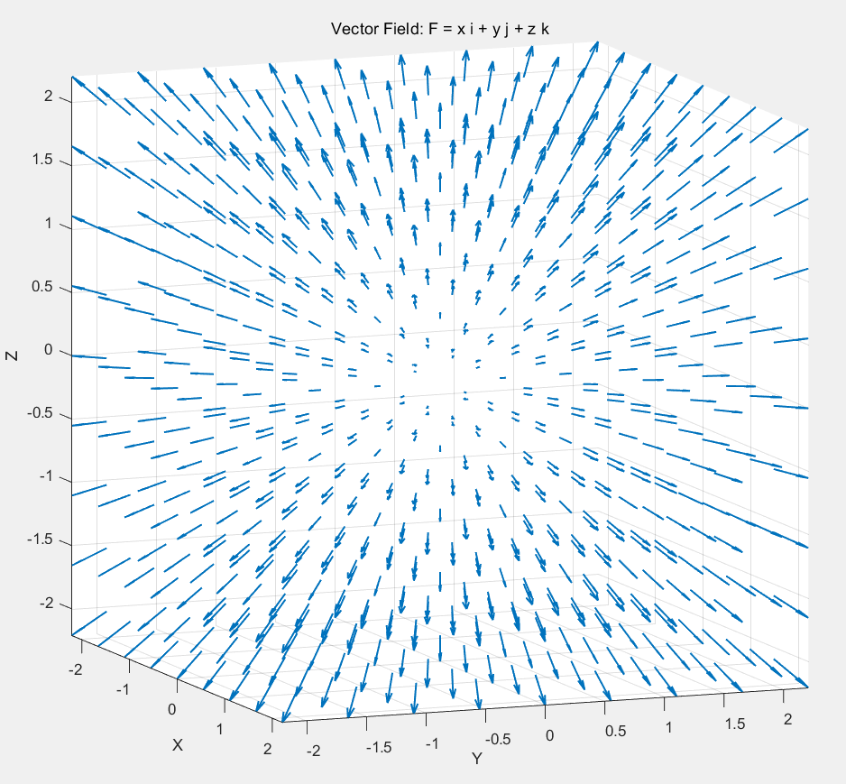
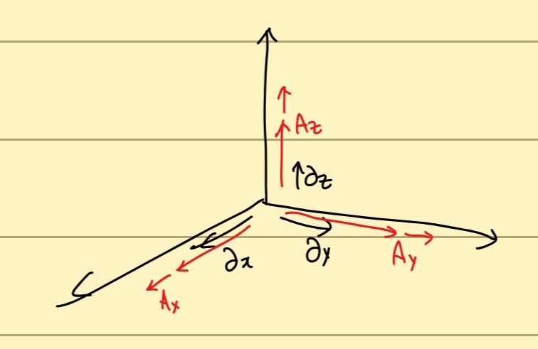
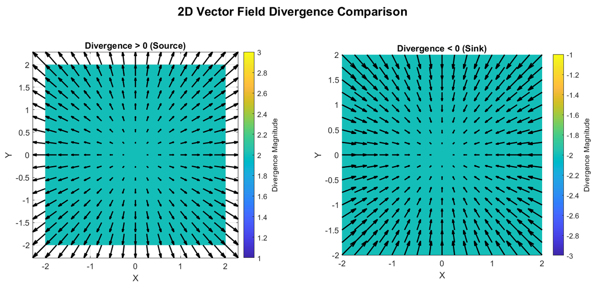
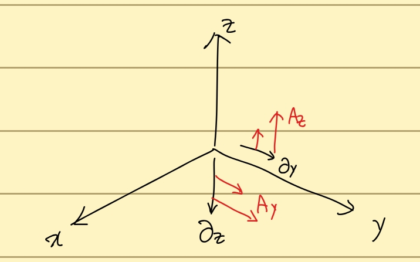
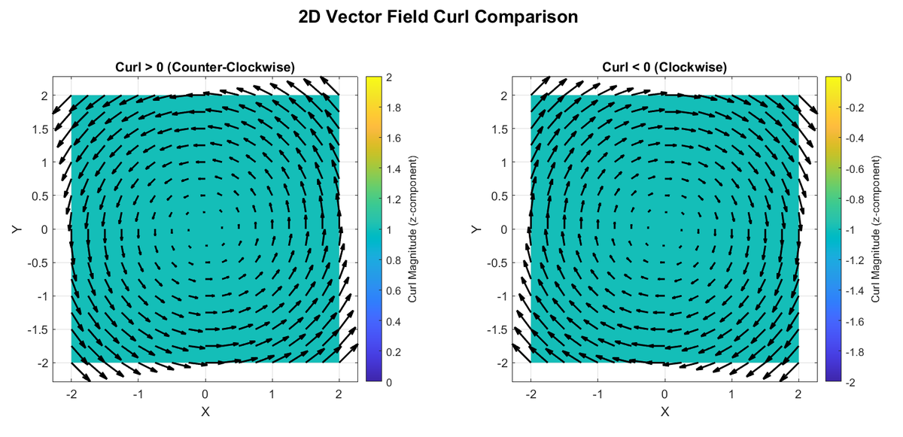

Hi everyone! It's been a week since I returned to university. I've joined a new club, and the weather is getting cooler, so it feels good to be back. Besides my own courses, I'm auditing an electromagnetism class in another department. I think it will be important for my future studies, so I'd like to organize what I learn into posts. Let's begin!

## Fields

We hear the word **field** all the time in physics: electric fields, magnetic fields, gravitational fields, and so on. What does it mean?

Think of a field as a function that assigns a value to every point in space. That value may be a scalar or a vector. A scalar at each point gives a **scalar field**; a vector at each point gives a **vector field**.

A contour map is a good scalar-field example. Each point in a two-dimensional map is assigned a height.

Each position is assigned a height, represented here by color.

Electric and magnetic fields are familiar vector-field examples. Each position is assigned a vector.

The two-dimensional field $(x,y)$: the point $(x,y)$ is assigned that vector.

The three-dimensional field $(x,y,z)$: each point is assigned its corresponding three-component vector.

Electric and magnetic fields assign vectors to points in this way. Does the idea of a field feel a little clearer now?

Once we have a field, we need tools to extract information from it. Those tools are **operators**.

## Gradient

I discussed gradients in my [partial derivatives and gradient post](https://oasisforhaanee.github.io/partial-derivatives-and-gradient/).

Please refer to that post for the details of gradients and partial derivatives. Here, applying a gradient to a scalar field gives:

$$
\nabla f=\frac{\partial f}{\partial x}\hat{\mathbf{i}}+\frac{\partial f}{\partial y}\hat{\mathbf{j}}+\frac{\partial f}{\partial z}\hat{\mathbf{k}}
$$

The gradient points in the direction in which the scalar field increases most rapidly. On a height map, it is the steepest uphill direction. For a small displacement vector $v$, the change in the function is approximately its dot product with the gradient:

$$
\Delta f\approx \mathbf{v}\cdot \nabla \mathbf{F}=\begin{pmatrix}v_x&v_y&v_z\end{pmatrix}\begin{pmatrix}\frac{\partial f}{\partial x}\\\frac{\partial f}{\partial y}\\\frac{\partial f}{\partial z}\end{pmatrix}
$$

$$
=v_x\frac{\partial f}{\partial x}+v_y\frac{\partial f}{\partial y}+v_z\frac{\partial f}{\partial z}
$$

For a vector field, every point already has several components, so its spatial derivatives have a different form:

$$
\nabla \mathbf{F}=\begin{pmatrix}\frac{\partial F_x}{\partial x}&\frac{\partial F_x}{\partial y}&\frac{\partial F_x}{\partial z}\\\frac{\partial F_y}{\partial x}&\frac{\partial F_y}{\partial y}&\frac{\partial F_y}{\partial z}\\\frac{\partial F_z}{\partial x}&\frac{\partial F_z}{\partial y}&\frac{\partial F_z}{\partial z}\end{pmatrix}
$$

Each row resembles the gradient of a scalar component. The first gives the spatial derivatives of $F_x$, the second those of $F_y$, and the third those of $F_z$. Collectively, these derivatives form a matrix, or a second-order tensor. A small displacement produces an approximate vector change through contraction with this derivative tensor. The following expression records the component arrangement used in the original notes:

$$
\Delta \mathbf{F}\approx \mathbf{v}\cdot \nabla \mathbf{F}=\begin{pmatrix}v_x&v_y&v_z\end{pmatrix}\begin{pmatrix}\frac{\partial F_x}{\partial x}&\frac{\partial F_x}{\partial y}&\frac{\partial F_x}{\partial z}\\\frac{\partial F_y}{\partial x}&\frac{\partial F_y}{\partial y}&\frac{\partial F_y}{\partial z}\\\frac{\partial F_z}{\partial x}&\frac{\partial F_z}{\partial y}&\frac{\partial F_z}{\partial z}\end{pmatrix}
$$

$$
=\begin{pmatrix}v_x\frac{\partial F_x}{\partial x}+v_y\frac{\partial F_y}{\partial x}+v_z\frac{\partial F_z}{\partial x},&v_x\frac{\partial F_x}{\partial y}+v_y\frac{\partial F_y}{\partial y}+v_z\frac{\partial F_z}{\partial y},&v_x\frac{\partial F_x}{\partial z}+v_y\frac{\partial F_y}{\partial z}+v_z\frac{\partial F_z}{\partial z}\end{pmatrix}
$$

## Divergence

The divergence of a vector field $A$ is defined by:

$$
\text{div}\, \mathbf{A}=\nabla \cdot \mathbf{A}=\begin{pmatrix}\frac{\partial }{\partial x}&\frac{\partial }{\partial y}&\frac{\partial }{\partial z}\end{pmatrix}\begin{pmatrix}A_x\\A_y\\A_z\end{pmatrix}=\frac{\partial A_x}{\partial x}+\frac{\partial A_y}{\partial y}+\frac{\partial A_z}{\partial z}
$$

Notice the dot product between the differential operator and the field. Applying it at each position gives a scalar divergence value. What does that value mean?

The derivative of $A_x$ with respect to $x$ measures how the field's $x$ component changes as we move a little in the $x$ direction. In the diagram, the long red arrow is the original component and the small red arrow represents its change. The other two directions work in the same way.

Adding these three derivatives measures local net outflow, like water spreading out from a fountain. The sign makes the interpretation clearer:

The left picture has positive divergence and looks like a source, spreading outward. The right has negative divergence and looks like a sink, drawing inward.

## Curl

The curl of a vector field is defined by:

$$
\nabla \times \mathbf{A}=\begin{vmatrix}\mathbf{i}&\mathbf{j}&\mathbf{k}\\\frac{\partial }{\partial x}&\frac{\partial }{\partial y}&\frac{\partial }{\partial z}\\A_x&A_y&A_z\end{vmatrix}=\left(\frac{\partial A_z}{\partial y}-\frac{\partial A_y}{\partial z}\right)\mathbf{i}+\left(\frac{\partial A_x}{\partial z}-\frac{\partial A_z}{\partial x}\right)\mathbf{j}+\left(\frac{\partial A_y}{\partial x}-\frac{\partial A_x}{\partial y}\right)\mathbf{k}
$$

Unlike divergence, we now use the cross-product form. Looking only at the $x$ component:

$$
\left(\nabla \times \mathbf{A}\right)_x=\left(\frac{\partial A_z}{\partial y}-\frac{\partial A_y}{\partial z}\right)\mathbf{i}
$$

The corresponding diagram is:

This component involves how $A_z$ changes along $y$ and how $A_y$ changes along $z$. The latter enters with a minus sign. Together, the arrows illustrate circulation about the $x$ axis. Repeating the reasoning for the other axes shows that each curl component describes local rotation about its corresponding axis.

The sign of the component indicates the rotational sense:

With the orientation shown, positive curl corresponds to counterclockwise circulation and negative curl to clockwise circulation.

Divergence and curl are so important in electromagnetism that I wanted to examine their calculus meaning carefully. Remember that gradients can describe spatial derivatives of both scalar and vector fields, although their results have different types. Divergence and curl here act on vector fields. The familiar gradient that points toward the fastest increase is specifically the gradient of a **scalar** field.

Thank you for reading this long explanation!

*This post reflects my own understanding, so there may be errors. Questions are always welcome, so feel free to ask.*
