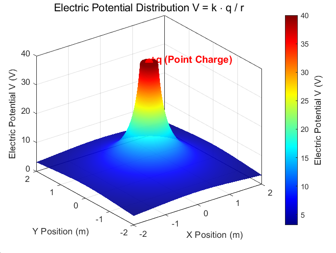
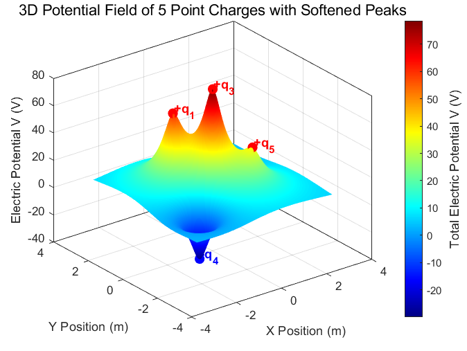
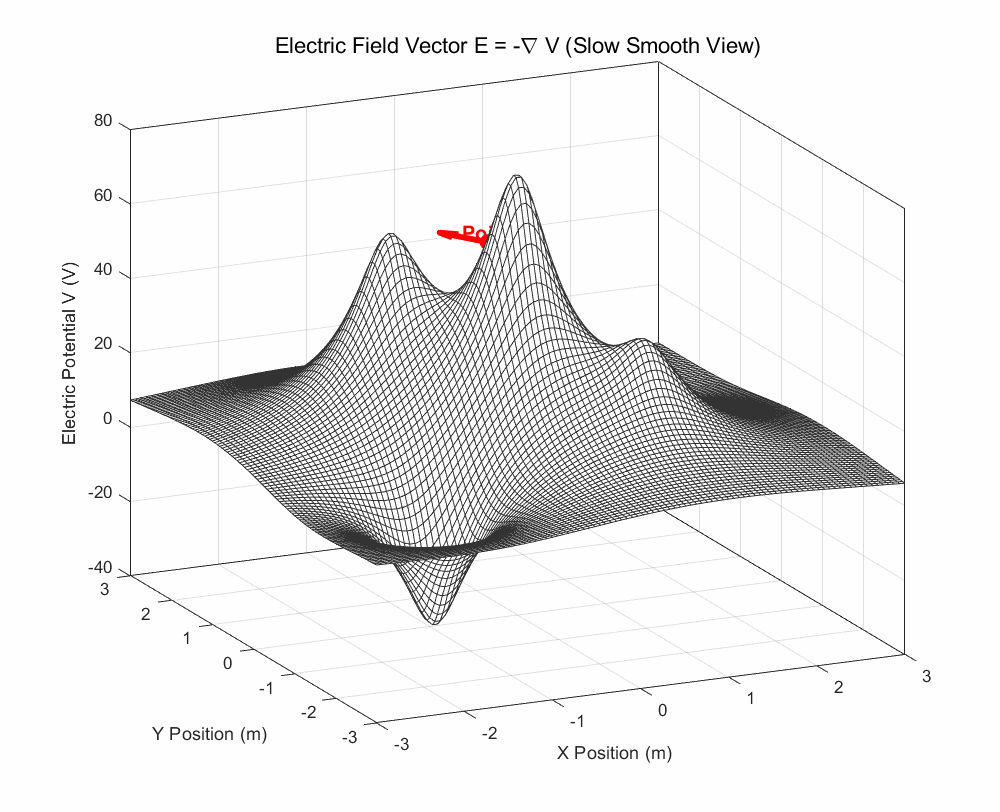
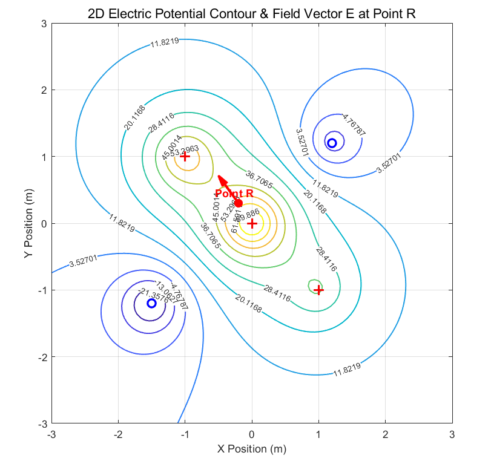

In this post, let's explore one of the most fundamental equations in electromagnetism: $\mathbf{E}=-\nabla V$.

Before we begin, if you have not read my earlier post on [Divergence and Curl](/divergence-and-curl/), please take a look at it first.

Let's get started.

## Electric potential V

If you have studied physics, you will have encountered the symbol $V$ in several contexts: potential energy, electric potential energy, and the potential in the Schrödinger equation, among others.

In electromagnetism, $V$ denotes **electric potential**: electric potential energy per unit charge. It is a scalar field, assigning a potential value to each position in space.

A simple way to picture it is as a kind of height in electromagnetism. Just as a higher position corresponds to greater gravitational potential energy and a lower position to less, a potential landscape tells us about electric potential energy per unit charge.

When a charge is present, it determines the potential at surrounding positions. For a point charge, the potential is

$$
V=\frac{1}{4\pi \epsilon _0}\frac{q}{r}
$$

We can replace the constant at the front with Coulomb's constant $k$:

$$
V=k\frac{q}{r}
$$

This means that a point charge $q$ creates a scalar field whose value at each position is $kq/r$, inversely proportional to the distance from the charge.

The graph above represents the potential created by a positive point charge $+q$ on a two-dimensional plane. Because the scalar field is inversely proportional to distance, it diverges at the origin. In three-dimensional space, the same idea applies: $V(r)$ decreases as we move farther from the positive charge.

If several charges are present, we simply add their contributions. The formula below gives the potential at a particular position $\mathbf{r}$—it may look complicated, but it is just the sum of the potentials created by all the individual point charges:

$$
V_{\text{total}}(\vec{r})=\sum _{i=1}^NV_i(\vec{r})=\frac{1}{4\pi \epsilon _0}\sum _{i=1}^N\frac{q_i}{|\vec{r}-\vec{r}_i|}
$$

*The potential landscape for several point charges. The height represents the potential value.*

Now imagine placing a particle with charge $q_1$ in this potential field, which has already been established by the source charges. Its electric potential energy is $W=q_1V$.

Electric potential energy is the product of the charge and the potential at its position. This is why electric potential is defined as electric potential energy **per unit charge**:

$$
W=qV
$$

## Electric field E

What, then, does the electric field mean? It is defined as electric force per unit charge:

$$
\vec{E}=\frac{\vec{F}}{q_0}
$$

To understand its connection with potential, we first need the relationship between force and potential energy. A conservative force points in the direction in which the potential energy decreases most rapidly:

$$
\vec{F}=-\nabla W
$$

Suppose we have a scalar field representing potential energy. Its gradient points in the direction of the fastest increase in potential energy; the force points in the **opposite** direction.

In other words, a particle in this energy landscape is pushed toward decreasing potential energy. Think of a ball on a hill: the force points down the steepest slope.

The relationship between electric force and electric potential energy is the same:

$$
\vec{F}=-\nabla W
$$

The electric field is force per unit charge, while electric potential is potential energy per unit charge. Dividing the expression above by the charge therefore gives

$$
\vec{E}=-\nabla V
$$

When we draw the potential as a landscape, as above, the electric-field vector at point $R$ points toward the fastest decrease in potential—the direction shown by the red arrow.

There is an important detail here. The plotted height represents the value of the potential over a two-dimensional spatial plane. We are taking the gradient with respect to the physical coordinates $x$ and $y$, not treating the displayed height as an additional spatial coordinate. The field vector in this two-dimensional example therefore lies in the $xy$-plane; it does not acquire a $z$ component merely because the potential is drawn as a three-dimensional surface.

*The potential drawn as contours on a two-dimensional plane. The electric-field vector $\mathbf{E}$ lies in the $xy$-plane.*

This discussion applies to **electrostatic fields**, where the source charges are stationary. In time-dependent electromagnetic situations, a changing magnetic field can also contribute to the electric field, and the simple scalar-potential description must be supplemented.

For the time being, I will focus on electrostatics, so please keep that restriction in mind.

In this post, we saw how the relationship between $\mathbf{E}$ and $V$ is expressed through the **negative gradient**. Understanding this connection is important for what comes next, including Maxwell's equations and $\nabla\times\mathbf{E}=0$ in electrostatics.

Thank you for reading, and have a great day!

---

*This post reflects my own understanding, so there may be errors. Questions are always welcome, so feel free to ask.*
