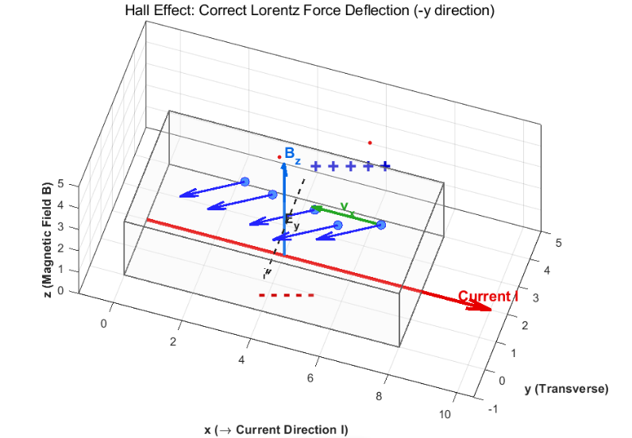
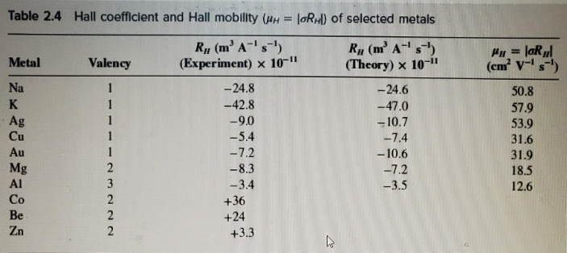

In this post, let's explore the **Hall effect**, which occurs when a magnetic field is applied to a flowing electric current.

## The Hall effect

Discovered by Edwin Hall in 1879, the Hall effect arises when a magnetic field is applied to a current-carrying conductor. The electrons are deflected by the Lorentz force, creating a small potential difference across the conductor. The resulting electric field opposes further deflection, and the transverse forces eventually balance.

Let's take a closer look.

The figure above shows a conductor carrying current $I$ in the $+x$ direction, with a magnetic field applied in the $+z$ direction. The electrons move opposite to the conventional current, with velocity $-v_x\hat{\mathbf{i}}$.

As these moving electrons pass through the magnetic field, the magnetic part of the Lorentz force deflects them toward $-y$. Initially, before the transverse electric field has built up, the force is

$$
\mathbf{F}_L=q(E+v\times B)=(-e)\left[(-v_x\hat{\mathbf{i}})\times (B_z\hat{\mathbf{k}})\right]
$$

$$
=ev_xB_z(\hat{\mathbf{i}}\times \hat{\mathbf{k}})=ev_xB_z(-\hat{\mathbf{j}})
$$

$$
=-ev_xB_z\hat{\mathbf{j}}
$$

The calculation confirms that the force points along $-\hat{\mathbf{j}}$, or the negative $y$-axis.

As the electrons are deflected, charge accumulates on one side. The electron-rich side becomes negatively charged, while the opposite side, which has a relative shortage of electrons, becomes positively charged.

An electric field then forms from the positive side toward the negative side. Its force on an electron is opposite to the magnetic force.

As more charge accumulates, this opposing electric force becomes stronger. Eventually, the electric and magnetic forces balance. The voltage across the conductor at this point is the **Hall voltage**, $V_h$. In terms of magnitudes, the balance gives

$$
F_E=F_B
$$

$$
eE_y=ev_xB_z
$$

$$
E_y=v_xB_z
$$

$$
V=E\cdot d
$$

$$
V_h=E_yd=v_xB_zd
$$

Here, $d$ is the conductor's width along the $y$-axis. Using the uniform-field relation $V=Ed$, the transverse field magnitude is $E_y=V_h/d$.

## Measuring current and the Hall coefficient

With an external magnetic field applied, measuring the Hall voltage lets us infer the mean carrier drift speed. Substituting that velocity into the current-density relation $J=qn\langle v_x\rangle$ gives the current density, and hence the current if the conductor's cross-sectional area is known.

This principle is widely used in **Hall-effect current sensors**: a Hall voltage produced in the sensor can be used to infer the current associated with the magnetic field.

Since the drift velocity is related to $E_y/B_z$, we can also express the result in terms of $J_x$:

$$
J_x=qn\langle v_x\rangle\ =\ qn\left(\frac{E_y}{B_z}\right)
$$

$$
nq=\frac{J_xB_z}{E_y}
$$

$$
=\frac{1}{R_h}\ \left(R_{h\ }:\ Hall\ coefficient\right)
$$

The quantity $nq$ is the charge density carried by the mobile carriers. Combining the mean drift velocity used in the Drude model with the Hall measurement lets us infer this quantity. Its inverse is the **Hall coefficient**, an indicator of a material's electrical properties.

## What the Hall coefficient tells us about the Drude model

These expressions are based on the assumptions of the Drude model. Because the model has limitations, its theoretical predictions do not always agree with experiment: some materials show close agreement, while others give very different results.

In the table below, the experimental and theoretical values agree reasonably well for the metals listed from Na through Al. For a material such as Co, however, the measured Hall coefficient is positive, and no corresponding theoretical value is listed in this simple comparison.

An electron-only Drude description cannot account for all of this behavior. In particular, it does not describe hole-like carriers. A more sophisticated treatment is needed to explain carrier mobility and conduction more accurately—and that treatment brings in quantum mechanics.

*Measured Hall coefficients on the left and theoretical values on the right, for several materials.*

In this post, we explored the Hall effect and used the Hall coefficient to assess the validity of the Drude model. In the following posts, I will look at the quantum-mechanical ideas used to improve on that model.

Honestly, I expect quite a bit of overlap with the posts I have already written while studying ahead. Looking back at those earlier posts may help with the material to come, too.

Thank you for reading, and have a good night!

---

*This post reflects my own understanding, so there may be errors. Questions are always welcome, so feel free to ask.*
