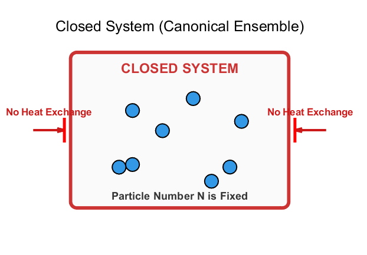
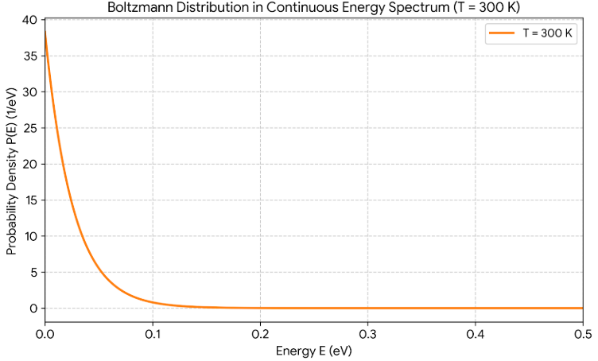
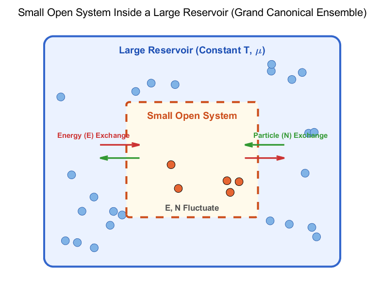
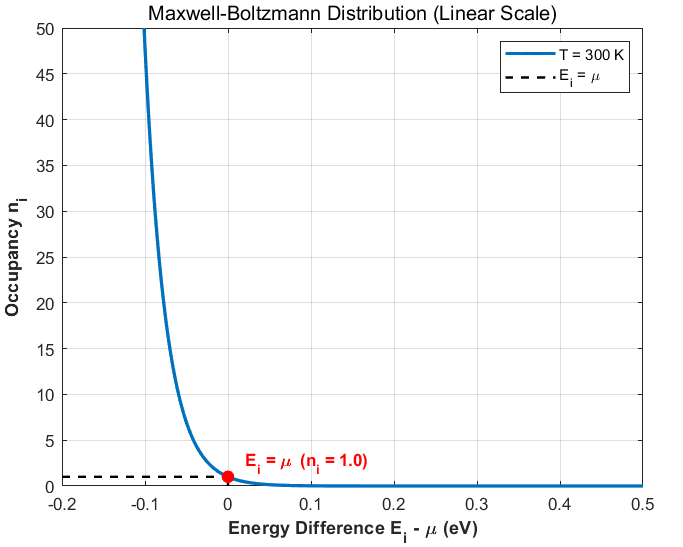
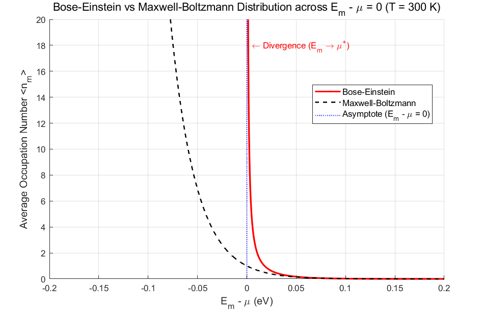
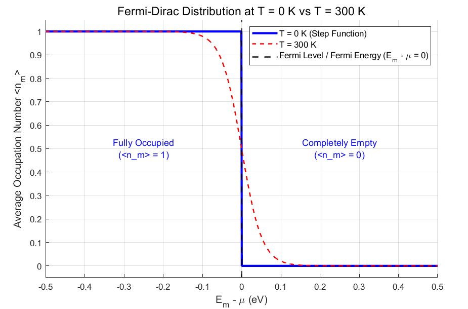
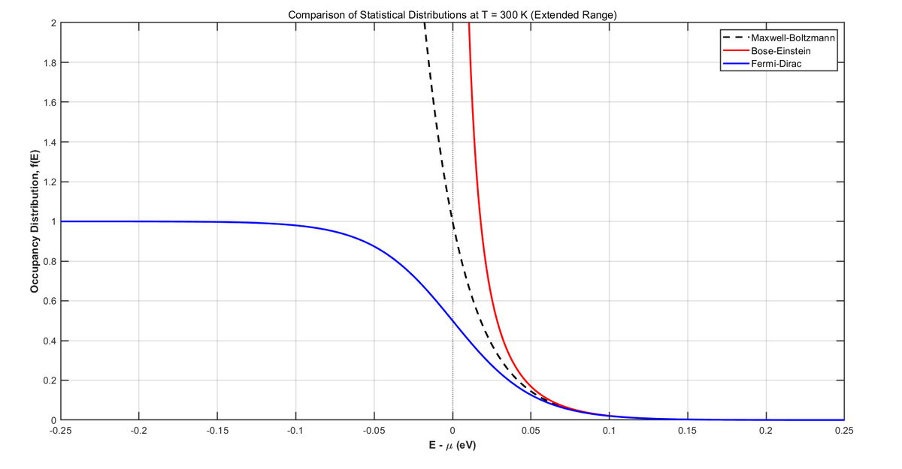

In this post, let's explore bosons and fermions. These are familiar concepts if you study quantum mechanics or modern physics. I had seen the terms often and knew some of their properties, but I had never really dug into why they behave that way. Let's take a deeper look.

## Distinguishable and indistinguishable particles

Imagine four balls colored red, orange, yellow, and green. How many ways can we divide them between boxes A and B? Each ball has two choices, giving $2^4=16$ arrangements.

Now imagine that the balls are identical and cannot be distinguished. We can describe the arrangements only by their numbers in the boxes:

| A | B |
|---|---|
| 0 | 4 |
| 1 | 3 |
| 2 | 2 |
| 3 | 1 |
| 4 | 0 |

There are just five possibilities. Distinguishability changes the counting, and different counting rules lead to different statistical distributions. Let's explore how this affects the way particles occupy energy states.

## What does indistinguishable mean?

This was the part I struggled with. If the counting differs so dramatically, we need a clear distinction between distinguishable and indistinguishable particles. What actually makes that distinction?

My [bonding and antibonding orbitals post](https://oasisforhaanee.github.io/bonding-and-antibonding-orbitals/) provides some useful intuition.

In that discussion, widely separated wavefunctions behaved almost independently. Bringing them together introduced overlap and interference, giving a combined system. Likewise, when matter waves scarcely overlap, a distinguishable-particle approximation can work. When their overlap becomes important, we must treat identical particles as a combined quantum system rather than label them as independent objects.

The point is not simply that the particles are too small to observe. Lower momentum means longer matter wavelength, making wavefunction overlap and exchange effects more important. Strictly speaking, identical particles remain fundamentally indistinguishable even when their overlap is negligible; overlap helps explain when the classical approximation stops being adequate.

Understanding this opens the door to a lot of physics, though the understanding itself can take time, haha. I think it took me about three years to feel comfortable with it.

## Distributions

A distribution describes how the particles in a system share its energy. Suppose four particles share a total energy of 100. They might each have 25, or one might have 10 and another 60, and so on. The key question is: **which macroscopic distribution corresponds to the largest number of microscopic arrangements?** Such a distribution is the most probable.

## Distinguishable particles

In the classical regime, distinguishable-particle counting leads to the Boltzmann distribution.

## A closed-system picture

The earlier counting argument fixes the total energy and particle number. Picture a system that exchanges neither matter nor energy with its surroundings. In strict ensemble terminology, that fully isolated system is microcanonical; a canonical ensemble instead has fixed particle number and exchanges energy with a heat reservoir.

### The Boltzmann distribution

The key result of the earlier argument is the most probable distribution under the specified constraints. The particle number associated with an energy takes the form:

$$
N_i=Ae^{-\frac{E_i}{k_BT}}
$$

Dividing by the total particle number gives:

$$
\frac{N_i}{N}=\frac{e^{-\frac{E_i}{k_BT}}}{\sum _j^{\infty }e^{-\frac{E_j}{k_BT}}}=\frac{e^{-\frac{E_i}{k_BT}}}{Z}
$$

Plotting the energy horizontally and the normalized particle number vertically at 300 K gives the following curve.

The Boltzmann distribution at 300 K.

Here, we will revisit the distribution using **chemical potential**, which we also need for bosons and fermions. This uses an open-system picture.

## Grand canonical ensemble

An open system can exchange both particles and energy with its surroundings. We introduce the chemical potential:

$$
\mu =\left(\frac{\partial U}{\partial N}\right)_{S,V}
$$

Very roughly, it describes the energy change associated with adding a particle, with the specified entropy and volume held fixed.

Imagine a very small subsystem inside a much larger total system. The subsystem exchanges particles and energy freely with its surroundings. The surroundings are so large that their temperature and chemical potential remain effectively unchanged. We call them a **reservoir**.

We derive probabilities for the small subsystem by considering exchanges with the reservoir. For a uniform system in equilibrium, the same local statistical description can be applied throughout the material.

A small open subsystem inside a much larger reservoir.

### Boltzmann factors in an open system

Imagine transferring one particle from the reservoir to the subsystem. Removing a particle from the reservoir contributes the chemical-potential term; placing it in a subsystem state of energy $E$ gives the combination $E-μ$. The corresponding Boltzmann factor therefore has the form:

$$
N_i\propto e^{-\frac{E_i-\mu }{k_BT}}
$$

$$
\frac{N_i}{N}=\frac{e^{-\frac{E_i-\mu }{k_BT}}}{\sum _j^{\ \infty }e^{-\frac{E_j-\mu }{k_BT}}}
$$

These state probabilities can be extended to describe the larger equilibrium system. The chemical potential appears in the Boltzmann factors as illustrated below.

Recall that the classical counting used in the earlier post is:

$$
W=\frac{N!}{n_1!n_2!n_3!\dots n_k!}
$$

This counts arrangements of distinguishable particles and is not the counting rule for indistinguishable quantum particles.

## Indistinguishable particles

We now need different counting rules. The open-system approach makes the calculation particularly convenient.

## Bosons

Bosons are identical particles whose many-particle states are symmetric under exchange. Multiple bosons may occupy the same single-particle state. Photons are a familiar example. Let's derive their occupation function using a small subsystem in a reservoir.

### Grand canonical description

A small open subsystem inside a large reservoir.

Particles and energy can again move between the reservoir and subsystem. For one bosonic state, the occupation number may be 0, 1, 2, and so on without an upper limit. We sum over all these occupations. The first expression is the statistical weight for occupation $n_m$, and the second is the single-state grand partition function:

$$
Z_m=e^{-\frac{n_m(E_m-\mu )}{k_BT}}
$$

$$
\Xi _m=\sum _{n_m=0}^{\infty }e^{-\frac{n_m(E_m-\mu )}{k_BT}}
$$

This is a geometric series with first term 1 and the exponential Boltzmann factor as its common ratio. Summing it gives:

$$
\Xi _m=\frac{1}{1-e^{-\frac{E_m-\mu }{k_BT}}}
$$

The probability of an occupation is its statistical weight divided by the partition function. The mean occupation is therefore:

$$
P(n_m)=\left(1-e^{-\frac{E_m-\mu }{k_BT}}\right)e^{-\frac{n_m(E_m-\mu )}{k_BT}}
$$

$$
\left\langle n_m\right\rangle =\sum _{n_m=0}^{\infty }n_mP(n_m)=\frac{\sum _{n_m=0}^{\infty }n_me^{-\frac{n_m(E_m-\mu )}{k_BT}}}{\Xi _m}
$$

The numerator can be written using the derivative of the partition function with respect to chemical potential. This simplifies the expression to:

$$
\left\langle n_m\right\rangle =\frac{\sum _{n_m=0}^{\infty }n_me^{-\frac{n_m(E_m-\mu )}{k_BT}}}{\Xi _m}
$$

$$
=\frac{k_BT\frac{\partial \Xi _m}{\partial \mu }}{\Xi _m}=k_BT\frac{\partial \ln \Xi _m}{\partial \mu }
$$

Differentiating the logarithm of the partition function gives the final result, called the **Bose–Einstein distribution**:

$$
\frac{\partial \ln \Xi _m}{\partial \mu }=-\frac{1}{1-e^{-\frac{E_m-\mu }{k_BT}}}\cdot \frac{\partial }{\partial \mu }\left(1-e^{-\frac{E_m-\mu }{k_BT}}\right)=\frac{\frac{1}{k_BT}e^{-\frac{E_m-\mu }{k_BT}}}{1-e^{-\frac{E_m-\mu }{k_BT}}}
$$

$$
\left\langle n_m\right\rangle =k_BT\left(\frac{\frac{1}{k_BT}e^{-\frac{E_m-\mu }{k_BT}}}{1-e^{-\frac{E_m-\mu }{k_BT}}}\right)=\frac{e^{-\frac{E_m-\mu }{k_BT}}}{1-e^{-\frac{E_m-\mu }{k_BT}}}=\frac{1}{e^{\frac{E_m-\mu }{k_BT}}-1}
$$

$$
\left\langle n_m\right\rangle =\frac{1}{e^{\frac{E_m-\mu }{k_BT}}-1}
$$

The Bose–Einstein distribution compared with the Boltzmann factor. Its occupation grows without bound as the state energy approaches the chemical potential from above.

The bosonic occupation can diverge as $E$ approaches the chemical potential: adding particles to that state costs a vanishing energy difference in this description. At sufficiently low temperatures, this is connected with the macroscopic ground-state occupation called **Bose–Einstein condensation**.

## Fermions

Fermions have a different restriction: at most one identical fermion can occupy a given complete single-particle quantum state. This is the Pauli exclusion principle. I will not derive its deeper origin here; treat it as an intrinsic quantum property. Electrons are a central example, making this distribution especially important for solid-state physics.

We can reuse the same partition-function method, but the occupation sum now includes only 0 and 1:

$$
\Xi _m=\sum _{n_m=0}^1e^{-\frac{n_m(E_m-\mu )}{k_BT}}=1+e^{-\frac{E_m-\mu }{k_BT}}
$$

The mean occupation is particularly easy to calculate:

$$
\left\langle n_m\right\rangle =\sum _{n_m=0}^1n_mP(n_m)=0\cdot P(0)+1\cdot P(1)=\frac{1\cdot e^{-\frac{E_m-\mu }{k_BT}}}{1+e^{-\frac{E_m-\mu }{k_BT}}}=\frac{1}{e^{\frac{E_m-\mu }{k_BT}}+1}
$$

Thus fermions follow the **Fermi–Dirac distribution**:

$$
\left\langle n_m\right\rangle =\frac{1}{e^{\frac{E_m-\mu }{k_BT}}+1}
$$

The Fermi–Dirac occupation at zero temperature and at 300 K.

At zero temperature, the distribution becomes a step. As temperature increases, some particles occupy higher-energy states and the step smooths out, as in the red dashed curve.

## Fermi level and Fermi energy

These two terms are sometimes used as if they were identical, but they are not generally the same. The **Fermi energy** is the highest occupied energy at zero temperature, a fixed reference defined for that limit. The **Fermi level** is the chemical potential; at nonzero temperature it is the energy where the mean occupation is one half. At zero temperature, the two coincide.

Plotting the mean occupation against energy measured relative to the chemical potential at 300 K gives the following comparison.

We have explored indistinguishability and the distributions of bosons and fermions. Knowing the deeper reasons may not change every practical engineering calculation—I honestly wonder how often it does—but for me it changes the depth of scientific understanding a great deal.

That's all for this post. Thank you for reading!

*This post reflects my own understanding, so there may be errors. Questions are always welcome, so feel free to ask.*
