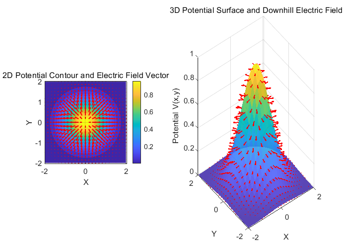
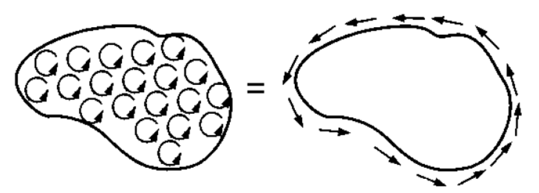
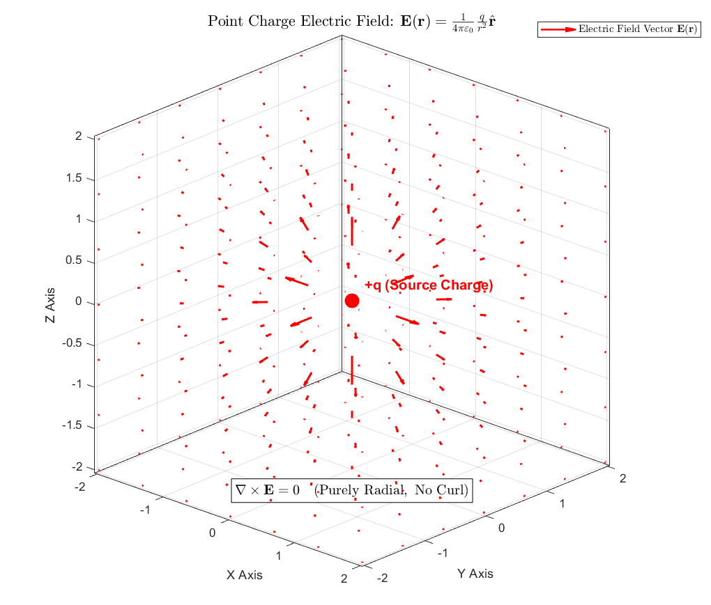

In this post, let's examine why the curl of the electric field is zero in electrostatics. For background, see my [previous electromagnetism post](https://blog.naver.com/kkul20235/224415166942).

In the previous post, we found that the electrostatic field is the negative gradient of the potential: $\mathbf{E}=-\nabla V$. It points opposite to the direction in which the potential increases most steeply.

The graph above represents the potential as a three-dimensional hill. The red arrows show the electric field, pointing opposite to the uphill direction. Now consider:

$$
\int _A^B\nabla V\cdot d\mathbf{l}
$$

This is the line integral, from A to B, of the dot product between the potential gradient and an infinitesimal displacement. Since the gradient describes local changes, it is analogous to integrating a derivative in elementary calculus. The result is the potential difference between the endpoints:

$$
\int _A^B\nabla V\cdot d\mathbf{l}=\int _A^BdV=V(B)-V(A)
$$

For any closed path, the initial and final points coincide, so the integral is zero. A field with this path-independent behavior is called a **conservative field**.

## Stokes' theorem

Stokes' theorem states that the line integral of a vector field around a closed curve equals the surface integral of its curl over a surface bounded by that curve:

$$
\oint _{C\ }^{\ }\mathbf{F}\cdot d\mathbf{l}=\int _{\ }^{\ }\int _{S\ }^{\ }(\nabla \times \mathbf{F})\cdot d\mathbf{A}
$$

If that does not feel intuitive, look at the following diagram.

Adding the circulation contributions from small surface elements leaves only the circulation along the outer boundary. Contributions along shared interior edges cancel because neighboring elements traverse them in opposite directions.

Consequently, if a smooth field has nonzero curl somewhere, an appropriately chosen small loop can have a nonzero circulation. Conversely, if the integral vanishes for every closed loop in the region, the local curl must vanish.

Let's return to the potential-gradient integral:

$$
\oint _{C\ }^{\ }\nabla V\cdot d\mathbf{l}
$$

Substituting the potential gradient into Stokes' theorem gives:

$$
\oint _{C\ }^{\ }\nabla V\cdot d\mathbf{l}=\iint _{S\ }^{\ }(\nabla \times \nabla V)\cdot d\mathbf{A}
$$

The line integral is the potential difference between the endpoints. For a closed curve, those endpoints coincide, so it must be zero:

$$
\oint _{C\ }^{\ }\nabla V\cdot d\mathbf{l}=0=\iint _{S\ }^{\ }(\nabla \times \nabla V)\cdot d\mathbf{A}
$$

Using the electric field's negative-gradient relation, we can equally write:

$$
\iint_S(\nabla\times\mathbf{E})\cdot d\mathbf{A}=0
$$

This must hold for arbitrary surfaces in the region. We therefore conclude that the electrostatic electric field has zero curl:

$$
\nabla\times\mathbf{E}=0
$$

## Some useful related identities

This derivation highlights several useful facts.

### 1. Conservative fields and zero curl

For a conservative field, a line integral between two points depends only on the endpoints, not on the path. Its curl is zero. Conversely, a smooth curl-free field is conservative on a simply connected region; the domain condition matters when going in this direction. A field with nonzero curl is not conservative.

### 2. The curl of a gradient is zero

For a sufficiently smooth scalar potential $A$, $\nabla\times\nabla A=0$. A gradient field is conservative, so it has no local circulation.

### 3. The divergence of a curl is zero

For a sufficiently smooth vector field $\mathbf{A}$, $\nabla\cdot(\nabla\times\mathbf{A})=0$. Curl describes local rotation, whereas divergence measures local net outflow. A curl field has no net source or sink; algebraically, the mixed second derivatives cancel.

### 4. The electrostatic field has zero curl

Besides the Stokes-theorem derivation, the field of a point charge gives a useful picture:

$$
\mathbf{E}(\mathbf{r})=\frac{1}{4\pi \varepsilon _0}\frac{q}{r^2}\hat{\mathbf{r}}
$$

The unit vector at the end points radially outward from the charge. The field is spherically symmetric and radial, directed outward or inward according to the charge sign. There is no circulation around the charge, which gives an intuitive picture of its zero curl away from the charge itself.

The radial electric vector field of a point charge.

We have explored properties of the electrostatic field, where the charges are stationary. Once charges move and fields vary with time, much more can happen. I will gradually discuss those cases in future posts.

Thank you for reading this long explanation. Have a lovely evening!

*This post reflects my own understanding, so there may be errors. Questions are always welcome, so feel free to ask.*
