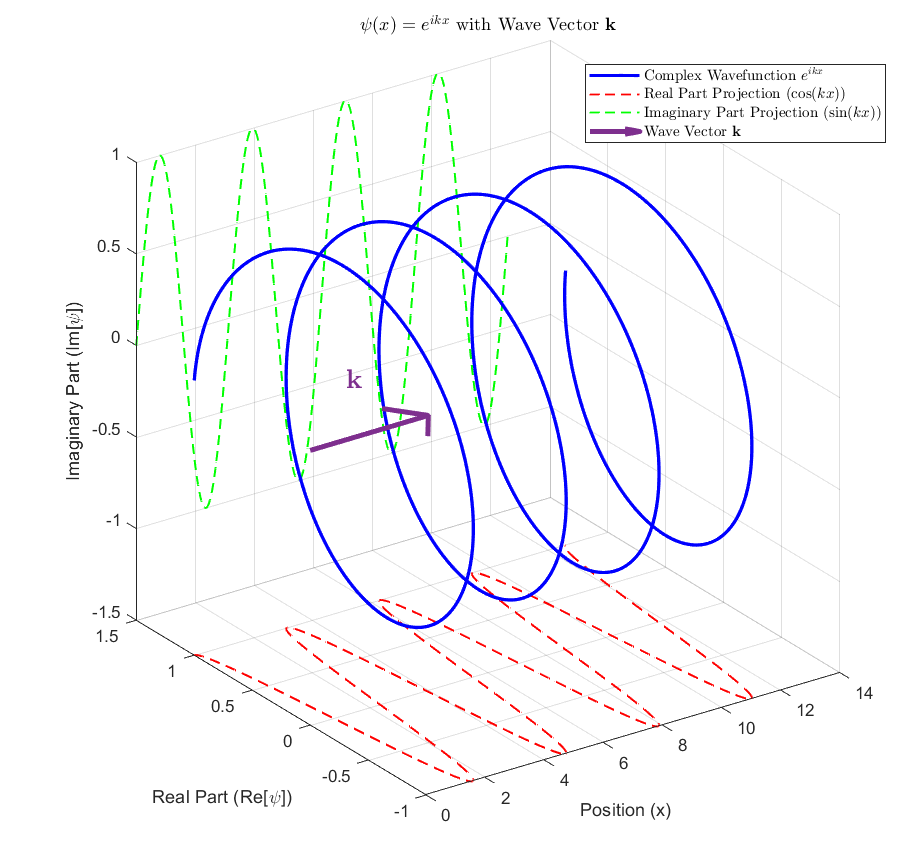
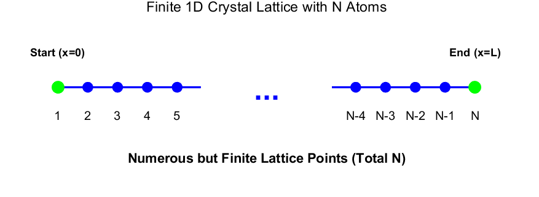
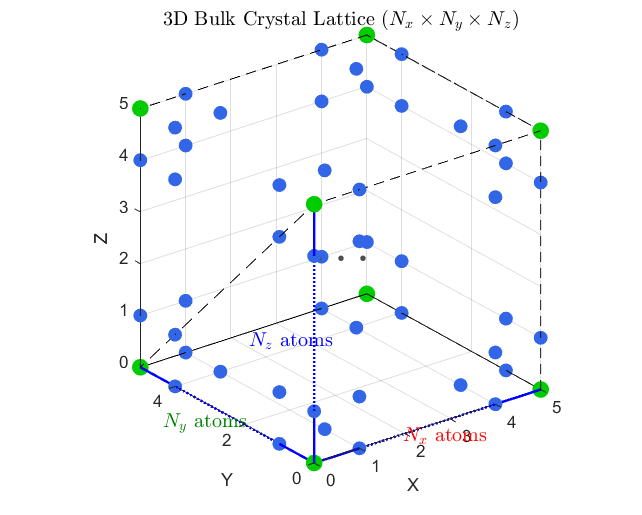
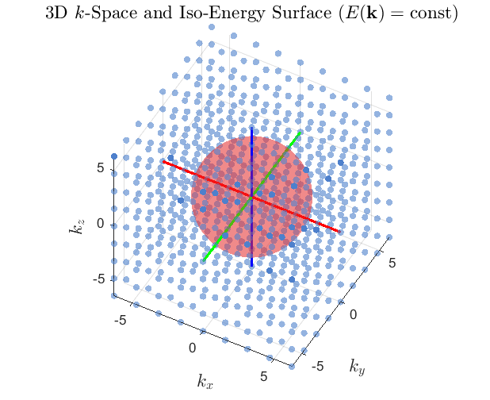
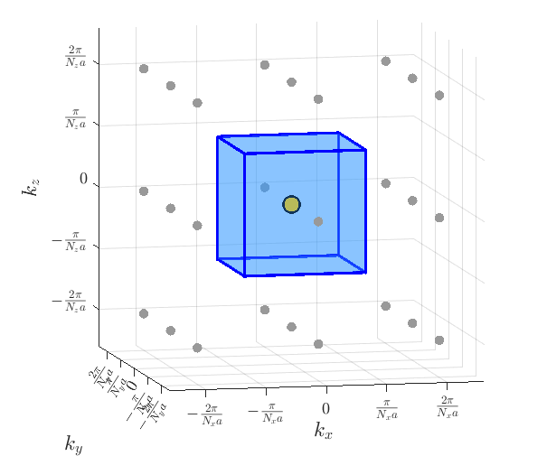
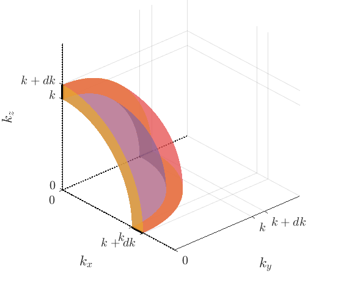
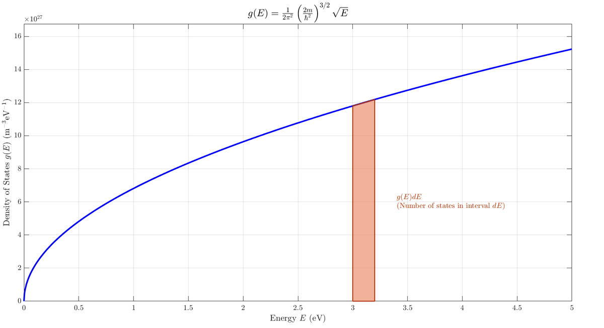
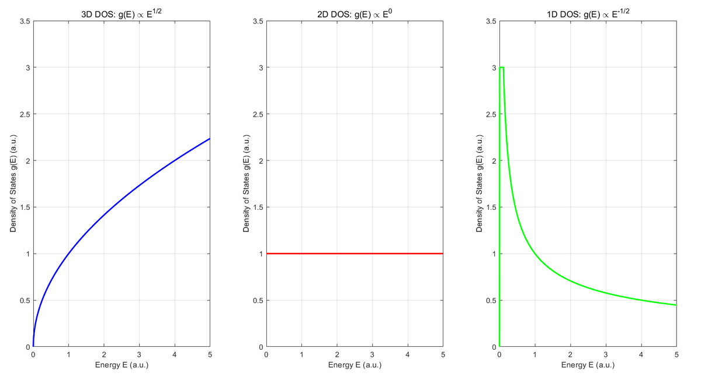

Hi! Are you enjoying the Chuseok holiday? Yesterday I went to an outlet mall with my family, bought some clothes, and enjoyed a good meal. Taking a proper break really helps me recover and find the energy to study again. If life has left you exhausted, try taking a break too. It can help more than you expect.

In this post, let's take a detailed look at **density of states**, or **DOS**, an important concept in solid-state physics.

## The time-independent Schrödinger equation for free electrons

For background, see my [Schrödinger-equation post](https://oasisforhaanee.github.io/schrodinger-equation/).

Before discussing DOS, let's solve the wavefunction equation for a free electron. This requires the Schrödinger equation, so please read the linked explanation first if it is unfamiliar.

$$
-\frac{\hbar ^2}{2m}\nabla ^2\psi (\mathbf{r})+V(\mathbf{r})\psi (\mathbf{r})=E\psi (\mathbf{r})
$$

Given a potential, the Schrödinger equation determines the corresponding energy eigenfunctions. These form a basis: suitable wavefunctions can be constructed as linear combinations of the basis states. For a free electron, the potential is zero. Substituting that condition gives:

$$
-\frac{\hbar ^2}{2m}\nabla ^2\psi (\mathbf{r})=E\psi (\mathbf{r})
$$

$$
\psi (\mathbf{r})=Ae^{i\mathbf{k}\cdot \mathbf{r}}
$$

Here, $k$ and $r$ are the wavevector and position vector, respectively. The wavevector specifies the propagation direction and spatial variation; the position vector identifies the point in space.

$$
\mathbf{k}=(k_x,k_y,k_z)
$$

$$
\mathbf{r}=(x,y,z)
$$

The exponential represents a **plane wave** propagating along the wavevector direction.

## Plane waves

Let's visualize what that complex exponential means.

The one-dimensional plane wave, $\psi(x)=e^{ikx}$.

The spiral illustrates rotation in the complex plane as position changes. The wavevector points along its axial direction. As we move along $x$, the phase changes through the product $kx$.

That picture represents a one-dimensional wave. A fully complex three-dimensional wavefunction would require more dimensions than we can directly visualize in the same way. In the following animation, color represents phase instead. It shows a plane wave propagating in an arbitrary wavevector direction over time.

<video controls autoplay loop muted playsinline style="max-width:100%;" src="/assets/img/density-of-states-plane-wave.mp4">Your browser does not support embedded video.</video>

Free-electron basis states are plane waves labeled by their wavevectors. Each is a stationary energy eigenstate, and we find its energy by substituting the plane wave into the Schrödinger equation:

$$
-\frac{\hbar ^2}{2m}\nabla ^2\psi (\mathbf{r})=E\psi (\mathbf{r})
$$

$$
\downarrow \ \ \psi (\mathbf{r})=e^{i\mathbf{k}\cdot \mathbf{r}}
$$

$$
\nabla ^2\left(e^{i\mathbf{k}\cdot \mathbf{r}}\right)=\nabla \cdot \left(i\mathbf{k}e^{i\mathbf{k}\cdot \mathbf{r}}\right)=-|\mathbf{k}|^2e^{i\mathbf{k}\cdot \mathbf{r}}=-k^2\psi (\mathbf{r})
$$

$$
-\frac{\hbar ^2}{2m}\left(-k^2\psi (\mathbf{r})\right)=E\psi (\mathbf{r})
$$

$$
\frac{\hbar ^2k^2}{2m}\psi (\mathbf{r})=E\psi (\mathbf{r})
$$

$$
E=\frac{\hbar ^2k^2}{2m}=\frac{\hbar ^2}{2m}(k_x^2+k_y^2+k_z^2)
$$

Thus the energy grows with the squared magnitude of the wavevector. Larger wavevectors mean higher energy. The normalized basis state and its energy can be summarized as follows, where $V$ is the real-space normalization volume:

$$
\ \psi _k(\mathbf{r})=\frac{1}{\sqrt{V}}e^{i\mathbf{k}\cdot \mathbf{r}}
$$

$$
E_k=\frac{\hbar ^2k^2}{2m}=\frac{\hbar ^2}{2m}(k_x^2+k_y^2+k_z^2)
$$

## Born–von Karman boundary conditions

See my [periodic-boundary-condition post](https://oasisforhaanee.github.io/born-von-karman-boundary-condition/).

Even when we model electrons in a solid as free, the sample is not an infinite region of zero potential. We use Born–von Karman periodic boundary conditions to define a finite volume. In one dimension, imagine $N$ atomic positions and identify the next position after the last one with the first position.

One-dimensional periodic boundary conditions.

In three dimensions, imagine a large rectangular box with $N_x$, $N_y$, and $N_z$ lattice spacings along the three directions. Its volume is $V=(N_xa)(N_ya)(N_za)$.

Three-dimensional periodic boundary conditions.

The periodicity conditions are:

$$
\psi (x+N_xa,\, y,\, z)=\psi (x,y,z)
$$

$$
\psi (x,\, y+N_ya,\, z)=\psi (x,y,z)
$$

$$
\psi (x,\, y,\, z+N_za)=\psi (x,y,z)
$$

Substituting the plane-wave basis into these conditions restricts the allowed wavevectors:

$$
e^{ik_x(x+N_xa)}=e^{ik_xx}e^{ik_xN_xa}=e^{ik_xx}\Rightarrow e^{ik_xN_xa}=1
$$

$$
e^{ik_y(y+Nya)}=e^{ik_yy}e^{ik_yN_ya}=e^{ik_yy}\Rightarrow e^{ik_yN_ya}=1
$$

$$
e^{ik_z(z+N_za)}=e^{ik_zz}e^{ik_zN_za}=e^{ik_zz}\Rightarrow e^{ik_zN_za}=1
$$

$$
k_x=\frac{2\pi }{N_xa}n_x\left(n_x\ is\ integer\right)
$$

$$
k_y=\frac{2\pi }{N_ya}n_y\left(n_y\ is\ integer\right)
$$

$$
k_z=\frac{2\pi }{N_za}n_z\left(n_z\ is\ integer\right)
$$

The wavevector, previously continuous in infinite space, is now quantized by the boundary conditions.

## Density of states

Recall the free-electron energy:

$$
E=\frac{\hbar ^2}{2m}(k_x^2+k_y^2+k_z^2)
$$

Different wavevectors can have the same energy. For example, exchanging the first two components of a wavevector does not change the sum of their squares. This is **degeneracy**, rather like the equal energies of the hydrogen 2p orbitals. DOS tells us the density of available states at each energy. Let's calculate it.

## Three-dimensional free-electron DOS

Plot the allowed wavevectors as points in a space whose axes are $k_x,k_y,k_z$. This is **k-space**.

The red sphere in k-space: all points on its surface have the same energy.

Each allowed point represents one spatial wavefunction basis state. Since energy depends on the sum of the squared wavevector components, constant-energy surfaces are spheres. To count states in a small energy interval, we count points in a thin spherical shell.

We need the shell volume multiplied by the number of states per unit k-space volume. Because the allowed points form a regular grid, one state occupies each primitive grid cell. The cell centered at the origin has the following coordinate bounds:

$$
-\frac{\pi }{N_ia}\le k_i\le \frac{\pi }{N_ia}
$$

A unit cell of the three-dimensional k-space grid.

The number of states per k-space volume is the reciprocal of that cell's volume. Expressing the denominator through the real-space volume gives:

$$
\frac{1}{\left(\frac{2\pi }{N_xa}\right)\times \left(\frac{2\pi }{N_ya}\right)\times \left(\frac{2\pi }{N_za}\right)}=\frac{V}{(2\pi )^3}
$$

Now consider the equal-energy shell. Although the equal-energy set itself is a surface, counting an energy interval requires a shell of small but finite thickness.

A shell segment in the positive octant. In the actual calculation, we use the entire spherical shell, not just this segment.

The volume between radii $k$ and $k+dk$ is:

$$
dV_k=4\pi k^2dk
$$

Multiplying by the k-space state density gives the number of spatial states in the shell. Electrons also have two spin states, so each spatial point can accommodate two electrons with opposite spins. Include this by multiplying by 2:

$$
2\times \frac{4\pi k^2dk}{\frac{(2\pi )^3}{V}}=\frac{V}{\pi ^2}k^2dk
$$

To express the result per energy interval rather than wavevector interval, change variables from $k$ to $E$:

$$
E=\frac{\hbar ^2k^2}{2m}\ \ \ \ \ k=\sqrt{\frac{2mE}{\hbar ^2}}=\left(\frac{2m}{\hbar ^2}\right)^{1/2}E^{1/2}
$$

$$
\frac{dE}{dk}=\frac{\hbar ^2k}{m}\ \ \ \ \ \ \ dk=\frac{m}{\hbar ^2k}dE
$$

Substituting the expressions for $k$ and $dk$ gives the number of states between $E$ and $E+dE$:

$$
\frac{V}{\pi ^2}k^2dk=\frac{V}{2\pi ^2}\left(\frac{2m}{\hbar ^2}\right)^{3/2}\sqrt{E}\, dE
$$

Finally, divide by the real-space volume $V$ to obtain the density of states per unit volume:

$$
g\left(E\right)dE=\frac{1}{2\pi ^2}\left(\frac{2m}{\hbar ^2}\right)^{3/2}\sqrt{E}\, dE
$$

$$
g\left(E\right)=\frac{1}{2\pi ^2}\left(\frac{2m}{\hbar ^2}\right)^{3/2}\sqrt{E}
$$

The three-dimensional free-electron DOS therefore increases with energy: more states are available per energy interval at higher energy.

## One- and two-dimensional free-electron DOS

$$
g_{2D}(E)=\frac{m}{\pi \hbar ^2}
$$

$$
g_{1D}(E)=\frac{\sqrt{2m}}{\pi \hbar }E^{-1/2}
$$

DOS can also be calculated in one or two dimensions. Instead of a thin spherical shell, count a thin circular annulus in two dimensions or intervals along a line in one dimension. The resulting energy dependences differ. Try deriving them yourself to build intuition!

The graphs below show the results: the three-dimensional DOS is proportional to the square root of energy, the two-dimensional DOS is constant, and the one-dimensional DOS is inversely proportional to the square root of energy.

From left to right: three-, two-, and one-dimensional DOS.

We have explored how available states are distributed in energy. In the next post, I will combine DOS with the Fermi–Dirac distribution to explain what it means for electron occupation. DOS appears constantly in solid-state physics, so understanding it now will make the later material much easier to follow.

That's all for this post. Thank you for reading, and enjoy the rest of the Chuseok holiday!

*This post reflects my own understanding, so there may be errors. Questions are always welcome, so feel free to ask.*
