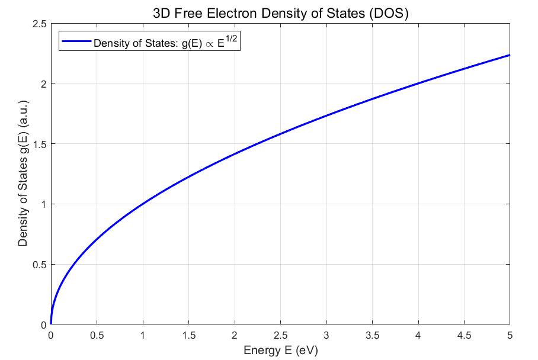
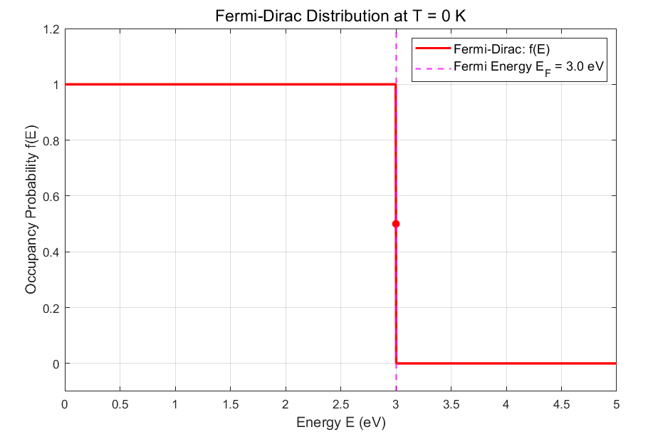
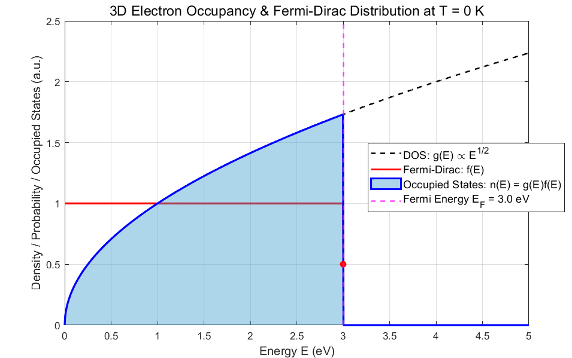
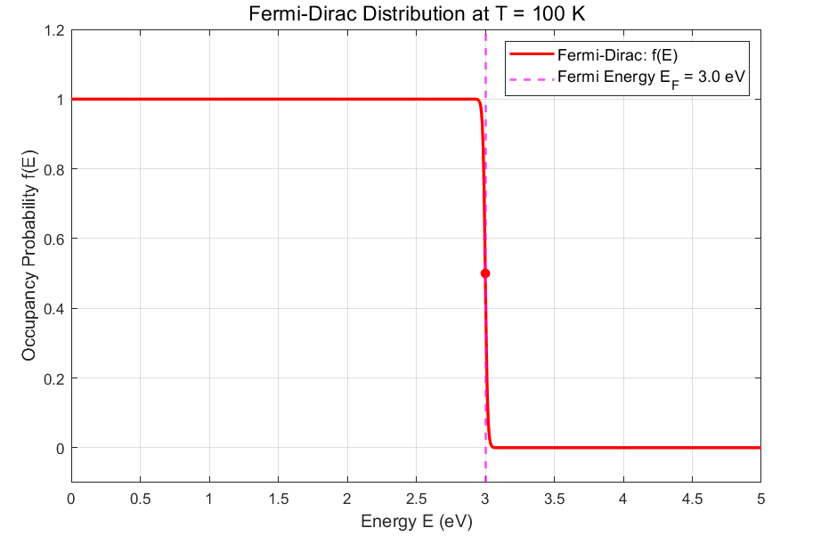
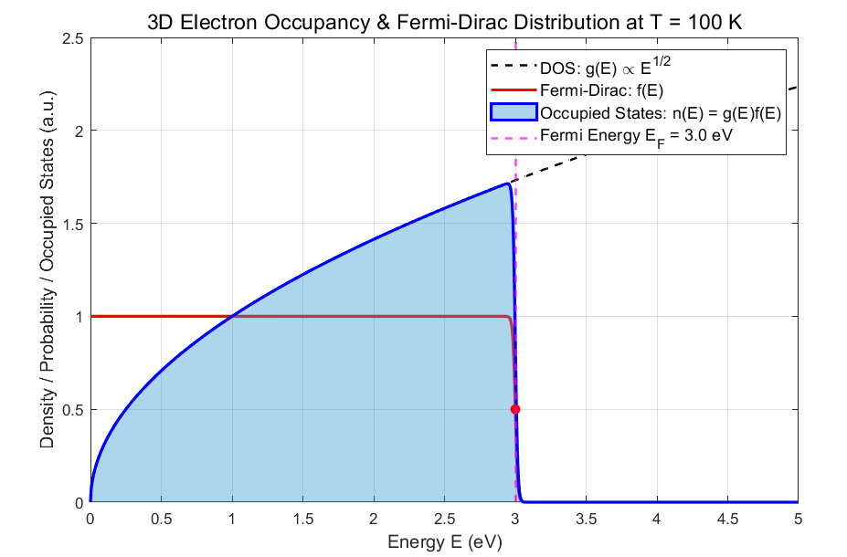
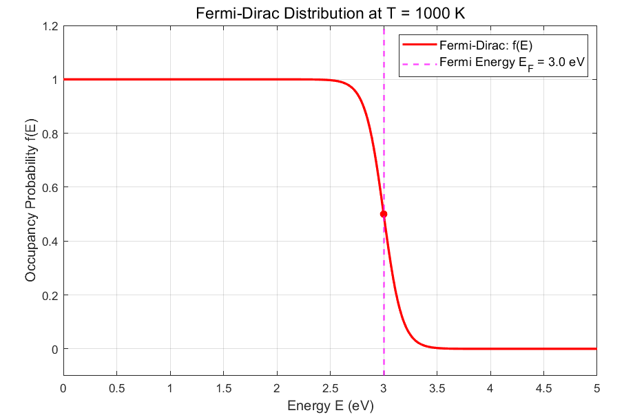
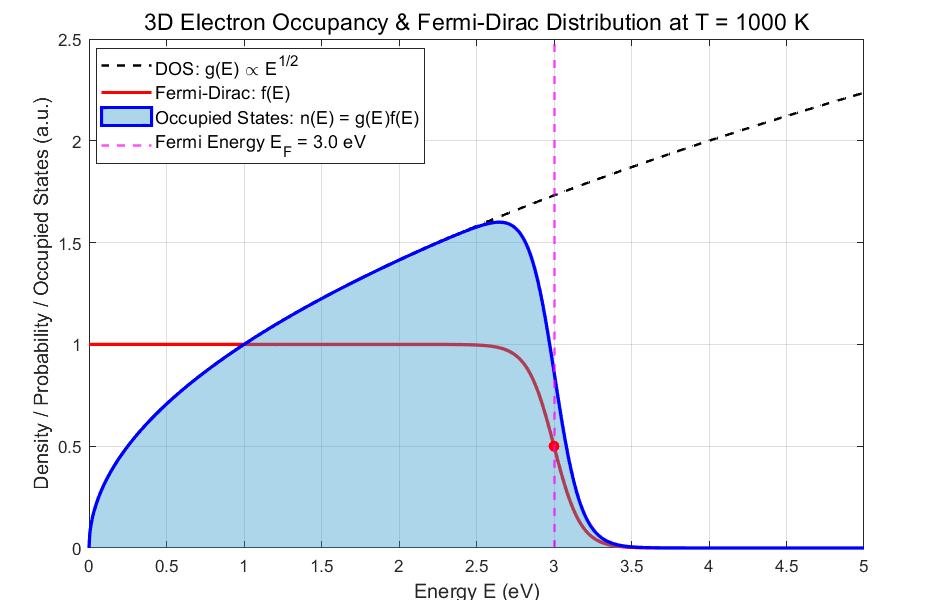
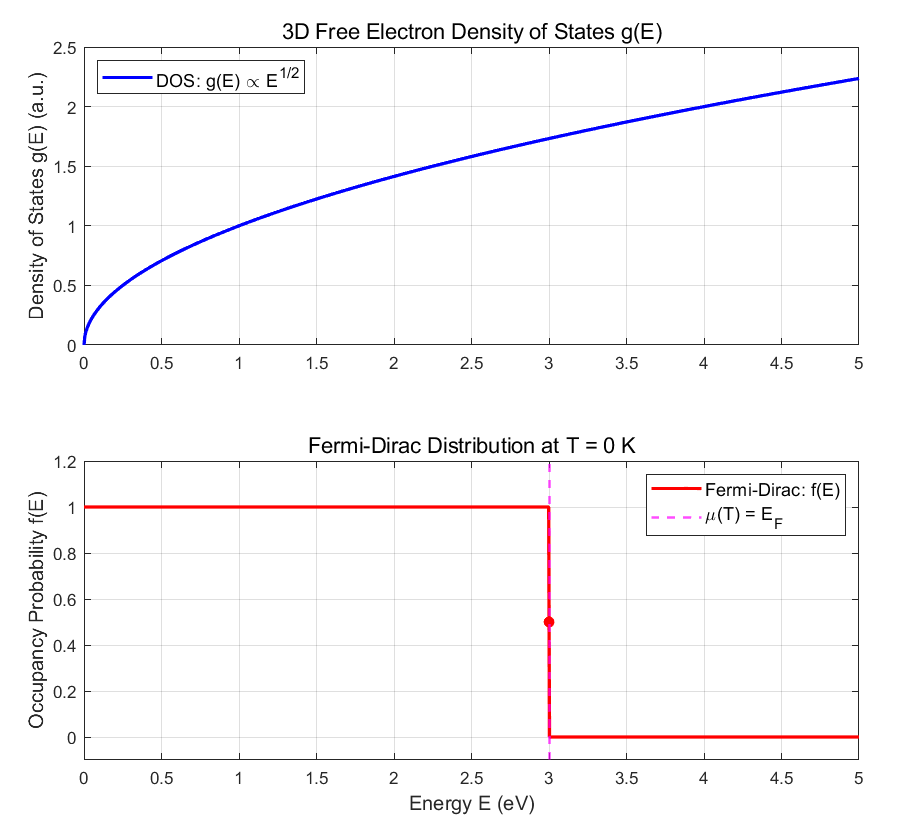
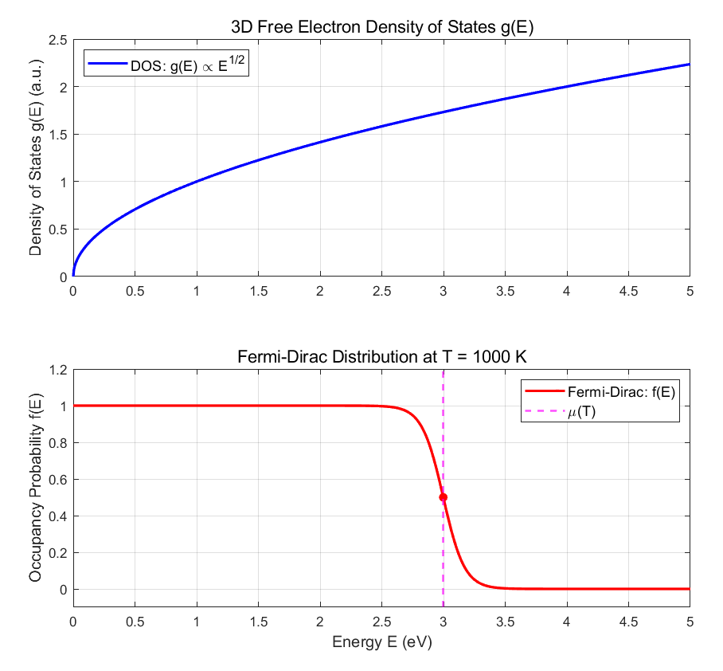
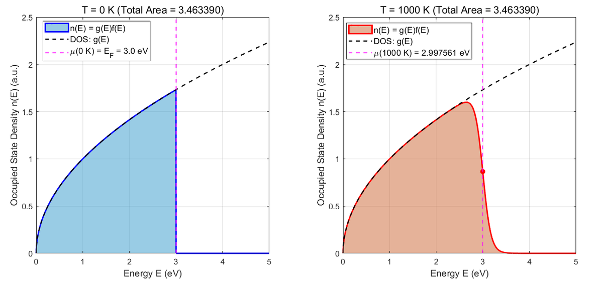

I'm writing this immediately after the previous post on the density of states. This time, let's explore how free electrons occupy states as temperature changes. Before starting, please read the earlier posts, including [bosons, fermions, and the Fermi–Dirac distribution](https://oasisforhaanee.github.io/bosons-and-fermions/).

The other prerequisite is my [density of states post](https://oasisforhaanee.github.io/density-of-states/).

## Fermi level

The Fermi level is the energy at which the Fermi–Dirac occupation probability is one half. It equals the chemical potential, which depends on temperature. The **Fermi energy**, by contrast, is the highest occupied energy at zero temperature. At zero temperature these two values coincide, but as temperature rises the chemical potential changes slightly. Let's explore how and why.

## Electron occupation

The occupied-state density as a function of energy is:

$$
n(E)=g(E)f(E)
$$

Here, $g(E)$ is the density of states and $f(E)$ is the Fermi–Dirac distribution. This makes sense: the former gives the available state density at energy $E$, and the latter gives the probability that each state is occupied. Multiplying them gives the occupied density. In the free-electron model considered here, the DOS does not change with temperature, but the occupation function does.

## Zero temperature

For three-dimensional free electrons, the DOS has the following shape:

Since this DOS is unchanged at the temperatures considered, I will not redraw it every time. At zero temperature the Fermi–Dirac distribution is:

Multiplying the DOS by the occupation function gives:

There are no electrons above 3 eV in this example. Both the Fermi energy and the zero-temperature Fermi level are 3 eV.

## 100 K

At 100 K, the occupation function becomes:

It is no longer a perfect step. The Fermi energy itself does not change, however, because it is defined at zero temperature. Multiplying the occupation function by the DOS gives the blue curve below. The sharp edge at zero temperature is now slightly smoothed.

## 1000 K

Let's push the example to 1000 K. The occupation function is now visibly smoother:

Multiplying it by the DOS gives the blue occupied-state density below. Electrons now occupy some states above 3 eV.

So far, these graphs have been intended to build intuition. To describe the actual temperature dependence, we must also enforce one important condition: **the total electron number is conserved**.

## Conservation of electron number

Heating a solid changes its energy-occupation distribution, but does not create extra electrons. The total electron number remains fixed. This introduces a constraint.

For the three-dimensional free-electron model, the DOS is proportional to the square root of energy and has no explicit temperature dependence. The occupation function is point-symmetric about its midpoint at the chemical potential:

$$
f(E)=\frac{1}{e^{(E-μ\left(T\right))/k_BT}+1}
$$

Take zero temperature as the reference. There, the chemical potential equals the Fermi energy.

Integrating the occupied-state density gives the electron number density:

$$
n=\int _0^{\infty }g(E)f(E)\, dE
$$

When temperature increases, the DOS remains fixed while the occupation function broadens symmetrically around its chemical potential.

The finite-temperature occupation curve is centered on the temperature-dependent chemical potential, not necessarily on the fixed Fermi energy of 3 eV.

At 1000 K, just as at zero temperature, the total number density is the integral of $g(E)f(E)$. But the DOS grows with energy. If we kept the midpoint at the original Fermi energy, the additional occupation above it would outweigh the lost occupation below it, giving too many electrons.

The chemical potential must therefore decrease to keep the integrated electron density constant. Solving for equal areas in the two cases gives the values illustrated below.

In the numerical illustration, the chemical potential decreases from 3 eV at zero temperature to approximately 2.997561 eV at 1000 K.

This behavior comes from the increasing three-dimensional DOS. A constant two-dimensional DOS gives essentially unchanged chemical potential in the degenerate, low-temperature regime, whereas the decreasing one-dimensional DOS gives the opposite leading trend.

## Sommerfeld expansion

We can also approximate the chemical potential analytically:

$$
\mu (T)=E_F-\frac{\pi ^2}{6}(k_BT)^2\frac{g'(E_F)}{g(E_F)}
$$

This expression comes from the **Sommerfeld expansion**, an expansion around the Fermi energy. I won't derive it here—I tried, and it gave me quite a headache, haha. For now, think of this as keeping the leading quadratic temperature correction.

Let's substitute the three-dimensional free-electron DOS:

$$
g(E)=\frac{1}{2\pi ^2}\left(\frac{2m}{\hbar ^2}\right)^{3/2}\sqrt{E}
$$

$$
\frac{g'(E_F)}{g(E_F)}=\frac{1}{2E_F}
$$

$$
\mu (T)=E_F-\frac{\pi ^2}{6}(k_BT)^2\frac{g'(E_F)}{g(E_F)}=E_F-\frac{\pi ^2}{6}(k_BT)^2\left(\frac{1}{2E_F}\right)
$$

$$
=E_F\left[1-\frac{\pi ^2}{12}\left(\frac{k_BT}{E_F}\right)^2\right]
$$

For a Fermi energy of 3 eV and a temperature of 1000 K, the original worked example quotes approximately 2.99796 eV from this approximation, close to the numerical value illustrated earlier. These values illustrate the small temperature-induced shift; the displayed expansion is an approximation that neglects higher-order terms.

## Conclusion

The Fermi energy is the fixed reference defined as the highest occupied energy at zero temperature. The Fermi level, or chemical potential, changes with temperature so that the total electron number remains constant. Their difference is often small, which is probably why the terms are easily confused.

I hope this post made both the distinction and its reason clearer. That's all for now. Thank you for reading!

*This post reflects my own understanding, so there may be errors. Questions are always welcome, so feel free to ask.*
