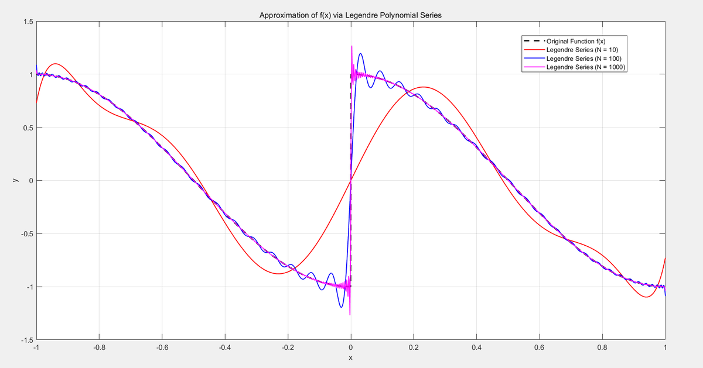

In this post, let's explore Legendre–Fourier series, which appear more often in engineering than I expected. When I encountered them in the hydrogen-atom orbital problem, I mostly wrote down the equations and used them rather than really understanding them. I thought they would not come up much. Then they appeared again in electromagnetism, so I decided it was time to understand them properly. See my [three-dimensional hydrogen-atom Schrödinger equation post](https://oasisforhaanee.github.io/hydrogen-atom-3d-schrodinger-equation/).

The functions $P_l(x)$ appearing there are Legendre polynomials.

## What is the point of this series?

Before deriving it, let's briefly discuss why we should learn it. Recall my [Fourier transform in quantum mechanics post](https://oasisforhaanee.github.io/fourier-transform-in-qm/).

A Fourier series represents a suitable periodic function using a sum of sine and cosine waves. A Legendre–Fourier series is similar, but uses polynomials instead. Suitable functions on $[-1,1]$ can be expanded in a basis of mutually orthogonal polynomials.

The Legendre differential equation is especially common in spherical coordinates. In the hydrogen atom's angular equation, substituting $x=\cos(\theta)$ into the Legendre equation gives the corresponding form for magnetic quantum number zero. That substitution naturally restricts $x$ to $[-1,1]$. Please also refer to the angular-equation discussion in my [hydrogen-atom post](https://oasisforhaanee.github.io/hydrogen-atom-3d-schrodinger-equation/).

Let's now derive the equations.

## Solving the Legendre differential equation

The equation is:

$$
(1-x^2)y''-2xy'+l(l+1)y=0
$$

We can solve it with the **power-series method**: write $y$ as a series in powers of $x$ and compare coefficients to make the equation an identity.

$$
y(x)=\sum _{n=0}^{\infty }a_nx^n=a_0+a_1x+a_2x^2+...
$$

Its first and second derivatives are:

$$
y'(x)=\sum _{n=1}^{\infty }na_nx^{n-1}
$$

$$
y''(x)=\sum _{n=2}^{\infty }n(n-1)a_nx^{n-2}
$$

Now substitute these series into the original differential equation:

$$
(1-x^2)\sum _{n=2}^{\infty }n(n-1)a_nx^{n-2}-2x\sum _{n=1}^{\infty }na_nx^{n-1}+l(l+1)\sum _{n=0}^{\infty }a_nx^n=0
$$

Collect equal powers of $x$. Reindexing the derivative sums so that the final expressions use powers $x^n$ starting at $n=0$ gives:

$$
\sum _{n=0}^{\infty }(n+2)(n+1)a_{n+2}x^n-\sum _{n=0}^{\infty }\left[n(n-1)+2n-l(l+1)\right]\ a_nx^n=0
$$

The coefficient multiplying $a_n$ can be factored as:

$$
n(n-1)+2n-l(l+1)=n^2+n-l^2-l=(n-l)(n+l+1)
$$

Since the right-hand side is zero, the coefficient of every power must vanish. Thus:

$$
(n+2)(n+1)a_{n+2}-(n-l)(n+l+1)a_n=0
$$

$$
a_{n+2}=\frac{(n-l)(n+l+1)}{(n+2)(n+1)}a_n
$$

The recurrence connects coefficients two indices apart. The even coefficients are determined by $a_0$ and the odd coefficients by $a_1$, independently. We can therefore express the solution as an even-power series plus an odd-power series:

$$
y(x)=a_0y_1(x)+a_1y_2(x)
$$

$$
y_1(x)=1+a_2x^2+a_4x^4+\dots\quad\text{(even-power series)}
$$

$$
y_2(x)=x+a_3x^3+a_5x^5+\dots\quad\text{(odd-power series)}
$$

Notice the factor $n-l$. For nonnegative integer $l$, the appropriate series terminates when $n=l$, producing a finite polynomial. The regular polynomial solutions are the **Legendre polynomials**.

There is a useful similarity with the Schrödinger equation: this is an eigenvalue problem. Rewrite it as follows:

$$
(1-x^2)y''-2xy'+l(l+1)y=0
$$

$$
\ \ \ \ \ \ \ \ \ \ \ \ \ \ \ \ \ \ \ \ \ \ \ \downarrow
$$

$$
-(1-x^2)y''+2xy'=l(l+1)y
$$

$$
\ \ \ \ \ \ \ \ \ \ \ \ \ \ \ \ \ \ \ \ \ \ \ \downarrow
$$

$$
-\frac{d}{dx}\left[(1-x^2)\frac{dy}{dx}\right]=l(l+1)y
$$

Just like the Hamiltonian eigenvalue equation in quantum mechanics, this has the form operator times function equals eigenvalue times function:

$$
\mathcal{L}y=\lambda y
$$

$$
\mathcal{L}=-\frac{d}{dx}\left[(1-x^2)\frac{d}{dx}\right],\quad\lambda=l(l+1)
$$

The solutions are therefore eigenfunctions indexed by $l$. We denote them by:

$$
P_l\left(x\right)
$$

The conventional normalization is $P_l(1)=1$. The first two are $P_0(x)=1$ and $P_1(x)=x$. Let's use the power-series recurrence to calculate the case $l=2$:

$$
l=2
$$

$$
a_{n+2}=\frac{(n-2)(n+3)}{(n+2)(n+1)}a_n
$$

$$
a_2=\frac{(0-2)(0+3)}{(0+2)(0+1)}a_0=\frac{-6}{2}a_0=-3a_0
$$

$$
a_4=\frac{(2-2)(2+3)}{(2+2)(2+1)}a_2=0\Rightarrow a_4=a_6=\dots =0
$$

If $a_1$ were nonzero, the odd-power solution would diverge at the endpoints. We must therefore set $a_1=0$ to obtain the regular polynomial solution:

$$
y(x)=\underbrace{a_0(1-3x^2)}_{\text{finite quadratic polynomial}}+\underbrace{a_1\left(x-\frac{2}{3}x^3-\frac{1}{5}x^5-\frac{4}{35}x^7-\dots\right)}_{\text{divergent infinite series}}
$$

$$
P_2(x)=\frac{1}{2}(3x^2-1)
$$

The same recurrence generates the other Legendre polynomials:

$$
P_0(x)=1
$$

$$
P_1(x)=x
$$

$$
P_2(x)=\frac{1}{2}(3x^2-1)
$$

$$
P_3(x)=\frac{1}{2}(5x^3-3x)
$$

$$
P_4(x)=\frac{1}{8}(35x^4-30x^2+3)
$$

$$
P_5(x)=\frac{1}{8}(63x^5-70x^3+15x)
$$

$$
P_6(x)=\frac{1}{16}(231x^6-315x^4+105x^2-5)
$$

$$
.
$$

$$
.
$$

$$
P_l(x)=\frac{1}{2^ll!}\frac{d^l}{dx^l}(x^2-1)^l
$$

Each $P_l(x)$ is an eigenfunction of the Legendre differential operator. Next, let's construct orthogonal polynomials directly using the **Gram–Schmidt process**.

## Gram–Schmidt orthogonalization

Let $P_n(x)$ denote a degree-$n$ polynomial. Orthogonality here means that polynomials of different degrees have zero inner product on $[-1,1]$:

$$
\int _{-1}^1P_n(x)P_m(x)\, dx=0\quad (n\ne m)
$$

The polynomials satisfying this condition, with a fixed normalization, are the Legendre polynomials. Let's construct them.

### Degree zero

A degree-zero polynomial is simply a constant. Choose 1 for convenience:

$$
P_0\left(x\right)=1
$$

### Degree one

Write the polynomial as $ax+b$. It must satisfy:

$$
\int _{-1}^1P_1(x)P_0(x)\, dx=\int _{-1}^1(ax+b)\cdot 1\, dx=\left[\frac{a}{2}x^2+bx\right]_{-1}^1=2b=0
$$

We do not yet know $a$, but we find $b=0$. Multiplying by a nonzero constant does not change orthogonality, so choose $a=1$:

$$
P_1\left(x\right)=x
$$

### Degree two

Write it as $ax^2+bx+c$. It must be orthogonal to both the degree-zero and degree-one polynomials:

$$
\int _{-1}^1(ax^2+bx+c)\cdot x\, dx=\int _{-1}^1bx^2\, dx=\frac{2}{3}b=0\Rightarrow b=0
$$

$$
\int _{-1}^1(ax^2+c)\cdot 1\, dx=\left[\frac{a}{3}x^3+cx\right]_{-1}^1=\frac{2}{3}a+2c=0\Rightarrow c=-\frac{1}{3}a
$$

Thus the polynomial is proportional to $x^2-1/3$. Choosing $a=3$ to eliminate fractions gives:

$$
P_2(x)=3x^2-1
$$

Continuing in the same way gives the higher-degree polynomials:

$$
P_3(x)=5x^3-3x
$$

$$
P_4(x)=35x^4-30x^2+3
$$

$$
.
$$

$$
.
$$

$$
.
$$

The shape at each degree is determined uniquely up to an overall nonzero scale. This does not mean Legendre polynomials are the only orthogonal polynomials in the world. Changing the interval or weight gives other families, such as Chebyshev or Hermite polynomials. The uniqueness here refers to the particular interval $[-1,1]$ and weight 1.

That qualification is for mathematical precision; the main idea is that these polynomials form a basis for expanding suitable functions on the interval.

We then choose a normalization convention: the value at $x=1$ should be 1. This differs from setting the inner product of each function with itself to 1. The latter is unit normalization, but it gives more cumbersome coefficients. With the conventional endpoint normalization, the polynomials are:

$$
P_0(x)=1
$$

$$
P_1(x)=x
$$

$$
P_2(x)=\frac{1}{2}(3x^2-1)
$$

$$
P_3(x)=\frac{1}{2}(5x^3-3x)
$$

$$
P_4(x)=\frac{1}{8}(35x^4-30x^2+3)
$$

$$
P_5(x)=\frac{1}{8}(63x^5-70x^3+15x)
$$

$$
P_6(x)=\frac{1}{16}(231x^6-315x^4+105x^2-5)
$$

$$
.
$$

$$
.
$$

$$
P_l(x)=\frac{1}{2^ll!}\frac{d^l}{dx^l}(x^2-1)^l
$$

As you might expect, Gram–Schmidt with the condition $P_l(1)=1$ gives exactly the same polynomials as the differential equation. Both constructions use the same orthogonality interval and weight.

Let's look at an application. In the graph below, the black dashed curve is a function to be expanded. Red includes terms through degree 10, blue through degree 100, and pink through degree 1000. The approximation becomes more detailed as more terms are included.

## Function integrals as vector inner products

See my [inner product and orthogonality of functions post](https://oasisforhaanee.github.io/inner-product-and-orthogonality-of-functions/).

As discussed there, functions can be treated as vectors in an infinite-dimensional function space—a Hilbert space. Integrating the product of two real functions gives their inner product, analogous to taking a dot product between vectors. That is why an orthogonal polynomial basis can be used for expansions in much the same way as an orthogonal vector basis.

That's all for this post. Thank you for reading!

*This post reflects my own understanding, so there may be errors. Questions are always welcome, so feel free to ask.*
