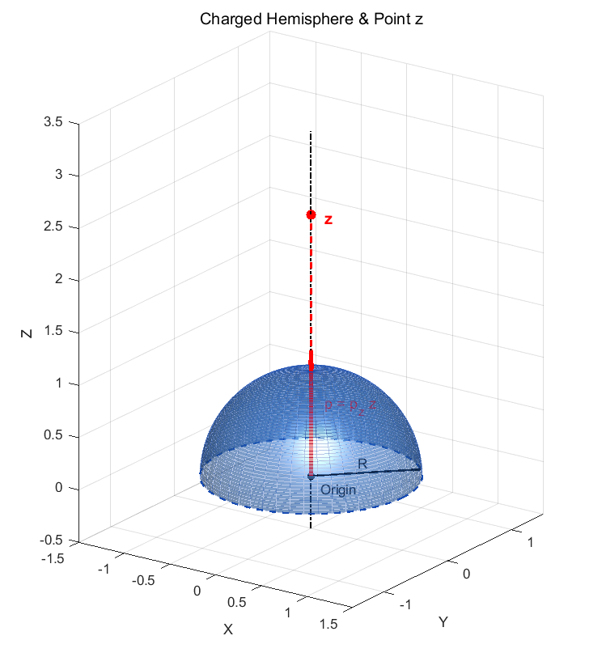

In this post, let's explore **multipole expansion**, a topic that appears when studying electric dipoles in electromagnetism.

## Electric potential

$$
V(r)=\frac{1}{4\pi \varepsilon _0}\frac{q}{r}
$$

For a point charge $q$, the potential at a distance $r$ is given by the expression above.

What if there are several charges? We can write

$$
V(\mathbf{r})=\frac{1}{4\pi \varepsilon _0}\sum _{i\ }^{\ }\frac{q_i}{|\mathbf{r}-\mathbf{r}_i'|}
$$

If there are so many charges that adding their individual contributions becomes impractical, we can introduce a charge-density function and replace the sum with an integral:

$$
V(\mathbf{r})=\frac{1}{4\pi \varepsilon _0}\int _{\ }^{\ }\frac{\rho (\mathbf{r}')}{|\mathbf{r}-\mathbf{r}'|}\, dV'
$$

Multipole expansion is a way of approximating this integral rather than evaluating the full contribution from every source position $\mathbf{r}'$ each time. Think of it as something like a Taylor approximation. Let's work through it.

Let $\mathbf{r}$ be the position where we want to measure the potential, and $\mathbf{r}'$ the position of a charge. Let $\theta$ be the angle between these two position vectors. By the law of cosines, their separation is

$$
|\mathbf{r}-\mathbf{r}'|=\sqrt{r^2+r'^2-2rr'\cos \theta }
$$

We can therefore write

$$
\frac{1}{|\mathbf{r}-\mathbf{r}'|}=\frac{1}{r\sqrt{1-2\left(\frac{r'}{r}\right)\cos \theta +\left(\frac{r'}{r}\right)^2}}
$$

Substituting $t=r'/r$ and $x=\cos\theta$ gives

$$
\frac{1}{|\mathbf{r}-\mathbf{r}'|}=\frac{1}{r}\frac{1}{\sqrt{1-2tx+t^2}}
$$

$$
\left(t=\frac{r'}{r},\ x=\cos \theta \right)
$$

Surprisingly, this function can be expanded in Legendre polynomials.

## The generalized binomial theorem

First, Taylor-expanding $(1-z)^{-1/2}$ about $z=0$ gives

$$
(1-z)^{-1/2}=1+\frac{1}{2}z+\frac{3}{8}z^2+\frac{5}{16}z^3+\dots
$$

Now substitute $z=2tx-t^2$:

$$
\frac{1}{\sqrt{1-2tx+t^2}}=1+\frac{1}{2}t(2x-t)+\frac{3}{8}t^2(2x-t)^2+\frac{5}{16}t^3(2x-t)^3+\dots
$$

Collecting equal powers of $t$, we find that the coefficient of each $t^l$ is $P_l(x)$:

$$
t^0\text{ coefficient}:\quad\ 1=P_0(x)
$$

$$
t^1\text{ coefficient}:\quad\ x=P_1(x)
$$

$$
t^2\text{ coefficient}:\quad\frac{1}{2}(3x^2-1)=P_2(x)
$$

$$
t^3\text{ coefficient}:\quad\frac{1}{2}(5x^3-3x)=P_3(x)
$$

$$
\cdots
$$

The function can therefore be expanded as the following series of Legendre polynomials. This is called the **Legendre generating function**:

$$
\frac{1}{\sqrt{1-2tx+t^2}}=\sum _{l=0}^{\infty }t^lP_l(x)\quad (|t|<1)
$$

Putting everything together, the potential becomes

$$
V(\mathbf{r})=\frac{1}{4\pi \varepsilon _0}\sum _{l=0}^{\infty }\frac{1}{r^{l+1}}\int _{\ }^{\ }r'^lP_l(\cos \theta )\rho (\mathbf{r}')\, dV'
$$

It looks complicated, but we do not necessarily have to add every term. Retaining only a few terms, such as $l=0$, $1$, and $2$, can give a very close approximation when the observation point is sufficiently far from the charge distribution.

## 1. The monopole term: l = 0

$$
V_0(\mathbf{r})=\frac{1}{4\pi \varepsilon _0\cdot r}\int _{\ }^{\ }\rho (\mathbf{r}')\, dV'=\frac{Q_{\text{total}}}{4\pi \varepsilon _0r}
$$

The $l=0$ term has the familiar form of a point-charge potential. It depends only on the distance $r$ from the origin to the observation point and the total charge $Q_{\text{total}}$ of the distribution.

## 2. The dipole term: l = 1

$$
V_1(\mathbf{r})=\frac{1}{4\pi \varepsilon _0\cdot r^2}\int _{\ }^{\ }r'\cos \theta \, \rho (\mathbf{r}')\, dV'
$$

The $l=1$ term includes $\cos\theta$. Here, $r'\cos\theta$ is the dot product of the source-position vector $\mathbf{r}'$ with the unit vector $\hat{\mathbf{r}}$:

$$
r'\cos \theta =\mathbf{r}'\cdot \hat{\mathbf{r}}
$$

$$
V_1(\mathbf{r})=\frac{1}{4\pi \varepsilon _0r^2}\left[\int _{\ }^{\ }\mathbf{r}'\rho (\mathbf{r}')\, dV'\right]\cdot \hat{\mathbf{r}}
$$

The expression in square brackets is the **electric dipole moment**. It describes how the charge is displaced or polarized. For discrete charges, we sum each charge multiplied by its position vector; here, we express the same idea as an integral over the charge density:

$$
\mathbf{p}\equiv \int _{\ }^{\ }\mathbf{r}'\rho (\mathbf{r}')\, dV'
$$

The dipole term can thus be written as

$$
V_1(\mathbf{r})=\frac{1}{4\pi \varepsilon _0\cdot r^2}\int _{\ }^{\ }r'\cos \theta \, \rho (\mathbf{r}')\, dV'=\frac{\mathbf{p}\cdot \hat{\mathbf{r}}}{4\pi \varepsilon _0r^2}=\frac{|\mathbf{p}|\cos \theta }{4\pi \varepsilon _0r^2}
$$

## 3. The quadrupole term: l = 2

$$
V_2(\mathbf{r})=\frac{1}{4\pi \varepsilon _0\cdot r^3}\int _{\ }^{\ }r'^2P_2(\cos \theta )\rho (\mathbf{r}')\, dV'
$$

This is the electric quadrupole term, which describes a further aspect of the shape or distortion of the charge distribution. Its value changes with how that distribution is shaped. Honestly, I do not think I fully understand it yet, so I will leave the more detailed explanation for another time...

## What multipole expansion means

So why did we do all this? Instead of adding up the potential contributions from every part of an extended charge distribution directly, we can decompose the result using an orthogonal basis—the Legendre polynomials.

Each term, whether monopole, dipole, quadrupole, or a higher multipole, scales as $1/r^{l+1}$. Higher-order terms therefore become less important at larger distances. Very far away, we may be able to neglect the dipole and quadrupole contributions. The example below will illustrate this.

The first term depends on $Q_{\text{total}}$. For an object with a nonzero net charge, such as a charged conductor, this is the leading contribution to its distant potential.

What about a neutral insulator? Its total charge is zero, so the first term vanishes. If it has internal polarization and a nonzero dipole moment, the second term becomes the leading contribution. That is why it is called the **dipole term**.

There are also systems for which both the first and second terms vanish. A carbon dioxide molecule, for example, has zero net charge and no permanent dipole moment: it is a nonpolar molecule. To describe its leading nonzero electrostatic potential, we have to turn to the third term, the quadrupole term.

Let's look at an example of multipole expansion.

## Example: a uniformly charged hemisphere

Suppose an upper hemispherical surface of radius $R$ is centered at the origin and uniformly coated with surface charge density $\sigma_0$. We want to find the potential on the $z$-axis, initially at a distance $2R$ from the origin.

If the observation point is far from the hemisphere compared with its radius, $z\gg R$, we can readily approximate the potential as $V(z)=V_0(z)+V_1(z)$ instead of evaluating the full integral every time.

For a general distance $z$ outside the hemisphere, the exact potential is

$$
V_{\text{exact}}(z)=\frac{\sigma _0}{4\pi \varepsilon _0}\int _0^{2\pi }d\phi '\int _0^{\pi /2}\frac{R^2\sin \theta '}{\sqrt{z^2+R^2-2zR\cos \theta '}}\, d\theta '
$$

Using the substitution

$$
u=\sqrt{z^2+R^2-2zR\cos \theta '}
$$

we obtain

$$
V_{\text{exact}}(z)=\frac{\sigma _0R}{2\varepsilon _0z}\left[\sqrt{z^2+R^2-2zR\cos \theta '}\right]_0^{\pi /2}=\frac{\sigma _0R}{2\varepsilon _0z}\left(\sqrt{z^2+R^2}-(z-R)\right)
$$

$$
V_{\text{exact}}(z)=\frac{\sigma _0R^2}{2\varepsilon _0z}\left(1-\frac{z}{R}+\sqrt{1+\frac{z^2}{R^2}}\right)
$$

Adding just the monopole and dipole terms gives

$$
V_0(z)=\frac{\sigma _0R^2}{2\varepsilon _0z},\quad V_1(z)=\frac{\sigma _0R^3}{4\varepsilon _0z^2}
$$

$$
V_{\text{approx}}(z)=V_0(z)+V_1(z)=\frac{\sigma _0R^2}{2\varepsilon _0z}\left(1+\frac{R}{2z}\right)
$$

For the numerical comparisons below, write $V_{\text{scale}}=\sigma_0R/(2\varepsilon_0)$.

At $z=2R$, the exact and approximate potentials are

$$
V_{\text{exact}}(2R)=\frac{V_{\text{scale}}}{2}\left(\sqrt{2^2+1^2}-(2-1)\right)=\frac{V_{\text{scale}}}{2}(\sqrt{5}-1)\approx \mathbf{0.61803\cdot V_{\text{scale}}}
$$

$$
V_{\text{approx}}(2R)=\frac{V_{\text{scale}}}{2}\left(1+\frac{1}{4}\right)=\frac{5}{8}V_{\text{scale}}=\mathbf{0.62500\cdot V_{\text{scale}}}
$$

The difference is about **1.13%**.

What happens if we move out to $z=5R$?

$$
V_{\text{exact}}(5R)=\frac{V_{\text{scale}}}{5}\left(\sqrt{5^2+1^2}-(5-1)\right)=\frac{V_{\text{scale}}}{5}(\sqrt{26}-4)\approx \mathbf{0.21980\cdot V_{\text{scale}}}
$$

$$
V_{\text{approx}}(5R)=\frac{V_{\text{scale}}}{5}\left(1+\frac{1}{10}\right)=\mathbf{0.22000\cdot V_{\text{scale}}}
$$

Now the difference is about **0.09%**. The approximation improves with distance because, as discussed above, the higher-order terms decay as inverse powers $1/r^{l+1}$.

At $z=100R$, the error becomes small enough to be negligible for many purposes:

$$
V_{\text{exact}}(100R)\approx \mathbf{0.01004999875\cdot V_{\text{scale}}}
$$

$$
V_{\text{approx}}(100R)=\mathbf{0.01005000000\cdot V_{\text{scale}}}
$$

$$
\Delta =1.24\times 10^{-5}\ \%
$$

This post has covered the basic idea of multipole expansion. I do not feel that I have completely mastered it yet, but we have seen an example of Legendre polynomials serving as an orthogonal basis in a problem expressed in spherical coordinates.

That is it for this post. Thank you for reading.

---

*This post reflects my own understanding, so there may be errors. Questions are always welcome, so feel free to ask.*
