Hi! In this post, let's explore reciprocal space. It appears constantly in crystallography and solid-state physics, and I hope this explanation helps you develop some intuition.

## Crystals

What is a crystal? You might picture many different things, but to me the essential feature is **periodicity**. A periodic arrangement gives rise to distinctive properties; without it, a material may be amorphous rather than crystalline. Amorphous materials can be isotropic, with the same properties in every direction, but their structure is clearly different from that of a crystal.

We describe a periodic arrangement with a **lattice**. In the following diagram, the vectors $a$, $b$, and $c$ generate lattice points in three directions. Their coefficients are integers: noninteger coefficients do not define the same periodic lattice.

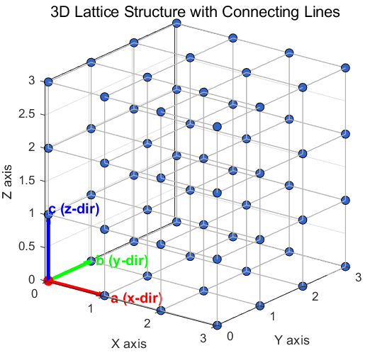

We can now specify each lattice point using vectors.

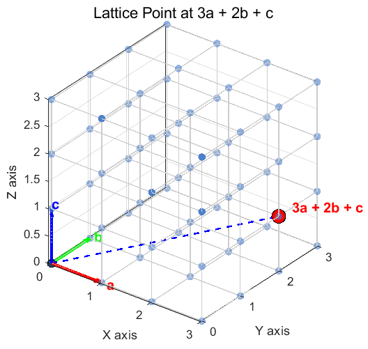

The diagram shows the lattice point $3a+2b+c$. The lengths of the three vectors and the angles between them determine the lattice shape. Here the vectors are mutually perpendicular and have equal lengths: a **cubic** lattice. If the first two lengths remain equal but the third is longer, with right angles preserved, we obtain the following **tetragonal** lattice.

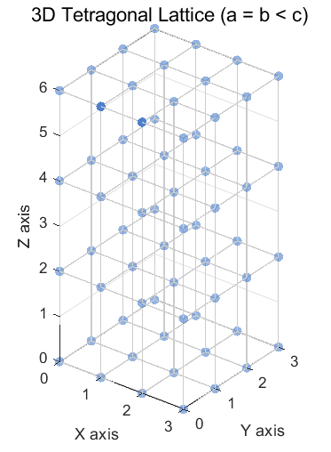

Different lengths and angles give different structures. Disregarding changes that simply rotate the same structure, the possible symmetry types are grouped into **seven crystal systems**.

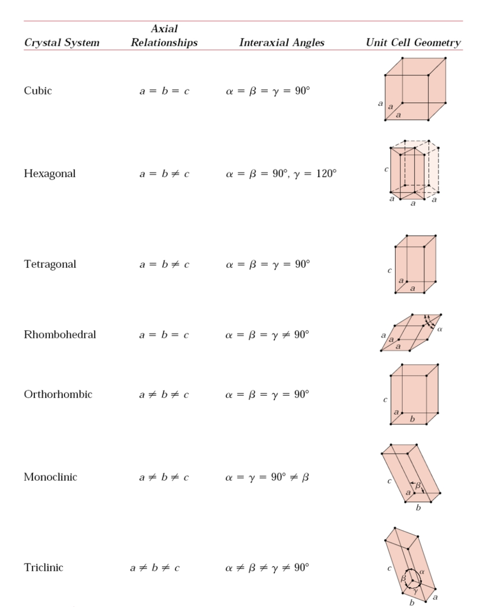

Not every crystal is cubic. Within a conventional cell, lattice points may also occur at the body center, face centers, or a pair of base faces. The common centering types are P, I, C, and F. One might expect seven times four possibilities, but some are equivalent or do not produce distinct Bravais lattices. For instance, a base-centered cubic description can be rewritten using a tetragonal cell.

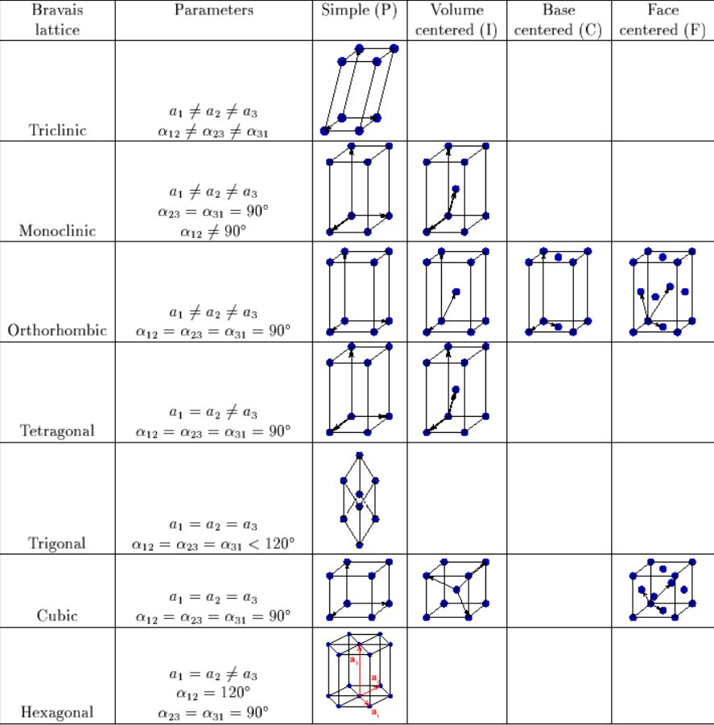

The 14 Bravais lattices.

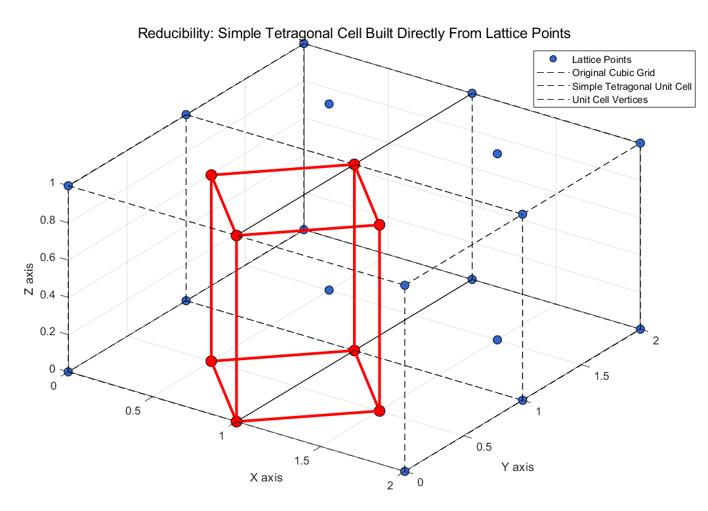

The blue points appear base-centered in the original cubic description, but the red lines define an equivalent tetragonal unit cell.

Accounting for these equivalences gives **14 Bravais lattices**. Crystals can be classified further using 32 point groups and 230 space groups, but here we will focus on the Bravais lattices.

## Real space

The lattices we have described represent the arrangement in ordinary physical space. This is **real space**. Reciprocal space has a very different meaning. To understand it, let's revisit the Fourier transform.

## Fourier transforms

If you are unfamiliar with Fourier transforms, please read my [Fourier-transform post](https://oasisforhaanee.github.io/fourier-transform/) first.

The following graph shows a periodic signal as a function of time. Apart from its periodicity, it is difficult to immediately identify the signal's components.

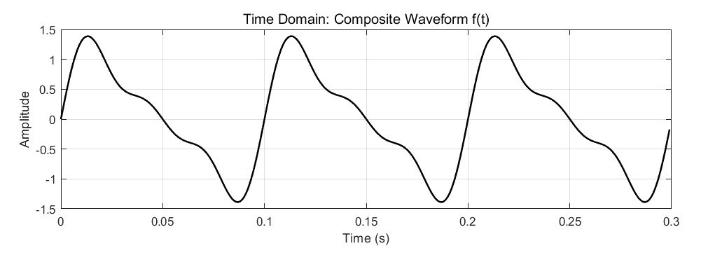

Representing the signal by frequency instead of time gives the red graph below. Its values specify the amplitudes of components at the fundamental frequency and its harmonics. Adding those components reconstructs the signal.

The time-domain and frequency-domain graphs describe the very same signal, yet look entirely different because they use different representations. The Fourier transform is the tool that changes between them.

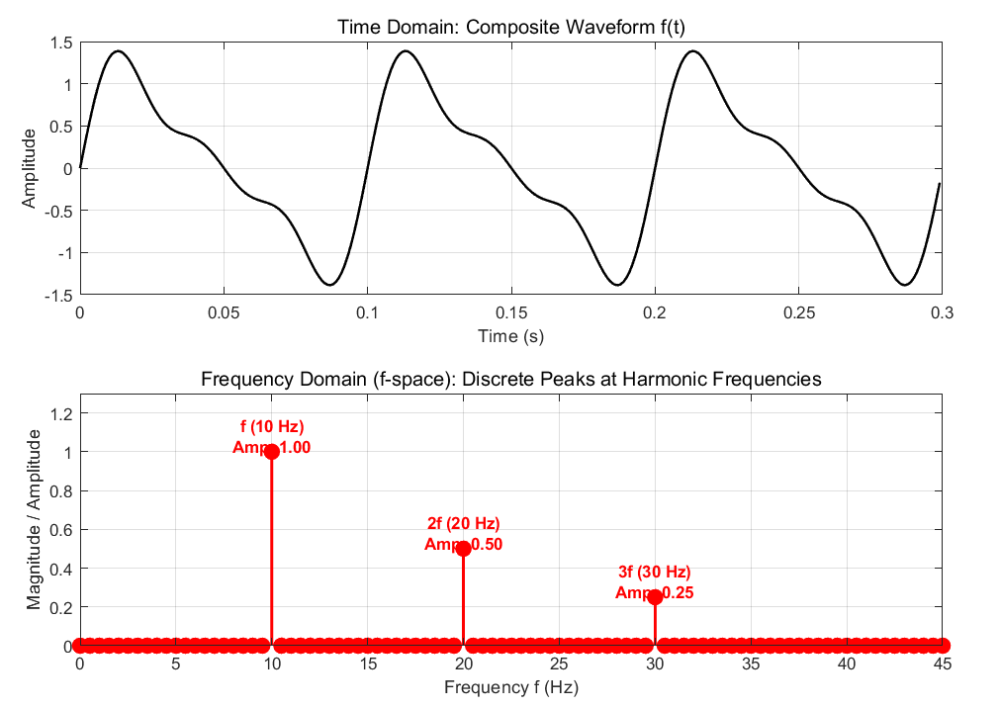

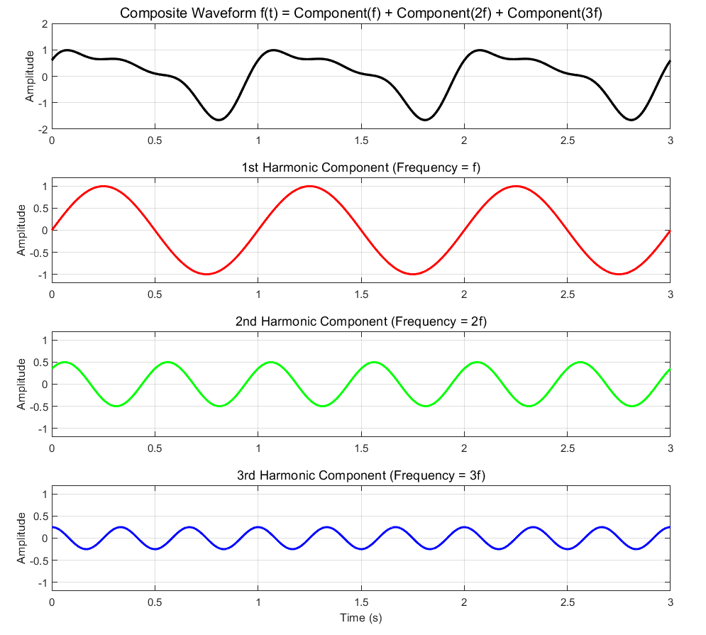

Adding the second, third, and fourth curves gives the first curve.

## Wavevector space

Just as time and frequency are Fourier-conjugate variables, position $x$ and wavevector $k$ are related through the Fourier transform. We can transform a spatial potential $V(x)$ into its wavevector-space representation. Let's do this for a one-dimensional periodic potential.

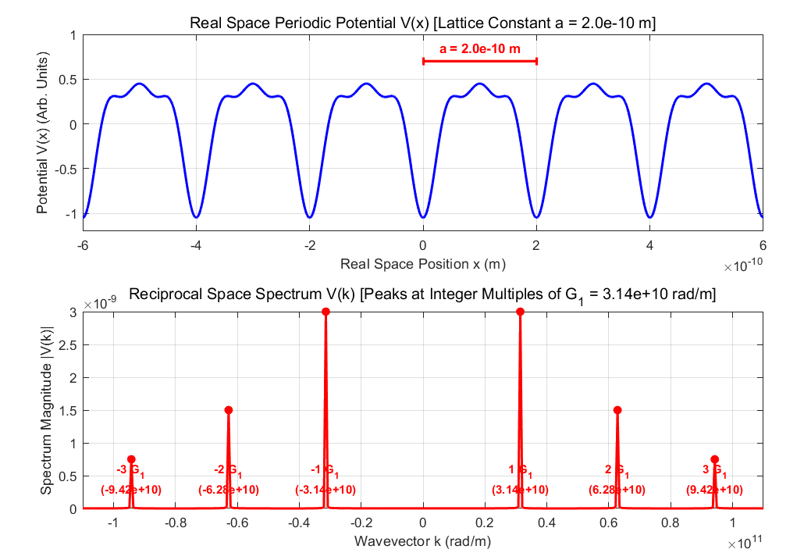

Fourier decomposition expresses the periodic potential as a sum of spatial wave components.

The lower graph gives the coefficients of complex exponential waves whose sum reconstructs the upper potential. Only discrete wavevectors—the fundamental reciprocal value and its integer multiples—have nonzero coefficients. This follows from the original function's period $a$.

For example, imagine a function with period 4. A component with period 3 would not generally respect repetition every 4 units. The allowed harmonics instead have periods such as 4, 2, and 1: periods that fit an integer number of times into 4. More generally, a function of period $a$ has Fourier harmonics with periods $a/n$.

The wavevector measures phase change per unit distance and obeys the wavelength relation below:

$$
\frac{a}{n}k=2\pi
$$

$$
k=\frac{2n\pi }{a}
$$

Thus the allowed wavevectors are integer multiples of $2π/a$. Keep that fundamental value in mind.

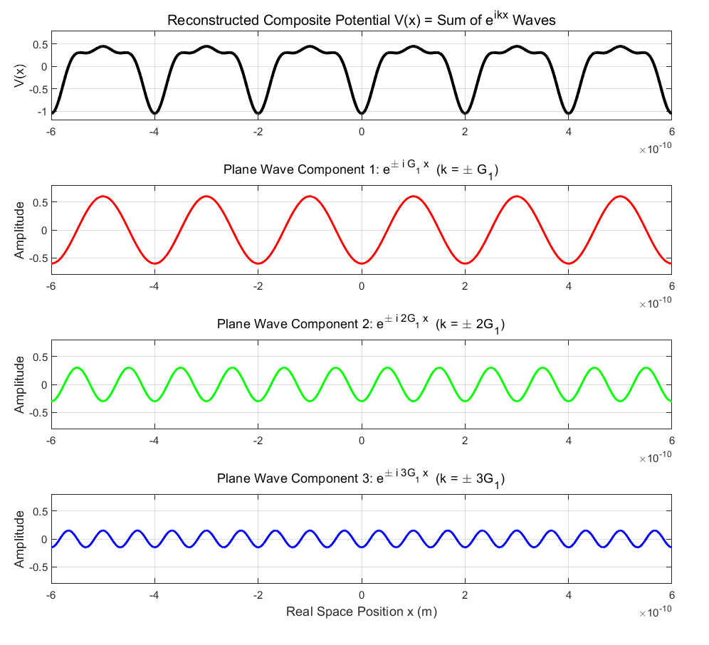

Combining the positive- and negative-wavevector exponential components reconstructs $V(x)$.

## Reciprocal basis vectors

Transforming from position to wavevector gives a representation in **k-space**. Our example used a one-dimensional potential, but a crystal has a three-dimensional potential $V(x,y,z)$. Fourier transformation therefore introduces three wavevector coordinates. The resulting three-dimensional space is **reciprocal space**.

The magnitudes and directions of the reciprocal basis vectors are determined by the real-space basis vectors through:

$$
\vec{b}_1=2\pi \frac{\vec{a}_2\times \vec{a}_3}{\vec{a}_1\cdot (\vec{a}_2\times \vec{a}_3)}
$$

$$
\vec{b}_2=2\pi \frac{\vec{a}_3\times \vec{a}_1}{\vec{a}_1\cdot (\vec{a}_2\times \vec{a}_3)}
$$

$$
\vec{b}_3=2\pi \frac{\vec{a}_1\times \vec{a}_2}{\vec{a}_1\cdot (\vec{a}_2\times \vec{a}_3)}
$$

For real-space primitive vectors $a_1,a_2,a_3$, these cross-product expressions define the reciprocal basis $b_1,b_2,b_3$. They correspond to the three real-space vectors we called $a,b,c$ earlier.

## The geometric meaning of reciprocal space

The next diagram superposes the real-space lattice (blue) and reciprocal lattice (red) for a cubic cell. Corresponding basis vectors point in the same directions in this special case, but their magnitudes differ: a real-space length $a$ corresponds to reciprocal spacing $2π/a$. Integer linear combinations of the reciprocal basis vectors locate reciprocal-lattice points. Their position vectors are called **reciprocal-lattice vectors**:

$$
\vec{G}=n_1\vec{b}_1+n_2\vec{b}_2+n_3\vec{b}_3\quad (n_i\text{=integer})
$$

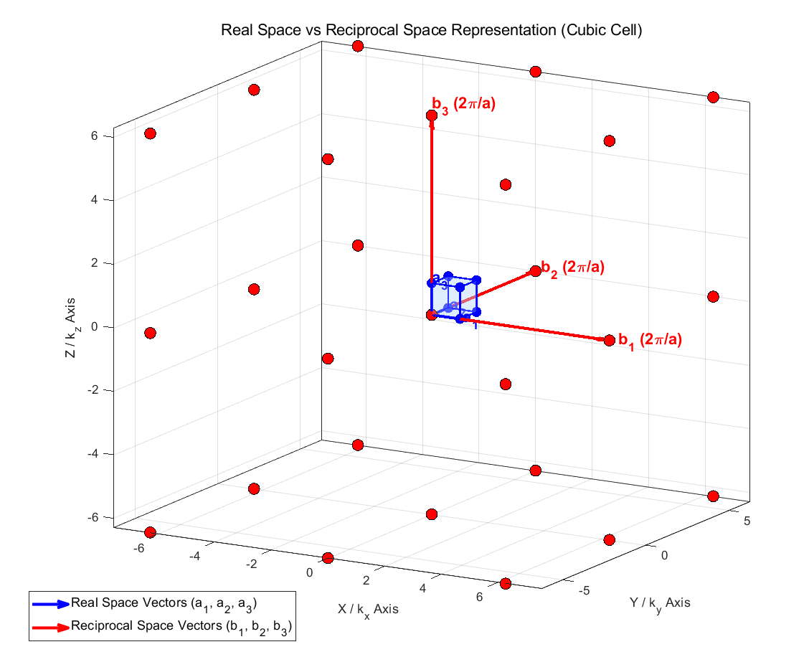

We can identify a reciprocal point by its integer coefficients. For instance, (110) means one step along the first reciprocal direction and one step along the second.

Geometrically, a reciprocal vector is normal to a corresponding family of real-space crystal planes. A reciprocal point represents the wavevector of a plane wave whose phase advances by an integer number of full cycles as we move between equivalent lattice positions. Its spatial periodicity matches that of the crystal.

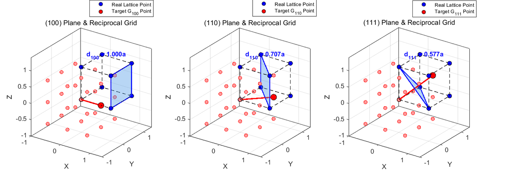

Reciprocal-lattice points are red and real-space points are blue. The (100), (110), and (111) reciprocal vectors are normal to the corresponding real-space plane families. In the cubic example, their magnitudes are respectively one, square-root-of-two, and square-root-of-three times the fundamental reciprocal spacing. In each case, the magnitude is inversely proportional to the interplanar spacing.

For a cubic lattice, we can therefore also express the reciprocal-vector magnitude using the plane indices:

$$
|\vec{G}|=\sqrt{n_1^2+n_2^2+n_3^2}\left(\frac{2\pi }{a}\right)
$$

$$
=\frac{2\pi }{a}\sqrt{h^2+k^2+l^2}
$$

How do we actually use this?

## Fourier expansion of a one-dimensional periodic function

A potential of period $a$ can be represented as a sum of plane waves whose wavevectors are integer multiples of the fundamental reciprocal spacing. Denoting those wavevectors by $G_n$, we write:

$$
V(x)=\sum _{n=-\infty }^{\infty }V_ne^{i\left(n\frac{2\pi }{a}\right)x}=\sum _{n=-\infty }^{\infty }V_ne^{iG_nx}
$$

By Bloch's theorem, an electron wavefunction labeled by $k$ has the following form. Its periodic factor also has period $a$, so we can Fourier-expand it:

$$
\psi _k(x)=e^{ikx}u_k(x)
$$

$$
=e^{ikx}\sum _{n=-\infty }^{\infty }C_me^{iG_mx}
$$

$$
=\sum _{n=-\infty }^{\infty }C_me^{i\left(G_m+k\right)x}
$$

Let's substitute these Fourier expansions into the Schrödinger equation:

$$
-\frac{\hbar ^2}{2m}\frac{d^2\psi (x)}{dx^2}+V(x)\psi (x)=E\psi (x)
$$

Expanding the terms gives the following expressions.

### Second-derivative term

$$
-\frac{\hbar ^2}{2m}\frac{d^2\psi _k(x)}{dx^2}=\sum _{m=-\infty }^{\infty }\frac{\hbar ^2(k+G_m)^2}{2m}C_me^{i(k+G_m)x}
$$

### Potential term

$$
V(x)\psi _k(x)=\left(\sum _{n=-\infty }^{\infty }V_ne^{iG_nx}\right)\left(\sum _{m=-\infty }^{\infty }C_me^{i(k+G_m)x}\right)=\sum _{n=-\infty }^{\infty }\sum _{m=-\infty }^{\infty }V_nC_me^{i(k+G_m+G_n)x}
$$

### Energy term

$$
E\psi _k(x)=\sum _{m=-\infty }^{\infty }EC_me^{i(k+G_m)x}
$$

### Full equation

$$
\sum _{m=-\infty }^{\infty }\frac{\hbar ^2(k+G_m)^2}{2m}C_me^{i(k+G_m)x}+\sum _{n=-\infty }^{\infty }\sum _{m=-\infty }^{\infty }V_nC_me^{i(k+G_m+G_n)x}=\sum _{m=-\infty }^{\infty }EC_me^{i(k+G_m)x}
$$

Plane waves with different reciprocal indices are orthogonal over a unit cell. We can therefore match the coefficients of each exponential separately. To avoid confusing the summation indices, introduce an independent index $l$ and collect the coefficient of the exponential with wavevector $k+G_l$.

The kinetic and energy terms simply select $m=l$. In the potential term, require $G_m+G_n=G_l$, or equivalently $m=l-n$. This gives:

$$
\frac{\hbar ^2(k+G_l)^2}{2m}C_le^{i(k+G_l)x}+\sum _{n=-\infty }^{\infty }V_nC_{l-n}e^{i(k+G_l)x}=EC_le^{i(k+G_l)x}
$$

Comparing the coefficients yields:

$$
\left(\frac{\hbar ^2(k+G_l)^2}{2m}-E\right)C_l+\sum _{m=-\infty }^{\infty }V_{l-m}C_m=0
$$

We can express the same set of equations in matrix form:

$$
\begin{pmatrix}\cdots \frac{\hbar ^2\left(k-G_1\right)^2}{2m}-E&V_{-1}&V_{-2}&\cdots \\\cdots V_1&\frac{\hbar ^2k^2}{2m}-E&V_{-1}&\cdots \\\cdots V_2&V_1&\frac{\hbar ^2(k+G_1)^2}{2m}-E&\cdots \\\vdots &\vdots &\vdots &\ddots \end{pmatrix}\begin{pmatrix}C_{-1}\\C_{_0}\\C_{_1}\\\vdots \end{pmatrix}=0
$$

Near $k=G_1/2$, a two-component approximation reduces this to the following two-by-two system; the other components are neglected in this approximation:

$$
\begin{pmatrix}\frac{\hbar ^2k^2}{2m}-E&V_{-1}\\V_1&\frac{\hbar ^2(k-G_1)^2}{2m}-E\end{pmatrix}\begin{pmatrix}C_0\\C_{-1}\end{pmatrix}=0
$$

For a nonzero coefficient vector, the determinant of the matrix must vanish. Write the free-electron energy using the symbol shown below and use the complex-conjugate relationship between the Fourier coefficients of a real potential:

$$
\begin{vmatrix}\frac{\hbar ^2k^2}{2m}-E&V_{-1}\\V_1&\frac{\hbar ^2(k+G_1)^2}{2m}-E\end{vmatrix}=0\quad \left(\text{where }\lambda _k^0=\frac{\hbar ^2k^2}{2m},\quad V_1=V_{-1}^*\right)
$$

Expanding the determinant gives a quadratic equation. Solving it yields the following eigenvalues near the Brillouin-zone boundary. As usual, these eigenvalues are the energies:

$$
E_{\pm }=\frac{\lambda _k^0+\lambda _{k-G_1}^0}{2}\pm \sqrt{\left(\frac{\lambda _k^0-\lambda _{k-G_1}^0}{2}\right)^2+|V_1|^2}
$$

$$
at\ k\ \approx \frac{G}{2}
$$

$$
E_{\pm }=\lambda _{G/2}^0\pm |V_G|
$$

We have now shown mathematically that energy splitting occurs near $k=G/2$. Away from that strongly coupled region, the energies approach the original free-electron dispersion in the weak-potential picture.

This problem is much easier when we Fourier-expand the continuous real-space functions into discrete, orthogonal plane-wave components. That is a central reason for transforming from real space to reciprocal space.

The calculation above was one-dimensional. In three dimensions we follow the same logic, although it gets much more complicated, haha. Just as a frequency-domain graph assigns a coefficient to each frequency, reciprocal space assigns coefficients to wavevector components at points in three dimensions. We label those points by:

$$
\mathbf{G}=h\mathbf{b}_1+k\mathbf{b}_2+l\mathbf{b}_3
$$

Assigning wavefunction and potential coefficients to these reciprocal vectors gives the corresponding three-dimensional calculation.

Reciprocal space is an essential concept whenever we study crystals. The equations matter, but understanding what the space represents and why we use it gives much better intuition for further study.

In the next post, I will explore the reciprocal lattices of different crystal structures. That's all for this post. Thank you for reading!

*This post reflects my own understanding, so there may be errors. Questions are always welcome, so feel free to ask.*
