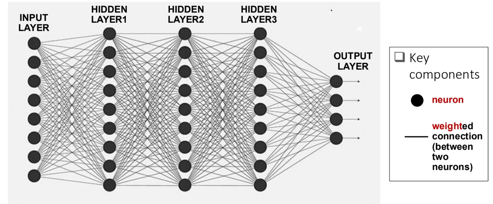
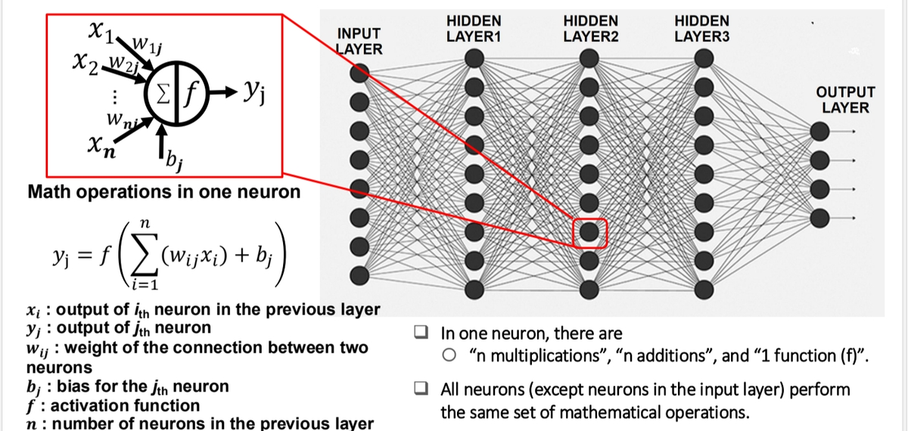
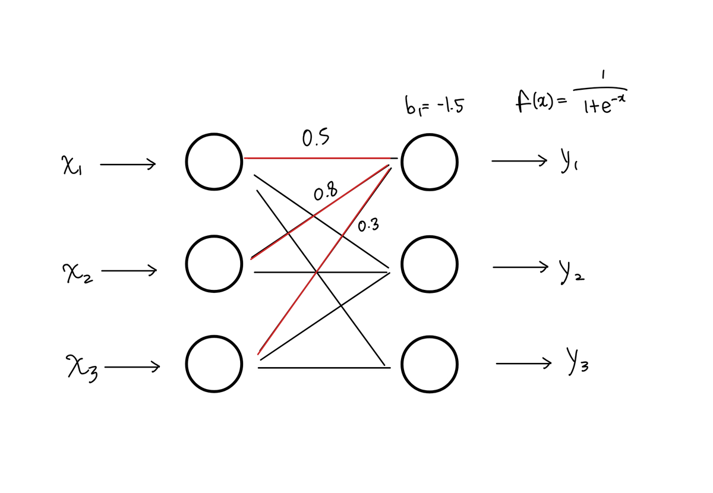
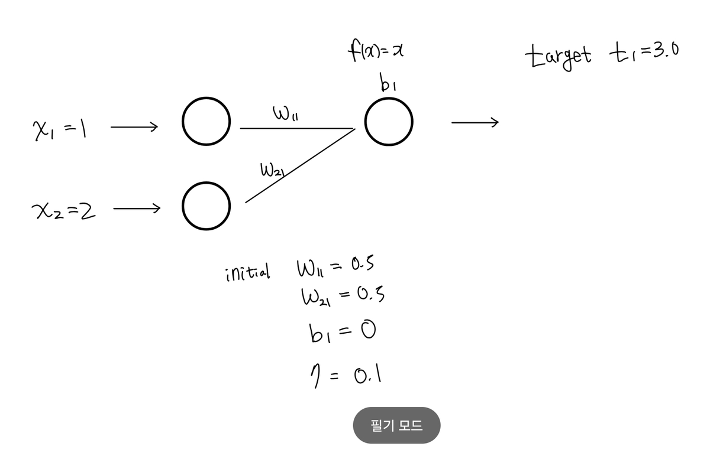

Hi! It's already mid-October. I'm happy to feel the weather getting a little cooler. I can finally wear the clothes I want, and the weather is lovely. Autumn really is a wonderful season. But the fact that it is only getting cool now... something feels off.

In this post, I want to explore artificial neural networks (ANNs), the deep-learning algorithms at the heart of the AI we now encounter everywhere. In future posts, I will connect this algorithm to neuromorphic computing and examine their algorithmic relationship in more detail.

## Artificial neural networks

ANNs form the foundations of today's large language models (LLMs). Their operation is inspired by the human brain. The following diagram shows an artificial neural network.

You can see several layers. The first, the **input layer**, receives the inputs. Several layers lie in between, and the last, the **output layer**, produces the outputs. As a rough analogy, think of ChatGPT's input box as the input side and the generated response as the output side. There are many, many hidden layers in between.

## How it works

In the diagram above, each dot represents a neuron, and the neurons are connected by lines. Each line has an assigned weight, $w$. When values enter through the input layer, computations involving the connected neurons determine the outputs in the next layer. The following equation describes this computation:

$$
y_j=f\left(\sum _{i=1}^n(w_{ij}x_i)+b_j\right)
$$

$$
note\ that\ \sum _{i=1}^n(w_{ij}x_i)+b_j\ =z_j
$$

Here, $x$ denotes an input from a neuron in the preceding layer, and $y$ denotes an output in the next layer. For the $n$ connections leading from the preceding layer to one particular neuron, we multiply each input by its connection weight, add the products, add the adjustment $b_j$, and apply the activation function. The result is the output of that neuron in the next layer.

The expression inside $f$ is denoted by $z_j$. All the $z_j$ values can be written together in matrix form as follows. For now, you can think of the biases and activation function as helping adjust the model, without worrying too deeply about them.

$$
\begin{bmatrix}z_1&z_2&\cdots &z_m\end{bmatrix}=\begin{bmatrix}x_1&x_2&\cdots &x_n\end{bmatrix}\begin{bmatrix}w_{11}&w_{12}&\cdots &w_{1m}\\w_{21}&w_{22}&\cdots &w_{2m}\\\vdots &\vdots &\ddots &\vdots \\w_{n1}&w_{n2}&\cdots &w_{nm}\end{bmatrix}+\begin{bmatrix}b_1&b_2&\cdots &b_m\end{bmatrix}
$$

The notation looks a little complicated, but the actual computation is very simple. An example should help. The following diagram shows a system with three neurons per layer.

Suppose we have the following conditions:

$$
x_1=9\ \ \ \ \ \ \ x_2=8\ \ \ \ \ x_3=2
$$

$$
w_{11}=0.5\ \ \ \ \ \ \ w_{21}=0.8\ \ \ \ \ \ w_{31}=0.3
$$

$$
b_1=-1.5
$$

$$
f(x)=\frac{1}{1+e^{-x}}
$$

We want to calculate the output of the first neuron in the second layer.

The inputs to the first layer are $x_1=9$, $x_2=8$, and $x_3=2$. Following the neuron-computation rule, we multiply each input by the weight of its connection, sum the results, add the bias $b_1$, and substitute that value into the activation function $f$. The resulting value is $y_1$.

$$
y_1=f\left((w_{11}x_1+w_{21}x_2+w_{31}x_3)+b_1\right)
$$

$$
w_{11}x_1+w_{21}x_2+w_{31}x_3+b_1=(0.5\times 9)+(0.8\times 8)+(0.3\times 2)-1.5=10
$$

$$
y_1=f(10)=\frac{1}{1+e^{-10}}\approx 0.999954
$$

This is the computation performed by an ANN. Pretty simple, isn't it? Just multiply, add, and substitute! How did such an algorithm become a technology that now dominates our daily lives?

The key is the **weights**. What we just did could easily be handled with a simple calculator. But the weights are not fixed constants: they are variables that change continually during learning.

If you have studied machine learning, you have probably heard of training sets and test sets. A test set evaluates how close the model's outputs are to the correct answers for given inputs. A training set, on the other hand, is used to change and optimize the weights so that the output-layer values approach the correct answers for the input-layer values.

The crucial part is the **training process**. Learning more finely tuned weights drives improvements in AI models.

## Backpropagation

The weights are updated using the backpropagation algorithm. Backpropagation attracted attention through work published by Geoffrey Hinton and his collaborators; I remember first encountering it in *A Nighttime Engineering Student's Comics*. At the time, I had no idea how important it would become. Today it is a foundational algorithm used throughout modern AI.

Let's look at its principles. For a deeper, multilayer derivation, see my [Backpropagation post](https://oasisforhaanee.github.io/backpropagation/).

I mentioned that weights change during training. We calculate the discrepancy between the correct answer and the output, then use it to adjust both the weights and the biases $b_j$. If the target answer is $t_j$, the error is defined as follows, where $n$ is the number of output nodes:

$$
E=\frac{1}{2n}\sum _{j=1\ }^{n\ }(y_j-t_j)^2
$$

We then calculate how sensitive this error is to the weight $w_{ij}$. This is the partial derivative of $E$ with respect to $w_{ij}$:

$$
\frac{\partial E}{\partial w_{ij}}
$$

Using the [chain rule](https://oasisforhaanee.github.io/partial-derivatives-and-gradient/#chain-rule), we can split this into three factors:

$$
\frac{\partial E}{\partial w_{ij}}=\frac{\partial E}{\partial y_j}\cdot \frac{\partial y_j}{\partial z_j}\cdot \frac{\partial z_j}{\partial w_{ij}}
$$

The first factor follows directly by differentiating the expression for $E$:

$$
\frac{\partial E}{\partial y_j}=\frac{\partial }{\partial y_j}\left(\frac{1}{2n}(y_j-t_j)^2\right)=\frac{1}{n}(y_j-t_j)
$$

For the second factor, since $y_j=f(z_j)$, we get:

$$
\frac{\partial y_j}{\partial z_j}=f'(z_j)
$$

For the third factor, differentiating the weighted sum in $z_j$ gives:

$$
z_j=\sum _{i=1}^n(w_{ij}x_i)+b_j
$$

$$
\frac{\partial z_j}{\partial w_{ij}}=x_i
$$

Multiplying these factors gives the sensitivity of the error to the weight. Finally, we multiply by the learning rate $η$ to control the update size, giving the following weight update:

$$
w_{ij}^{(new)}=w_{ij}^{(old)}-\eta \frac{\partial E}{\partial w_{ij}}=w_{ij}^{(old)}-\eta \frac{1}{n}(y_j-t_j)f'(z_j)x_i
$$

We can update $b_j$ in the same way. The first two factors remain unchanged, but the third differs: the partial derivative of $z_j$ with respect to $b_j$ is 1.

$$
\frac{\partial E}{\partial b_j}=\frac{\partial E}{\partial y_j}\cdot \frac{\partial y_j}{\partial z_j}\cdot \frac{\partial z_j}{\partial b_j}
$$

$$
z_j=\sum _{i=1}^n(w_{ij}x_i)+b_j
$$

$$
\frac{\partial z_j}{\partial b_j}=1
$$

$$
\frac{\partial E}{\partial b_j}=\frac{1}{n}(y_j-t_j)\cdot f'(z_j)
$$

The final bias-update rule is therefore:

$$
b_j^{(new)}=b_j^{(old)}-\eta \frac{\partial E}{\partial b_j}=b_j^{(old)}-\eta \frac{1}{n}(y_j-t_j)f'(z_j)
$$

## A worked example

Let's work through an example.

Please excuse my handwriting!

The diagram above shows a system with one output node ($n=1$), inputs $x_1=1$ and $x_2=2$, initial weights $w_{11}=w_{21}=0.5$, and initial bias $b_1=0$. The activation function is $f(x)=x$, the learning rate is $η=0.1$, and the target answer is $t_1=3.0$.

First, computing the output with the current weights gives:

$$
z_1=w_{11}x_1+w_{21}x_2+b_1=(0.5\times 1)+(0.5\times 2)+0.0=1.5
$$

$$
y_1=f(z_1)=1.5
$$

We want 3.0, but the output is 1.5. That means the weights need updating. Let's update them using backpropagation. First, the error is:

$$
E=\frac{1}{2n}(y_1-t_1)^2=\frac{1}{2\times 1}(1.5-3.0)^2=\frac{1}{2}(-1.5)^2=1.125
$$

The derivatives of the error with respect to the two weights are:

$$
\frac{\partial E}{\partial w_{11}}=\frac{1}{1}\times (y_1-t_1)\times f'(z_1)\times x_1=1\times (1.5-3.0)\times 1\times 1=-1.5
$$

$$
\frac{\partial E}{\partial w_{21}}=\frac{1}{1}\times (y_1-t_1)\times f'(z_1)\times x_2=1\times (1.5-3.0)\times 1\times 2=-3.0
$$

Finally, applying the learning rate $η$ gives the updated weights:

$$
w_{11}^{(new)}=w_{11}^{(old)}-\eta \frac{\partial E}{\partial w_{11}}=0.5-0.1\times (-1.5)=0.65
$$

$$
w_{21}^{(new)}=w_{21}^{(old)}-\eta \frac{\partial E}{\partial w_{21}}=0.5-0.1\times (-3.0)=0.80
$$

Now let's calculate the output again using these new weights:

$$
y_1^{(new)}=(0.65\times 1)+(0.80\times 2)+0.0=0.65+1.60=2.25
$$

The output was 1.5 before, but now it is 2.25, closer to 3.0. Repeating this backpropagation update five or ten times brings it even closer to 3.0.

$$
5\ times\ after\ back\ propagation
$$

$$
y_1\approx 2.9531
$$

$$
10\ times\ after\ back\ propagation
$$

$$
y_1\approx 2.9985
$$

This process—gradually adjusting the weights using the error between the output and the correct answer—is how AI models become more accurate. In the next post, I will discuss problems faced by modern AI and neuromorphic devices and circuits that could help address them.

That's all for this post. Thank you for reading this long explanation!

*This post reflects my own understanding, so there may be errors. Questions are always welcome, so feel free to ask.*
