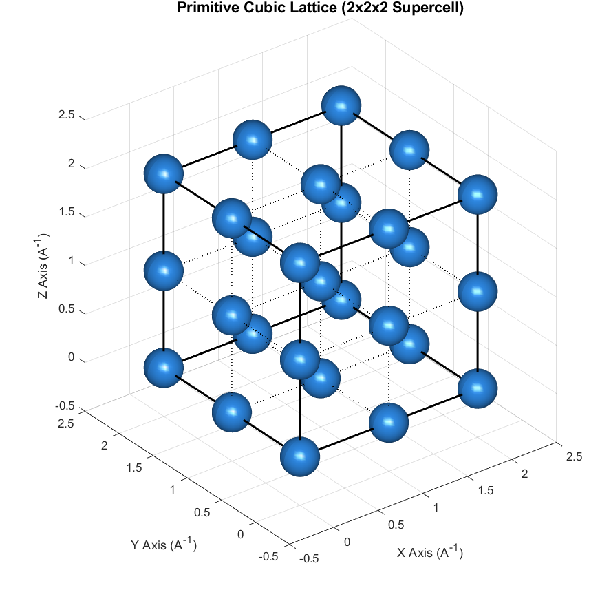
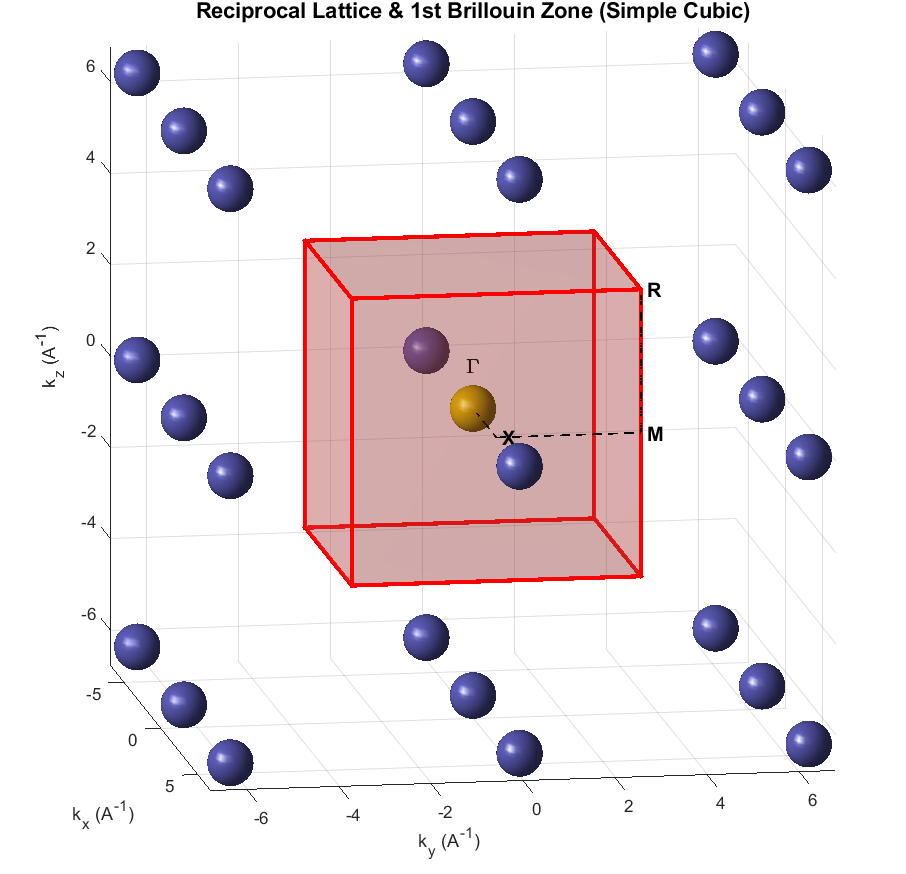
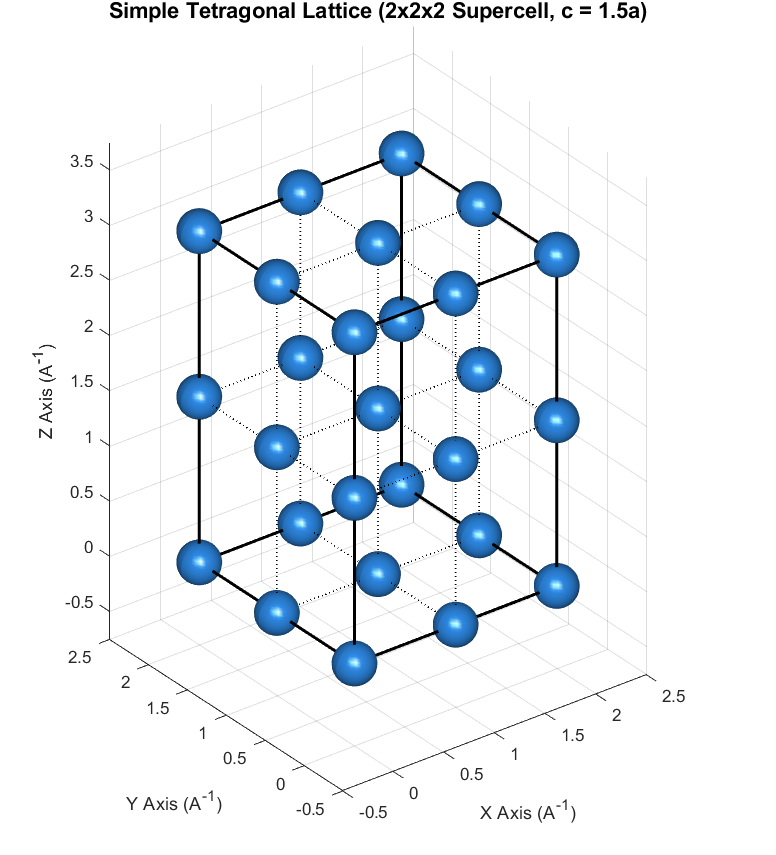
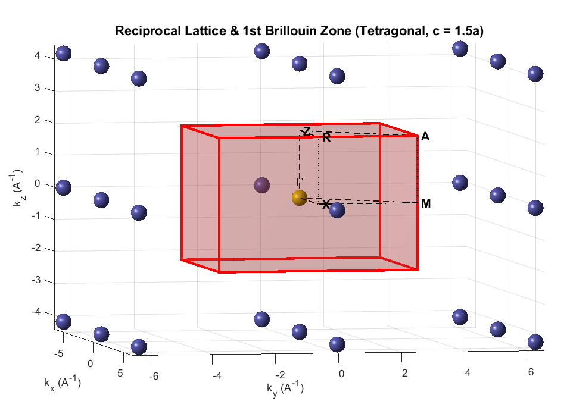
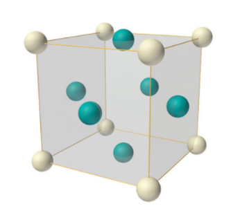
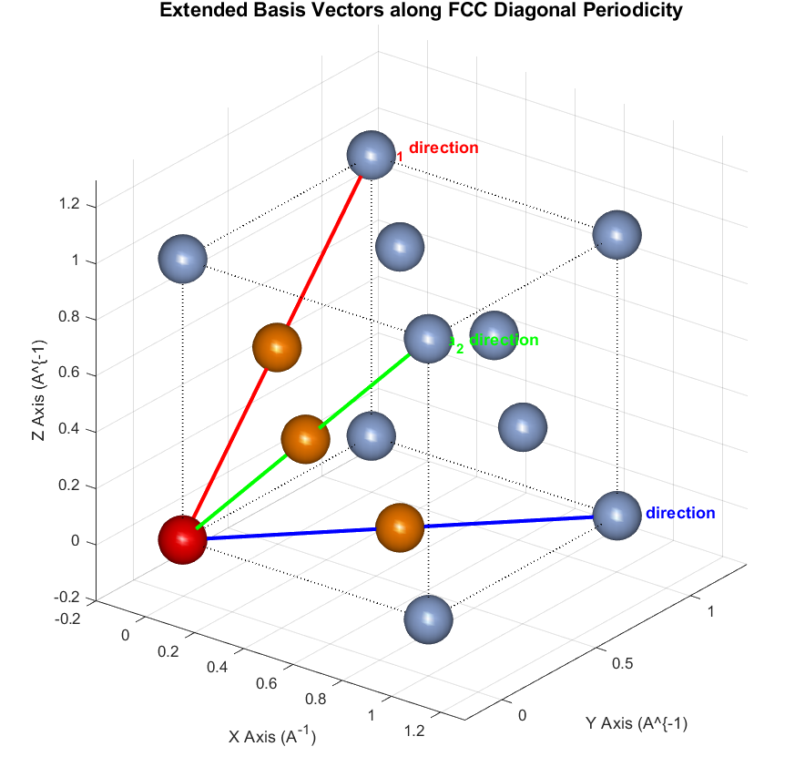
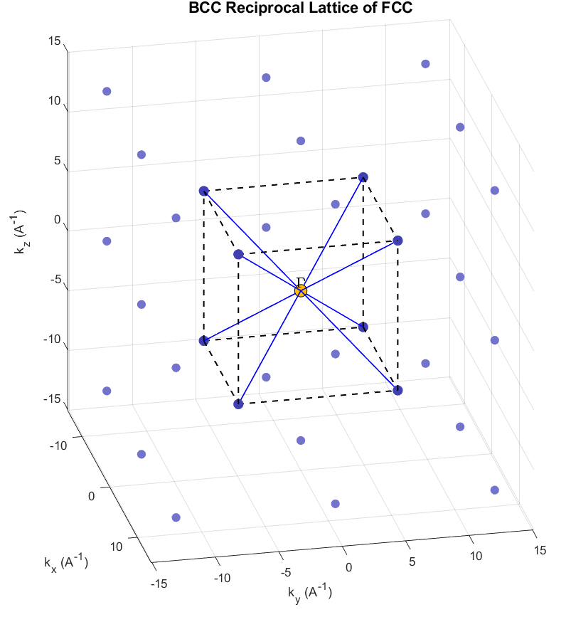
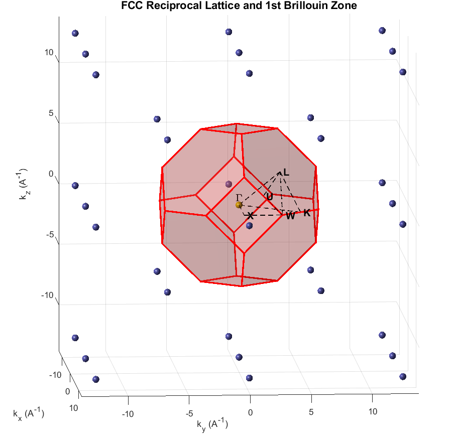
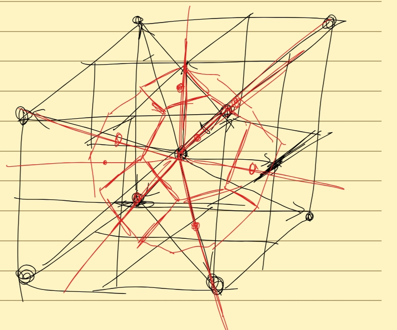

In this post, let's explore the reciprocal lattices of FCC and BCC crystals. If reciprocal space is unfamiliar, please read my [reciprocal-lattice introduction](https://blog.naver.com/kkul20235/224436591820) first.

Reciprocal space is the wavevector-space description obtained by Fourier-transforming real-space structure. Just as a time-dependent wave can be represented as a superposition of frequency components, a real-space lattice can be described using wavevector components. Reciprocal space is where we represent those components.

## Primitive cubic cell

This is the simplest familiar lattice: atoms arranged at regular intervals along the $x$, $y$, and $z$ directions. Fourier-transforming it gives the following reciprocal lattice.

From the reciprocal-vector formulas, the reciprocal lattice of a primitive cubic cell is also a regularly spaced cubic lattice. Its first Brillouin zone is the red cube centered on a reciprocal-lattice point. Translating these equivalent cells sideways or vertically tiles the reciprocal space.

What happens if we change the real-space lattice shape a little?

## Primitive tetragonal cell

The diagram shows a tetragonal lattice. Fourier-transforming this cell gives reciprocal spacings determined by the following vector formulas. For the relative lengths illustrated here, the reciprocal spacings in the $k_x$ and $k_y$ directions are larger than that along $k_z$. Try calculating them yourself!

$$
\vec{b}_1=2\pi \frac{\vec{a}_2\times \vec{a}_3}{\vec{a}_1\cdot (\vec{a}_2\times \vec{a}_3)}
$$

$$
\vec{b}_2=2\pi \frac{\vec{a}_3\times \vec{a}_1}{\vec{a}_1\cdot (\vec{a}_2\times \vec{a}_3)}
$$

$$
\vec{b}_3=2\pi \frac{\vec{a}_1\times \vec{a}_2}{\vec{a}_1\cdot (\vec{a}_2\times \vec{a}_3)}
$$

The reciprocal lattice is therefore drawn as follows.

Unlike real space, where the $z$ spacing is longer, reciprocal space has larger spacings along $k_x$ and $k_y$. Think of the length scales as inversely related.

## Face-centered cubic cell

Let's now calculate the reciprocal lattice of FCC. Unlike the earlier examples, its primitive translations do not simply follow the Cartesian axes. Instead, convenient primitive directions are diagonal. The following vectors play the role that the axial vectors $(a,0,0)$, $(0,a,0)$, and $(0,0,a)$ played in the primitive cubic cell:

$$
\mathbf{a}_1=\frac{a}{2}(\hat{y}+\hat{z})=\left(0,\frac{a}{2},\frac{a}{2}\right)
$$

$$
\mathbf{a}_2=\frac{a}{2}(\hat{x}+\hat{z})=\left(\frac{a}{2},0,\frac{a}{2}\right)
$$

$$
\mathbf{a}_3=\frac{a}{2}(\hat{x}+\hat{y})=\left(\frac{a}{2},\frac{a}{2},0\right)
$$

The next diagram shows this more clearly. Follow the colored lines and you will see the periodically repeating atoms.

Substitute these three primitive vectors into the reciprocal-vector formulas. The resulting reciprocal basis vectors are:

$$
\mathbf{b}_1=\frac{2\pi }{a}(-\hat{x}+\hat{y}+\hat{z})
$$

$$
\mathbf{b}_2=\frac{2\pi }{a}(\hat{x}-\hat{y}+\hat{z})
$$

$$
\mathbf{b}_3=\frac{2\pi }{a}(\hat{x}+\hat{y}-\hat{z})
$$

But look: apart from the overall scale factor, these are precisely primitive vectors of BCC! In other words, the reciprocal lattice of an FCC lattice has the BCC structure.

The reciprocal lattice calculated from the FCC primitive vectors has the BCC structure.

Conversely, the reciprocal lattice of BCC is FCC. The corresponding first Brillouin zone is illustrated below.

Honestly, my brain short-circuited when I first saw this diagram.

A little overwhelming, right? But the idea is not so complicated. The first Brillouin zone is a fundamental reciprocal-space cell. To construct this soccer-ball-like shape, draw planes that bisect the lines between the central point (the gamma point) and neighboring reciprocal-lattice points, perpendicular to those lines. The enclosed region containing the center is the zone.

If we draw an identical region around every reciprocal-lattice point, the regions fill space without gaps. For now, think of it as a basic cell capturing the lattice periodicity. Try putting the vectors into a calculation and drawing the construction yourself—it helps build intuition!

My own attempt at drawing it.

That's all for this post. Thank you for reading this long explanation!

*This post reflects my own understanding, so there may be errors. Questions are always welcome, so feel free to ask.*
