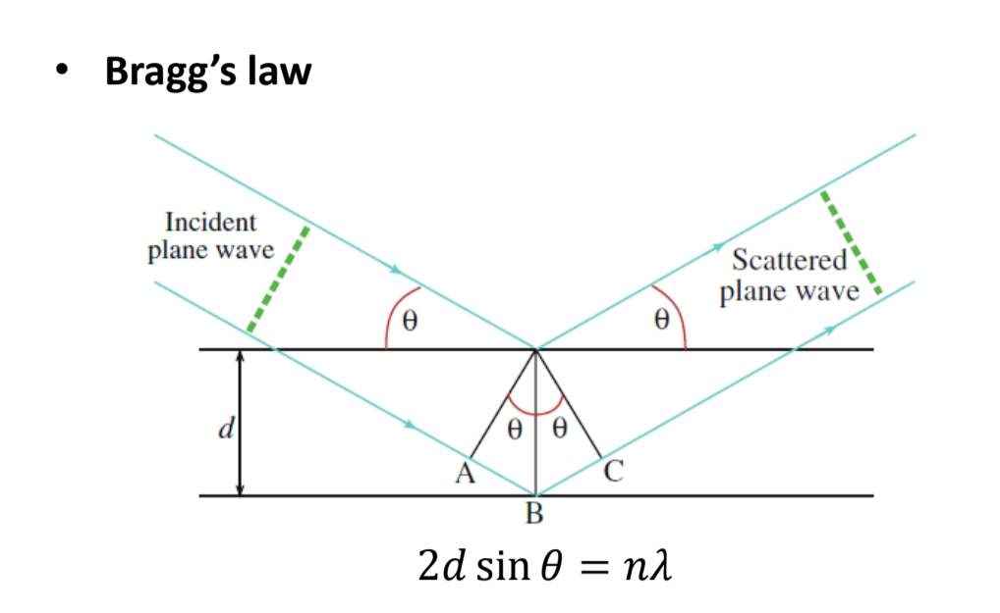
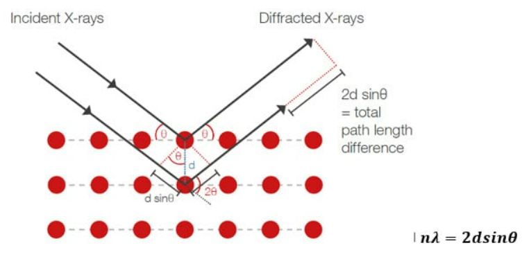
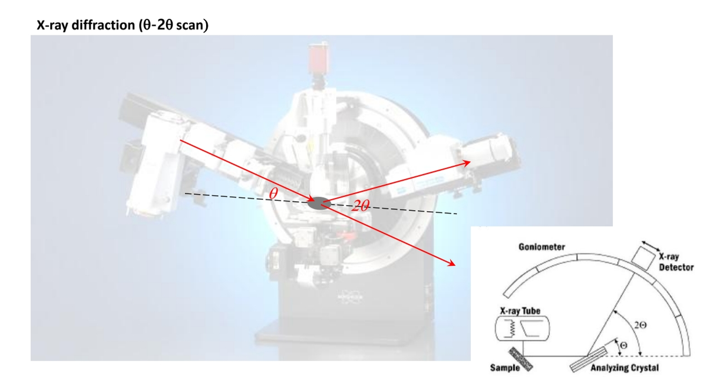
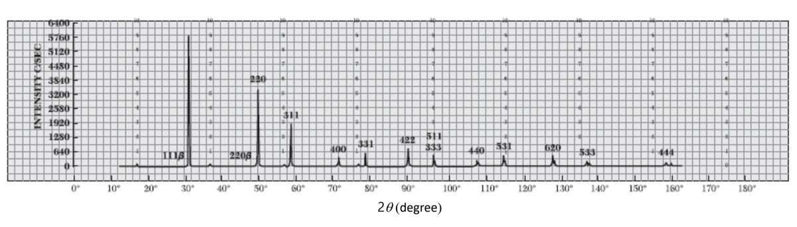
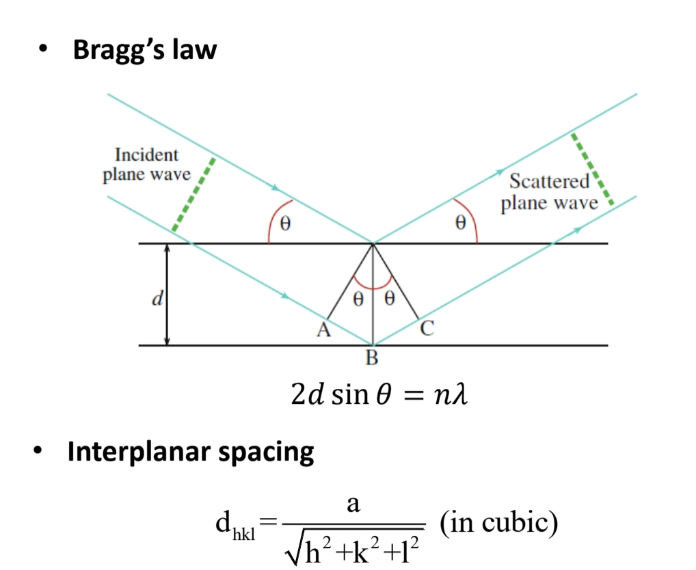
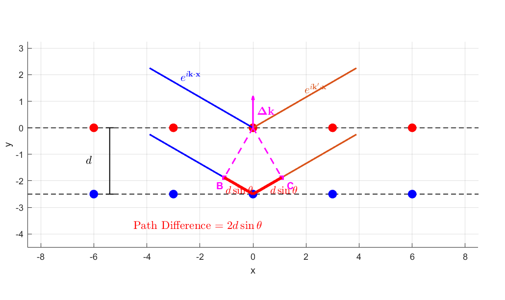
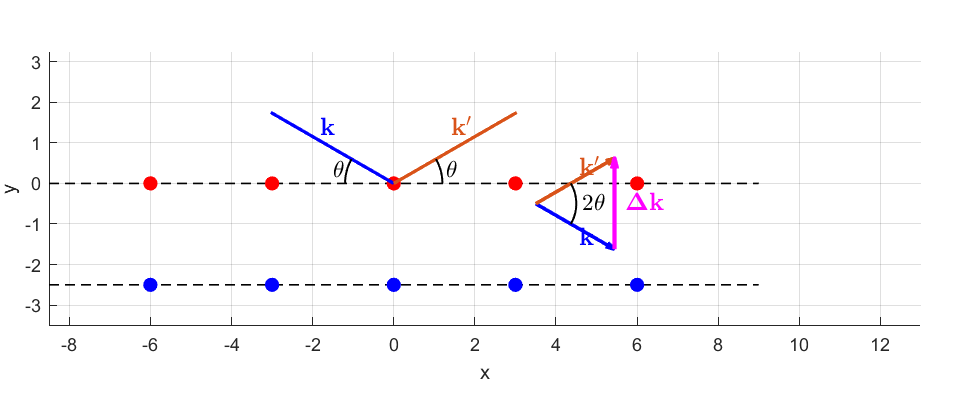

In this post, let's explore the relationship between X-ray diffraction (XRD) and reciprocal space.

## X-ray diffraction

XRD is one of the most widely used methods for analyzing crystal structures. We illuminate a material with X-rays and examine its structure through the diffraction pattern. To understand the principle, we first need Bragg's law.

## Bragg's law

The diagram below probably looks familiar. You may have seen it when studying constructive and destructive interference in school.

Bragg's law.

Light arriving from the left reflects from the first and second planes. The two reflected rays have a path difference equal to AB + BC. The ray reflected from the second plane travels that extra distance, so its phase changes by an additional amount.

If the two rays nevertheless emerge with matching phases, they interfere constructively and the reflected intensity increases. This happens when the path difference is an integer multiple of the wavelength. In the diagram, AB and BC each have length equal to the plane spacing $d$ times the sine of the angle. Thus strong reflection occurs at angles satisfying **twice the plane spacing times the sine of the angle equals an integer number of wavelengths**.

Bragg's law in a crystal.

The light entering from the left represents the incident X-rays; the red dots represent atoms in the crystal. Once again, Bragg's law tells us which angles give constructive interference.

What if the angle is slightly off? Suppose the phase difference between reflections from adjacent planes misses the matching condition by about one degree. With only two planes, it seems that appreciable intensity could remain. But a real crystal has a very large, though finite, number of equally spaced planes. A one-degree mismatch between the first and second planes becomes two degrees between the first and third, and grows with increasing depth. Contributions from many planes largely cancel away from the Bragg condition. This produces a peak near the angle where the phases match.

## How an XRD instrument works

Adjusting the sample and detector angles in an XRD instrument.

As in the right-hand diagram, the sample is tilted through an angle theta, and the detector measures the diffracted X-rays. Tilting the sample by theta requires a detector angle of twice theta in this geometry, so the measured pattern plots intensity against $2θ$. A typical pattern is shown below.

A typical XRD pattern.

What information can we extract from this? Let's revisit Bragg's law.

We know the measured diffraction angle and the incident X-ray wavelength, so we can determine the spacing $d$ of the reflecting planes. For a cubic crystal, the spacing is related to the Miller indices $(hkl)$ by the formula shown above. This lets us identify candidate reflecting planes. The labels at the peaks in the XRD pattern indicate these plane indices.

## The Laue condition

Once we have identified the reflecting planes, we can interpret the result in reciprocal space. Let the incident wavevector be $k$ and the outgoing wavevector be $k'$.

The path difference remains twice the plane spacing times the sine of theta. Using the relation between wavevector magnitude and wavelength, we can write Bragg's law in terms of $k$:

$$
k=\frac{2\pi }{\lambda }
$$

$$
2d\sin \theta =n\left(\frac{2\pi }{k}\right)
$$

The two wavevectors form an angle of twice theta, giving the following magnitude of their difference:

$$
|\mathbf{\Delta k}|=2k\sin \theta
$$

A reciprocal-lattice vector satisfies:

$$
\mathbf{G}_{hkl}=h\mathbf{b}_1+k\mathbf{b}_2+l\mathbf{b}_3
$$

$$
|\mathbf{G}_{hkl}|=\sqrt{h^2+k^2+l^2}\left(\frac{2\pi }{a}\right)=\frac{2\pi }{\left(\frac{a}{\sqrt{h^2+k^2+l^2}}\right)}=\frac{2\pi }{d_{hkl}}
$$

$$
|\mathbf{G}_{hkl}|=\frac{2\pi }{d_{hkl}}
$$

Combining these expressions gives the **Laue condition**. The wavevector change is perpendicular to the diffracting planes and parallel to the corresponding reciprocal-lattice vector. A higher diffraction order can be represented by the corresponding reciprocal-lattice vector:

$$
2d_{hkl}\sin \theta =n\left(\frac{2\pi }{k}\right)
$$

$$
2k\sin \theta =n\left(\frac{2\pi }{d_{hkl}}\right)
$$

$$
|\mathbf{\Delta k}|=|\mathbf{G}_{hkl}|
$$

$$
\mathbf{\Delta k}=\mathbf{G}_{hkl}
$$

An XRD peak therefore occurs when the difference between the outgoing and incident wavevectors matches a reciprocal-lattice vector, in both direction and magnitude. This is the Laue condition: Bragg's law expressed using wavevectors and the reciprocal lattice.

That's all for this post. Thank you for reading!

*This post reflects my own understanding, so there may be errors. Questions are always welcome, so feel free to ask.*
