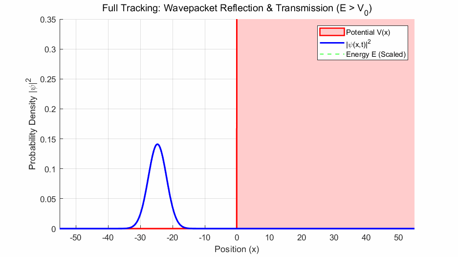
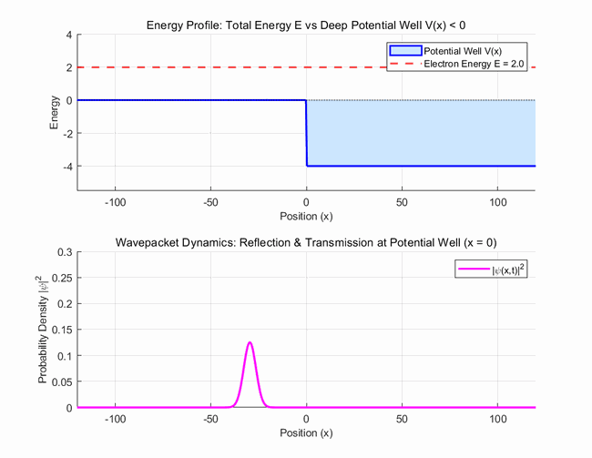
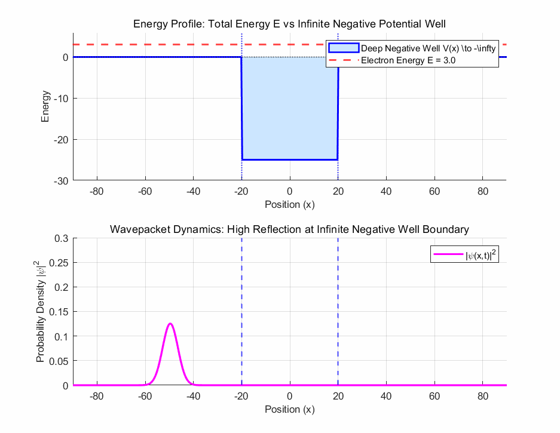
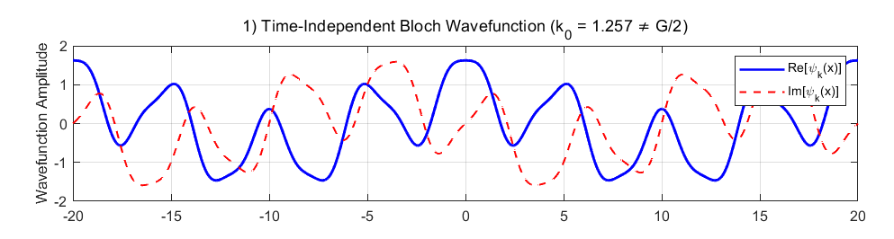
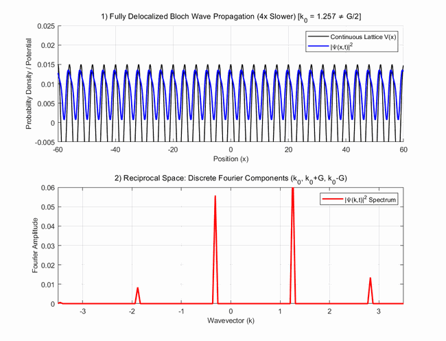
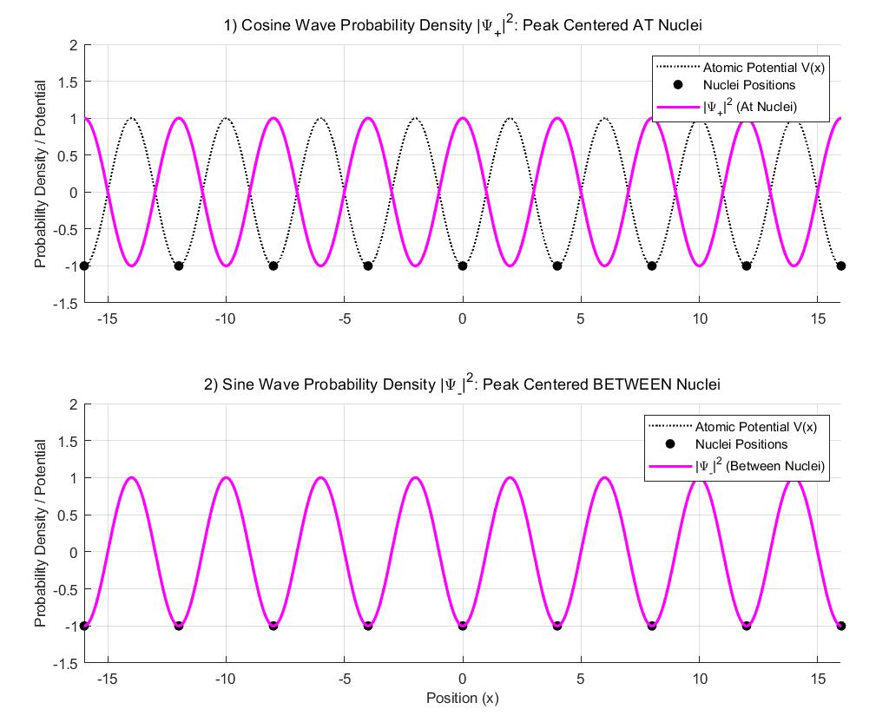
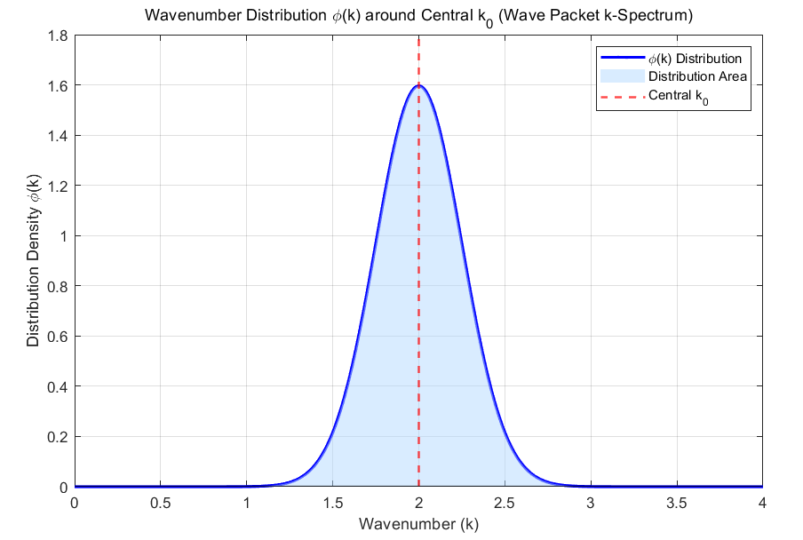
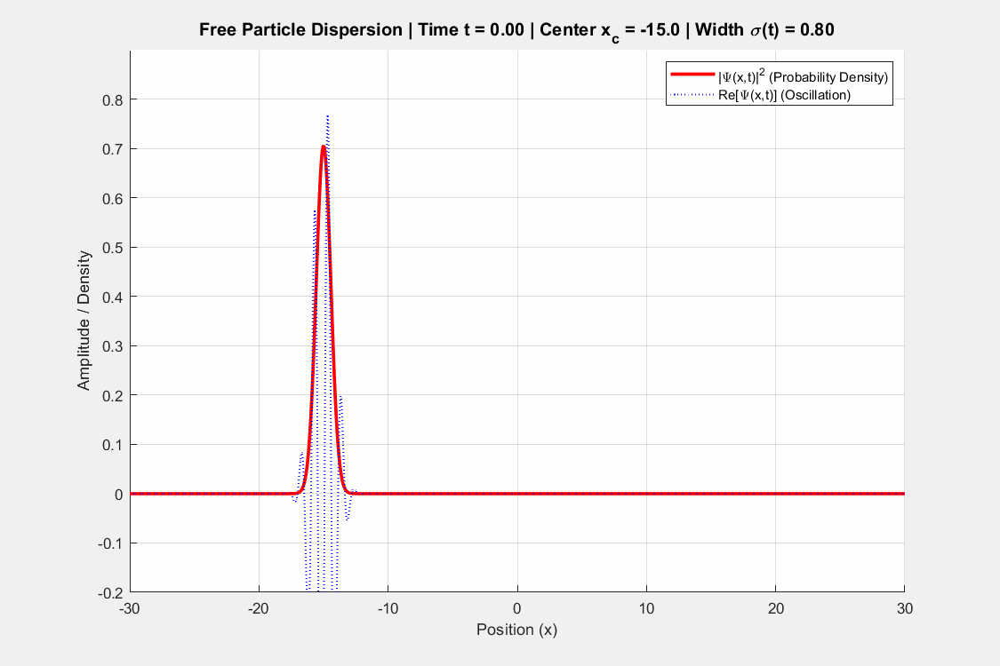
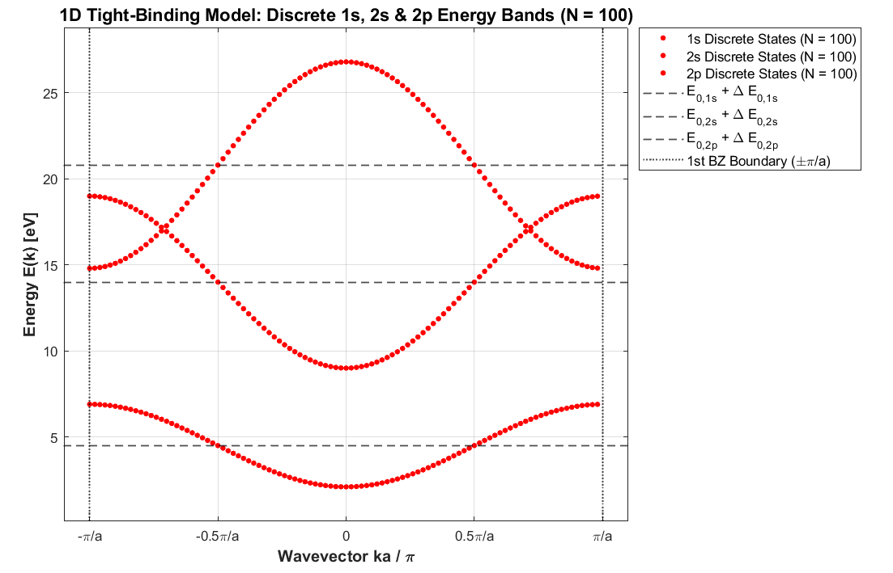

In this post, I will explain effective mass through the properties of electron wavefunctions in a crystal. In a way, this brings together everything I have discussed in solid-state physics so far. There is a lot to cover, so referring to my earlier posts may help. Let's begin!

## The mass of an electron

We all know that an electron is a particle with mass. Its mass is approximately:

$$
m_e\approx 9.11\times 10^{-31}\ \text{kg}
$$

Viewed as a particle, a free electron has momentum equal to its mass times its velocity. Viewed as a wavefunction, its motion is characterized by the wavevector $k$. A free electron with wavevector $k$ is represented as:

$$
\psi _k\left(x\right)=e^{ikx}
$$

$$
p=\hbar k
$$

We can find its energy by substituting the wavefunction into the Schrödinger equation:

$$
-\frac{\hbar ^2}{2m}\frac{d^2\psi (x)}{dx^2}+V\left(x\right)\psi (x)=E\psi (x)
$$

$$
at\ Free\ electron\ condition
$$

$$
V\left(x\right)=0,\ \psi \left(x\right)=e^{ikx}
$$

$$
-\frac{\hbar ^2}{2m}\frac{d^2\psi _k(x)}{dx^2}=E_k\psi _k(x)
$$

$$
E_k=\frac{\hbar ^2k^2}{2m_e}
$$

The stationary Schrödinger equation gives an eigenvalue for each eigenfunction. Here, the plane wave is a free-electron eigenfunction and $E_k$ is its energy eigenvalue. The result is so simple because the potential $V(x)$ is zero.

Electrons in a crystal, however, behave differently.

## Reflection of waves

A wave encountering a potential can be reflected. A classical particle passing over a hill with sufficient energy is not reflected, but a wave can be partly reflected even when its energy is greater than the potential. Part of the wave can also be transmitted.

Reflection occurs even when the wave energy exceeds the potential $V$.

A negative potential can also cause reflection.

An atomic potential becomes strongly negative near the atomic center. What happens when a wave encounters a very deep potential well?

For a potential well much deeper than the wave's energy scale, reflection can become nearly complete, as illustrated here.

Surprising, isn't it? We might expect reflection from a very high potential, but a very low, negative potential can reflect a wave too.

The wavefunction being reflected here is the electron wavefunction. As it moves through the lattice, it interacts with the nuclear potentials and undergoes reflection. An interesting effect then appears: reflected components whose wavevectors differ by a reciprocal-lattice vector $G$ have matching phases and can interfere constructively, whereas other contributions cancel across the crystal. This is the same principle as Bragg's law, discussed in my [XRD post](https://blog.naver.com/kkul20235/224446636507).

As a result, the electron takes the form of a Bloch state: a propagating plane-wave factor multiplied by a periodic function that incorporates the lattice and Bragg-scattering effects. Still a little abstract? We need equations to make it precise.

## Bloch electrons

An electron in a crystal experiences a periodic potential. Solving the Schrödinger equation with this potential gives new eigenfunctions and energy eigenvalues. By [Bloch's theorem](https://oasisforhaanee.github.io/blochs-theorem/), the wavefunction has the following form, where $u_k(x)$ has the lattice periodicity $a$:

$$
\psi _k(x)=e^{ikx}u_k\left(x\right)
$$

$$
\left(u_k\left(x\right)=u_k\left(x+a\right)\right)
$$

This describes the form of an electron wavefunction labeled by $k$ inside the crystal. It is an eigenfunction of the Schrödinger equation in the presence of $V(x)$:

$$
-\frac{\hbar ^2}{2m}\frac{d^2\psi _k(x)}{dx^2}+V(x)\psi _k(x)=E(k)\psi _k(x)
$$

$$
\left(\psi _k(x)=e^{ikx}u_k(x)\right)
$$

Substituting this expression directly into the Schrödinger equation makes the calculation complicated. To exploit the orthogonality of plane waves, we expand the periodic functions $u_k(x)$ and $V(x)$ as Fourier series in reciprocal-lattice plane waves. Please refer to the one-dimensional periodic-function expansion in my [reciprocal-lattice post](https://blog.naver.com/kkul20235/224436591820).

The potential can be expanded as:

$$
V(x)=\sum _{n=-\infty }^{\infty }V_ne^{i\left(n\frac{2\pi }{a}\right)x}=\sum _{n=-\infty }^{\infty }V_ne^{iG_nx}
$$

The wavefunction can likewise be written as:

$$
\psi _k(x)=e^{ikx}u_k(x)
$$

$$
=e^{ikx}\sum _{n=-\infty }^{\infty }C_me^{iG_mx}
$$

$$
=\sum _{n=-\infty }^{\infty }C_me^{i\left(G_m+k\right)x}
$$

Substituting these expansions and matching coefficients gives:

$$
\left(\frac{\hbar ^2(k+G_l)^2}{2m}-E\right)C_l+\sum _{m=-\infty }^{\infty }V_{l-m}C_m=0
$$

We then turn this into a matrix eigenvalue problem and solve for the energies $E$.

Notice that the periodic factor $u_k(x)$ is a series of plane waves associated with reciprocal-lattice vectors. These are the phase components involved in Bragg reflection: a linear superposition of waves that interfere constructively in the crystal. Expanding the potential in the same basis accounts for their interaction with the lattice potential, including Bragg-scattered components.

The real and imaginary parts of the Bloch wavefunction.

Propagation of a Bloch wave in a lattice potential. In Fourier space, the coupled components differ by reciprocal-lattice vectors.

Multiplying the periodic function $u_k(x)$ by the propagating plane-wave factor completes the wavefunction, including its propagation through real space.

To visualize time-dependent propagation as in the graph above, we must also multiply each energy eigenstate by its time-evolution factor. Please refer to my [stationary-state post](https://oasisforhaanee.github.io/stationary-state/).

What happens if $k=G/2$? A Bloch function consists of a plane-wave factor and a periodic modulation, with the latter expanded in reciprocal-lattice components. Away from the strong Bragg-reflection condition, the electron can propagate through the crystal.

Near $k=G/2$ or $-G/2$, however, an incident wave can couple strongly to a reflected wave differing in wavevector by $G$. Linear combinations of those two counterpropagating waves form **standing waves**, just as adding opposite complex exponentials gives a cosine:

$$
\psi _+=e^{i\frac{G}{2}x}+e^{-i\frac{G}{2}x}=2\cos \left(\frac{G}{2}x\right)
$$

$$
\psi _-=e^{i\frac{G}{2}x}-e^{-i\frac{G}{2}x}=2i\sin \left(\frac{G}{2}x\right)
$$

Instead of a traveling wave, we now have standing-wave states that do not carry the same propagating motion. Their different spatial relationships with the nuclear potential give them different energies.

The cosine-like standing wave (top) and sine-like standing wave (bottom).

The upper graph concentrates electron probability near the atoms, whereas the lower graph concentrates it between atoms. These different spatial distributions give different energies, reminiscent of bonding and antibonding orbitals in chemistry.

The resulting energy splitting at $k=G/2$ produces an interval between the two states in which no electron states are available: the **band gap**.

## Effective mass

We can now explain effective mass. An electron wavefunction in a crystal extends through the lattice and takes the Bloch form. Because it interacts with the periodic potential, its acceleration in an applied electric field does not follow the free-electron relation using the bare electron mass.

The interaction depends on the Bloch wavevector $k$, so the acceleration response to an external force also depends on $k$. Effective mass bundles all those complicated lattice-potential and Bragg-reflection effects into one quantity—rather like sweeping them all into the same box, haha.

Let's derive it. First, you need the idea of group velocity; please read my [group-velocity post](https://blog.naver.com/kkul20235/224447121386).

The propagation speed of an electron wavepacket in the lattice is its group velocity. Using that relation, we can derive the effective mass:

$$
v_g=\left(\frac{dw}{dk}\right)
$$

$$
E=\hbar \omega \ \left(For\ wave\ function\right)
$$

$$
v_g=\frac{1}{\hbar }\left(\frac{dE}{dk}\right)
$$

$$
F_{ext}=\hbar \frac{dk}{dt}=m^*a=m^*\frac{dv_g}{dt}
$$

$$
\frac{dv_g}{dt}=\frac{dv_g}{dk}\cdot \frac{dk}{dt}=\frac{1}{\hbar }\left(\frac{d^2E}{dk^2}\right)\cdot \left(\frac{F_{ext}}{\hbar }\right)
$$

$$
F_{ext}=m*\cdot \frac{1}{\hbar }\left(\frac{d^2E}{dk^2}\right)\cdot \left(\frac{F_{ext}}{\hbar }\right)
$$

$$
\frac{1}{m*}=\frac{1}{\hbar ^2}\left(\frac{d^2E}{dk^2}\right)
$$

Thus the inverse effective mass is proportional to the curvature, or second derivative, of the energy as a function of $k$.

## Extra: group velocity of a wavepacket

You can skip this section if you like.

I had a question here. Group velocity arises from superposing waves with slightly different wavevectors and frequencies. How can we calculate it simply by taking the derivative of the dispersion relation? Couldn't we do that for a single band without explicitly superposing any waves? Each Bloch eigenstate has its own energy, and the slope seems to be just the continuous change of energy between eigenstates. Why should that give a velocity defined through superposition?

The answer requires understanding a wavepacket. Without going into full mathematical rigor, a wavepacket necessarily superposes wavefunctions with some spread in $k$. By the uncertainty principle, a real electron localized in position cannot have one perfectly definite wavevector. If we call the central wavevector $k_0$, the wavepacket must also include nearby wavevectors. It already is a superposition. For a sufficiently narrow distribution, the derivative at its center gives the velocity of its envelope. The following equations express this:

$$
\Psi (x,t)=\int _{-\infty }^{\infty }\phi (k)\, u_k(x)\, e^{i(kx-\omega (k)t)}\, dk
$$

$$
\omega (k)\approx \omega (k_0)+\frac{d\omega }{dk}_{k_0}(k-k_0)
$$

$$
\Psi (x,t)\approx e^{i(k_0x-\omega (k_0)t)}\cdot u_{k_0}(x)\int _{-\infty }^{\infty }\phi (k)e^{i(k-k_0)\left(x-\frac{d\omega }{dk}_{k_0}t\right)}dk
$$

The function giving the wavevector amplitudes has a distribution such as the following:

A plot of the distribution of wavevector amplitudes.

A real wavepacket can also spread as it moves. The simple two-wave example has a single beat velocity, but a packet includes a distribution of wavevectors and their associated time-dependent energy phases. Their differing propagation behavior can change the packet's shape over time.

The wavepacket spreading with time.

That was a bit of a detour, but I wanted to explain why the derivative of frequency with respect to wavevector gives the electron's group velocity. I will discuss this more deeply in a future quantum-mechanics post.

Now let's examine electron motion at different positions in an energy band.

## Energy bands and effective mass

For the shape of energy bands, please refer to my [energy-band post](https://oasisforhaanee.github.io/energy-band/).

From bottom to top: bands associated with 1s, 2s, and 2p orbitals.

The graph shows energy bands arising from combinations of atomic orbitals. The horizontal axis is $k$ and the vertical axis is energy. Let's focus on the lowest, 1s-derived band. The effective mass obeys:

$$
\frac{1}{m*}=\frac{1}{\hbar ^2}\left(\frac{d^2E}{dk^2}\right)
$$

It is therefore inversely proportional to the second derivative of energy with respect to $k$.

### 1. Near the band bottom ($k=0$)

The energy curve is concave upward, so its second derivative is positive and the effective mass is positive. As $k$ increases, the slope and hence the group velocity increase. An external force that increases $k$ therefore accelerates the electron in the force direction. It behaves rather like a free electron, but the lattice interaction changes the mass from the bare value to the effective mass.

### 2. Near the Brillouin-zone boundary

Near the band top at the zone boundary, the curve is concave downward. The second derivative and effective mass are negative. Increasing $k$ decreases the slope and the group velocity. The electron therefore accelerates opposite to the applied force, as though its mass were negative. Later, we will describe this behavior using the concept of a **hole**.

### 3. Near an inflection point

At an inflection point—illustrated here near $k=π/(2a)$—the second derivative is zero, so the effective mass diverges. Locally, a small increase or decrease of $k$ hardly changes the slope. Thus the group velocity remains approximately unchanged under a small applied force, as expressed below:

$$
v_g(k_0-\Delta k)\approx v_g(k_0+\Delta k)
$$

To first order, it is as though the wavepacket does not accelerate under the force. We describe that response as an infinite effective mass.

In conclusion, effective mass packages the complicated effects of the lattice potential into one quantity, allowing us to describe electron motion under external forces in the familiar Newtonian form: force equals effective mass times acceleration.

That's all for this post. Thank you for reading this long explanation!

*This post reflects my own understanding, so there may be errors. Questions are always welcome, so feel free to ask.*
