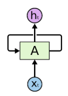
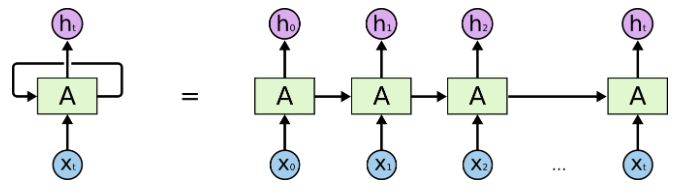
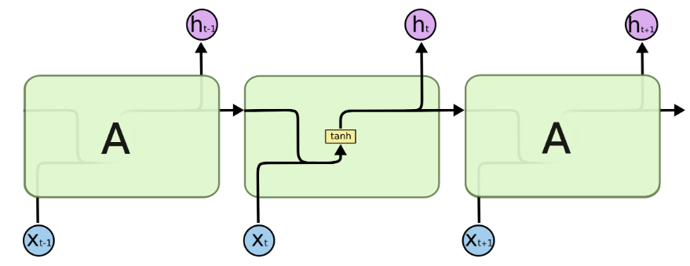
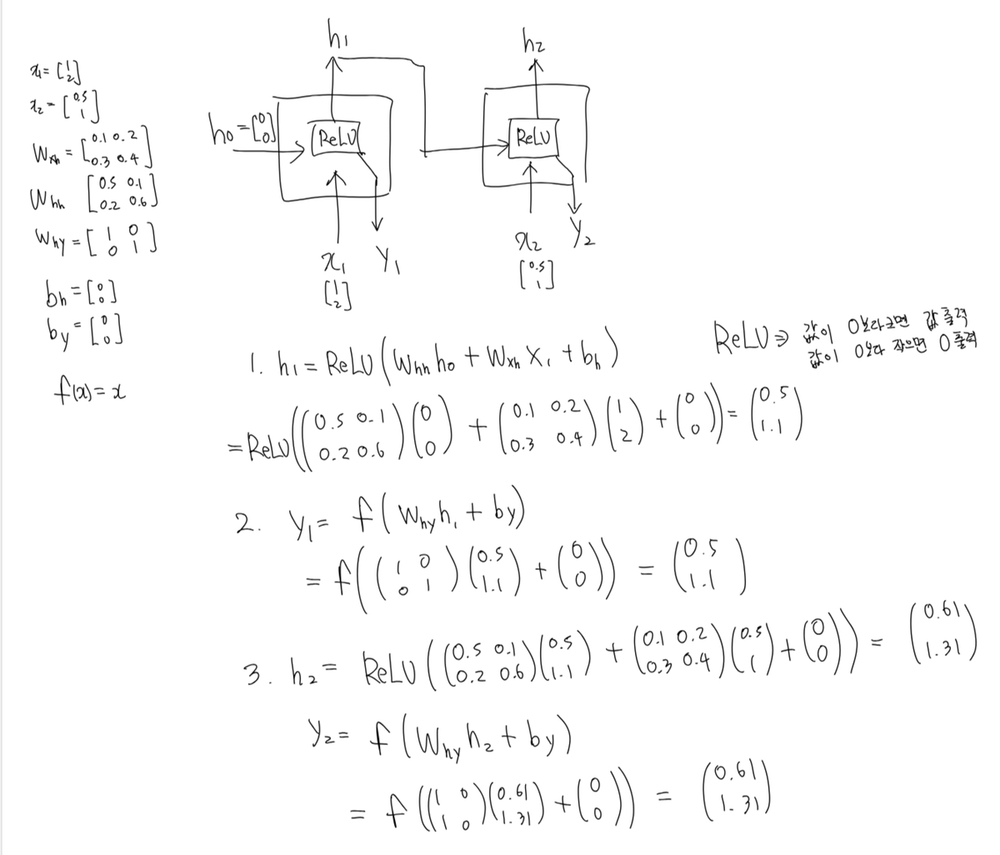

In this post, let's explore recurrent neural networks (RNNs), a development of artificial neural networks (ANNs). Please read my [ANN post](https://oasisforhaanee.github.io/artificial-neural-network/) first.

## The basic idea of an RNN

As the word *recurrent* suggests, an RNN introduces loops into the network. Unlike the forward-only computation in the ANN we discussed, the result of a computation is fed back into the next computation. I will call the actual output for input $x_t$ by the name $y_t$.

As shown below, an input $x_t$, together with the previous hidden state, produces a hidden state $h_t$ and an output $y_t$. The newly calculated hidden state is then passed around the loop into the next time step. Strictly speaking, it is not simply fed in unchanged: it is combined with the current input $x_{t+1}$. I will explain that calculation below. Repeating this process is the basic principle of an RNN.

Input $x_t$ produces $h_t$ and $y_t$, and the hidden state is fed into the next computation.

Although this recursive system shows inputs and outputs around one recurrent unit, we can also draw it as follows.

What looks like a single loop can also be viewed as many connected units unrolled through time.

It may look like one loop, but we can represent it as many connected units along the time axis. The diagram means that the first input $x_0$ and the initial hidden state produce $h_0$ and $y_0$. Then $h_0$ combines with the next input $x_1$ to produce $h_1$ and $y_1$, and $h_1$ is passed into the next computation. This continues, producing the RNN's outputs.

## The hidden state

Let's examine the algorithm in more detail, starting with the meaning of $h_t$. I said that input $x_t$ produces both $h_t$ and $y_t$. Unlike the actual output, the **hidden state** $h_t$ is not directly presented as the output. What is it for? Think of it as a value that remembers information accumulated so far. The equations for $h_t$ and $y_t$ make this clearer.

The hidden state is calculated as follows. Here, tanh is one possible activation function; other functions can also be used.

$$
h_t=\tanh (W_{hh}h_{t-1}+W_{xh}x_t+b_h)
$$

$$
\tanh (z)=\frac{e^z-e^{-z}}{e^z+e^{-z}}
$$

The actual output $y_t$ is calculated as follows:

$$
y_t=f(W_{hy}h_t+b_y)
$$

$$
f:\ activation\ function
$$

Here, $W_{hh}$, $W_{xh}$, and $W_{hy}$ are the RNN's weight matrices, and $b_h$ is a bias.

An RNN's computation proceeds approximately as follows:

1. When input $x_t$ arrives, calculate $h_t$ using the preceding hidden state $h_{t-1}$ and the weight matrices. Store $h_t$ for use when the next input arrives.
2. Combine $h_t$ with the next input $x_{t+1}$ to calculate $h_{t+1}$ and $y_{t+1}$.
3. Apply an output function appropriate to the RNN system. During training, compare $y_t$ with the correct answer and use the discrepancy to update the weights.

The hidden state carries the accumulated results of earlier computations. This may sound abstract, but it matters greatly in language processing. Suppose you entered the sentence, “I went to France.” Much later, if asked whether you had been to France, the information retained in the hidden state can influence the next output so that the model can answer “Yes.” The learned weights determine how that stored information affects the output.

## An RNN example

Let's work through a simple example with two successive recurrent computations and $2-by-2$ weight matrices. The initial values are:

$$
x_1=\begin{bmatrix}1\\2\end{bmatrix},\quad x_2=\begin{bmatrix}0.5\\1\end{bmatrix}
$$

$$
h_0=\begin{bmatrix}0\\0\end{bmatrix}
$$

The weight matrices are:

$$
W_{xh}=\begin{bmatrix}0.1&0.2\\0.3&0.4\end{bmatrix}
$$

$$
W_{hh}=\begin{bmatrix}0.5&0.1\\0.2&0.6\end{bmatrix}
$$

$$
W_{hy}=\begin{bmatrix}1.0&0.0\\0.0&1.0\end{bmatrix}
$$

The biases and activation function are as follows. ReLU returns its input if the input is positive and returns zero if it is negative.

$$
b_h,b_y=\begin{bmatrix}0\\0\end{bmatrix}
$$

$$
f(z)=\text{ReLU}(z)
$$

Let's calculate the outputs. When $x_1$ enters, use $h_0$ and the weight matrices to obtain $h_1$:

$$
h_1=\text{ReLU}(W_{hh}h_0+W_{xh}x_1)=\text{ReLU}\left(\begin{bmatrix}0\\0\end{bmatrix}+\begin{bmatrix}0.5\\1.1\end{bmatrix}\right)=\begin{bmatrix}0.5\\1.1\end{bmatrix}
$$

We can then use $h_1$ to obtain $y_1$:

$$
y_1=W_{hy}h_1=\begin{bmatrix}1.0&0.0\\0.0&1.0\end{bmatrix}\begin{bmatrix}0.5\\1.1\end{bmatrix}=\begin{bmatrix}0.5\\1.1\end{bmatrix}
$$

Using the same procedure, calculate $h_2$ and $y_2$:

$$
h_2=\text{ReLU}(W_{hh}h_1+W_{xh}x_2)=\text{ReLU}\left(\begin{bmatrix}0.36\\0.76\end{bmatrix}+\begin{bmatrix}0.25\\0.55\end{bmatrix}\right)=\begin{bmatrix}0.61\\1.31\end{bmatrix}
$$

$$
y_2=W_{hy}h_2=\begin{bmatrix}1.0&0.0\\0.0&1.0\end{bmatrix}\begin{bmatrix}0.61\\1.31\end{bmatrix}=\begin{bmatrix}0.61\\1.31\end{bmatrix}
$$

Please excuse my handwriting!

Stopping here would miss the point. We need to compare the output with the correct answer and update the weights through training. Just as with an ANN, training searches for optimized weights. This uses [backpropagation](https://oasisforhaanee.github.io/backpropagation/).

We obtained $y_2=(0.61,1.31)^T$. Suppose the correct answer is $(1.01,2.31)^T$. The following calculation illustrates a backpropagation update. Here, $e_2$ is the error vector; it gives the componentwise discrepancy associated with the loss gradient.

$$
d_2=\begin{bmatrix}1.01\\2.31\end{bmatrix}
$$

$$
e_2=d_2-y_2=\begin{bmatrix}0.4\\1.0\end{bmatrix}
$$

$$
L=\frac{1}{2}\left|d_2-y_2\right|^2=0.58
$$

We update the weights as follows:

$$
\eta =0.1
$$

$$
\frac{\partial L}{\partial W_{hy}}=-e_2h_2^T=-\begin{bmatrix}0.4\\1.0\end{bmatrix}\begin{bmatrix}0.61&1.31\end{bmatrix}=-\begin{bmatrix}0.244&0.524\\0.610&1.310\end{bmatrix}
$$

$$
W_{hy}^{\text{new}}=W_{hy}-\eta \frac{\partial L}{\partial W_{hy}}=\begin{bmatrix}1.0&0.0\\0.0&1.0\end{bmatrix}+0.1\begin{bmatrix}0.244&0.524\\0.610&1.310\end{bmatrix}=\begin{bmatrix}1.0244&0.0524\\0.0610&1.1310\end{bmatrix}
$$

The equations look complicated; honestly, I used Gemini to help with them too. The important point is that the weights change according to the error, scaled by the learning rate.

Using these new weights, the outputs become:

$$
y_1^{\text{new}}=W_{hy}^{\text{new}}h_1=\begin{bmatrix}1.0244&0.0524\\0.0610&1.1310\end{bmatrix}\begin{bmatrix}0.5\\1.1\end{bmatrix}=\begin{bmatrix}0.570\\1.275\end{bmatrix}
$$

$$
y_2^{\text{new}}=W_{hy}^{\text{new}}h_2=\begin{bmatrix}1.0244&0.0524\\0.0610&1.1310\end{bmatrix}\begin{bmatrix}0.61\\1.31\end{bmatrix}=\begin{bmatrix}0.694\\1.519\end{bmatrix}
$$

The correct answer is $(1.01,2.31)^T$, whereas the original $y_2$ was $(0.61,1.31)^T$. We can see that the updated $y_2$ is closer to the target.

In the next post, I will explore LSTM, a further development of the RNN model.

Thank you for reading this long post. Have a great day!

Source for the RNN diagrams and discussion: [Understanding LSTM Networks](https://colah.github.io/posts/2015-08-Understanding-LSTMs/).

*This post reflects my own understanding, so there may be errors. Questions are always welcome, so feel free to ask.*
