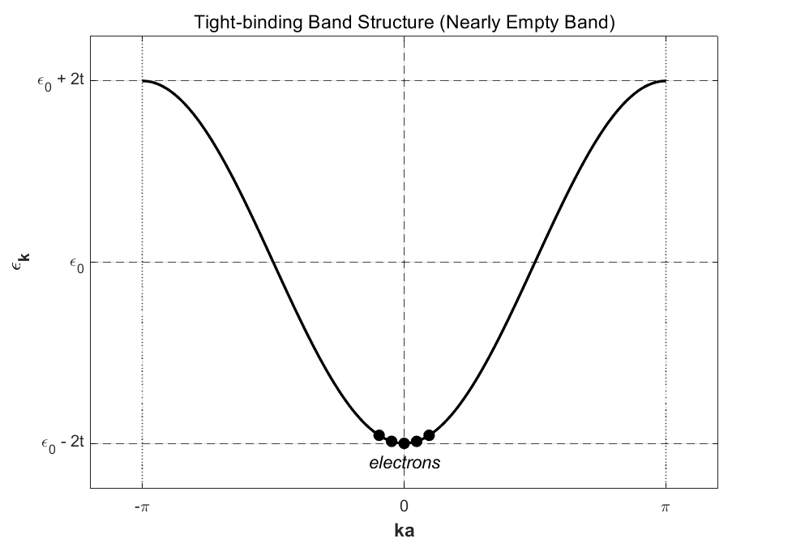
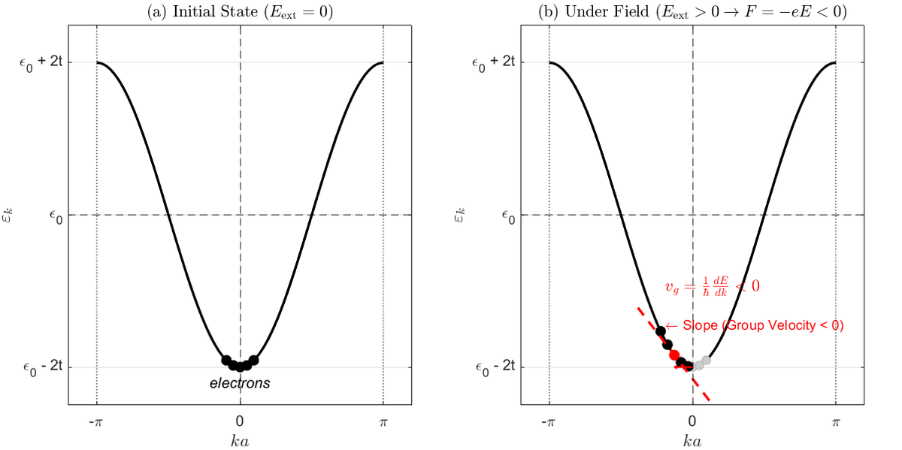
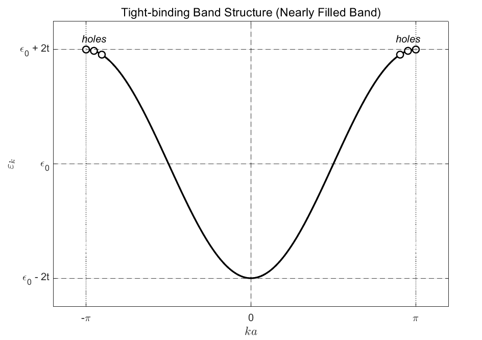
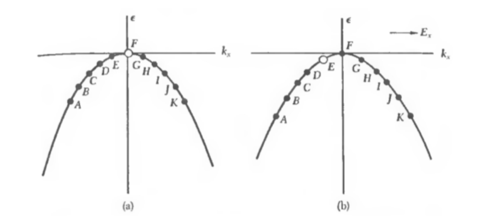
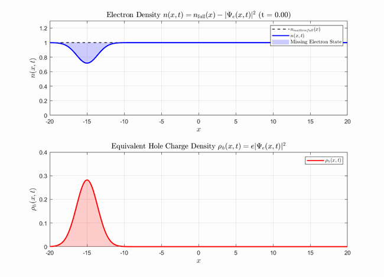
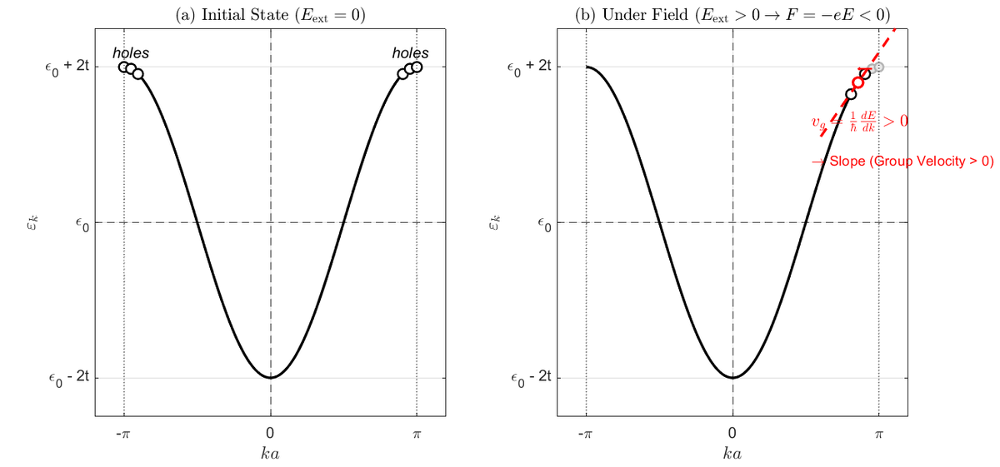

In this post, let's explore electrons and holes. Please read my [effective-mass post](https://blog.naver.com/kkul20235/224447833077) first.

## Electron motion in a crystal

Depending on their interaction with the lattice, electrons in a crystal can move as though their mass were positive or negative. In an electric field, their equation of motion is as follows. Because an electron has crystal momentum given by hbar times $k$, the external force is the time derivative of that momentum.

$$
\hbar \frac{dk}{dt}=F=-eE=e\nabla V
$$

Let's first consider a band that is almost empty.

## Nearly empty band

Almost all the energy states are empty except those near the bottom.

The figure above shows a band that is empty apart from a few occupied states (black dots) near its bottom. Let's apply an electric field in the positive $x$ direction.

$$
\hbar \frac{dk}{dt}=F=-eE=e\nabla V
$$

Taking a field in the positive $x$ direction as $E>0$, the negatively charged electrons experience a force in the negative $x$ direction. Thus $dk/dt$ is negative, and the occupied states shift toward negative $k$.

The group velocity of a wavepacket made from these states becomes negative because it is proportional to the slope $dE/dk$ at the shifted states. This agrees with our intuition: an electric field in the positive $x$ direction moves electrons in the negative $x$ direction.

## Nearly filled band

Now let's consider an almost completely filled band. Applying an electric field in the positive $x$ direction again gives $dk/dt<0$, shifting the occupied states toward negative $k$.

$$
\hbar \frac{dk}{dt}=F=-eE=e\nabla V
$$

All the states are occupied except for a few empty states near the top.

All the occupied points should move to the left. Rather than tracking every one of them, it is much simpler to track the few empty points near the top. These empty states are what we call **holes**.

Let's see what happens when all the occupied states move to the left.

When all the occupied states (black dots) move left, the unoccupied states (white dots) also move left.

In the diagram, black dots are occupied states and open dots are empty states. If all the occupied states move left together, the electron at E moves to D and the electron at G moves to F. As a result, the empty state moves to E. Let's replace the picture of collective electron motion with that of a single moving hole.

Before introducing a hole, the band is completely filled. By symmetry, the sum of all the wavevectors is zero:

$$
\ \sum _{\ }^{\ }k_{all}=0
$$

If one state is empty, the sum over the remaining electrons is the full-band sum minus the wavevector of the missing state. Calling that missing state's wavevector $k_e$, the remaining sum is $-k_e$:

$$
\ \sum _{\ }^{\ }k=-k_e
$$

We now want to describe the same situation as a filled band plus one hole. The hole picture must represent the same physical state as the missing-electron picture. Its wavevector must therefore be $-k_e$, giving:

$$
k_h=-k_e
$$

Next, consider the group velocity. With one electron state missing, the density can be expressed as:

$$
n(x,t)=n_{\text{full}}(x)-|\Psi _e(x,t)|^2
$$

Here, the first term is the density of the filled band, and the subtracted term is the probability density of the missing electron state. Describing that missing state as a hole gives the following hole distribution:

$$
\rho _h(x,t)=|\Psi _e(x,t)|^2
$$

Their motion in time can be illustrated as follows.

In the upper graph, blue represents the negative contribution of the missing state's density; red represents that same missing contribution as a hole.

The motion of the remaining electrons is the full-band motion minus the contribution of the empty state. We represent this missing contribution as a hole with the opposite charge, $+e$. The empty-state distribution and the hole distribution must therefore travel with the same group velocity: $v_e=v_h$.

A hole is a fictitious particle that simplifies the collective behavior of an almost-filled band with a few empty states. It may feel unintuitive that its wavevector has the opposite sign, but the definitions are:

$$
k_h=-k_e
$$

$$
v_h=v_e
$$

The definitions must be precise for collective electron motion and single-hole motion to describe exactly the same physical state. That equivalence is the key point.

## The effective mass of a hole

How do we define a hole's effective mass? An electron near the top of an energy band has a negative effective mass. Reversing the energy convention for a hole gives it a positive effective mass.

$$
v_h=\frac{1}{\hbar }\left(\frac{dE_h}{dk_h}\right)=v_e=\frac{1}{\hbar }\left(\frac{dE_e}{dk_e}\right)
$$

$$
k_h=-k_e
$$

The hole energy is defined as:

$$
E_h=E_v^{high}-E_v\left(k_e\right)
$$

We take the highest energy in the valence band as the zero of hole energy. The hole's energy is then the difference between that reference and the energy of the missing electron state. Near the band-top region discussed here, moving toward lower wavevector can therefore increase the hole energy while decreasing the corresponding electron energy.

## Holes in the valence and conduction bands

We have examined electron motion in nearly empty and nearly filled bands. In many solid-state systems, the valence band is nearly filled and the conduction band is nearly empty.

In the conduction band, the largely empty set of states lets electrons behave approximately like free electrons, so electrons are the main charge carriers. In the valence band, most states are filled. Rather than describing the collective motion of all those electrons, we define the few empty states as fictitious particles called holes and describe them as positively charged carriers.

I hope this post helped you understand the concept of a hole a little more deeply. That's all for this post. Thank you for reading!

*This post reflects my own understanding, so there may be errors. Questions are always welcome, so feel free to ask.*
