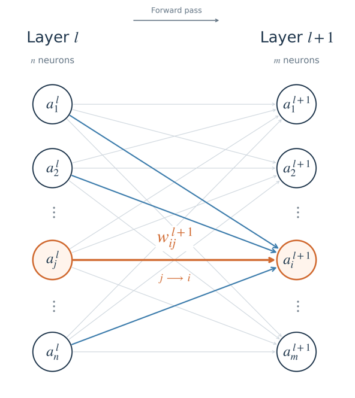
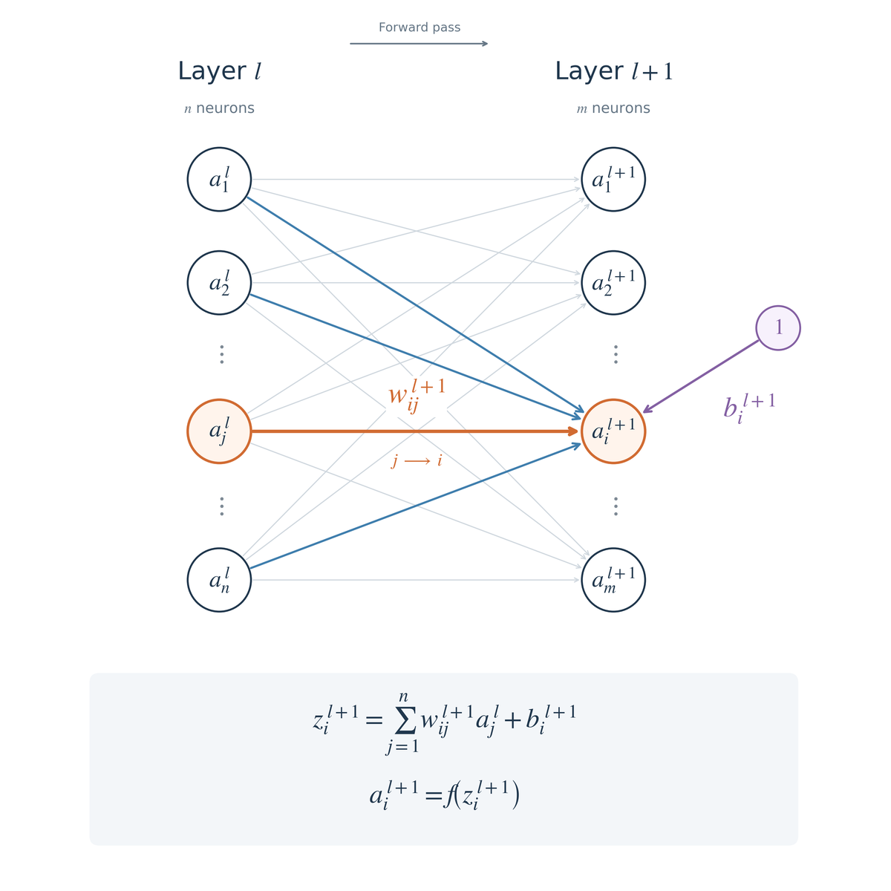
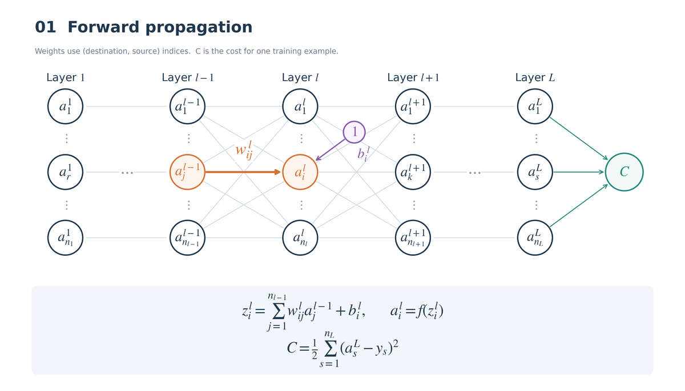
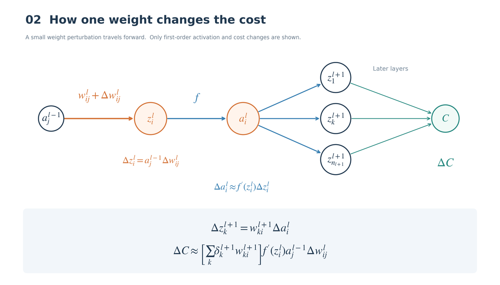
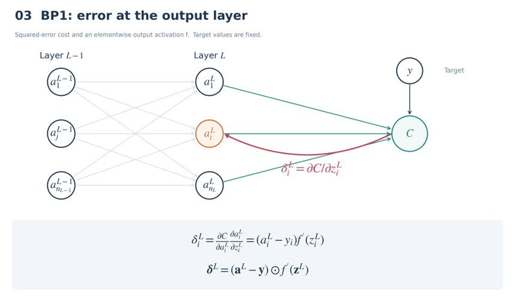
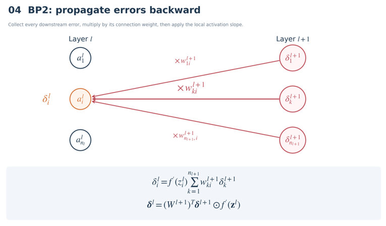
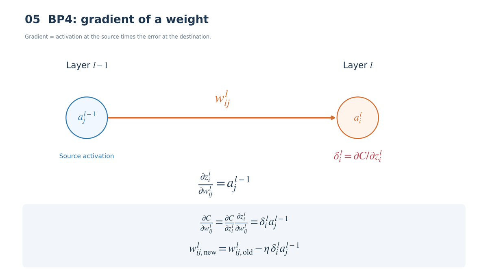
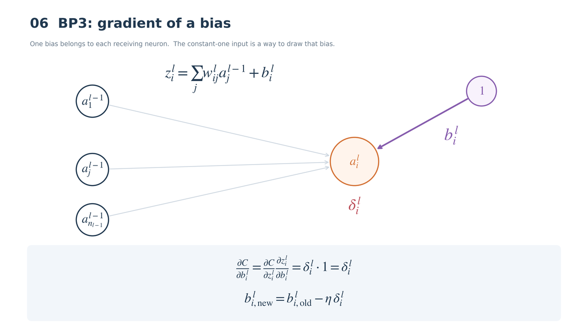

Hi! In this post, I will take a deeper look at backpropagation, which I introduced in my earlier post on artificial neural networks (ANNs). If you are not yet familiar with ANNs, please read the [ANN post](https://blog.naver.com/kkul20235/224439468218) first.

If you are unfamiliar with the chain rule, please read the [chain rule section](https://oasisforhaanee.github.io/partial-derivatives-and-gradient/#chain-rule) first.

## How an ANN works

Let's revisit how an ANN works, starting with the computation between two layers. The diagram below shows layer $l$ and layer $l+1$.

Each dot represents a neuron, and each line connecting two dots represents a weight. Suppose layer $l$ has $n$ neurons and layer $l+1$ has $m$ neurons. We denote the input value at neuron $j$ in layer $l$ as follows:

$$
a_j^l
$$

The weight assigned to the connection between $a_j^l$ and $a_i^{l+1}$ is $w_{ij}^{l+1}$. Pay close attention to the order of the indices $ij$ and to the superscript $l+1$, rather than $l$.

$$
a_j^l<--->a_i^{l+1}
$$

$$
\ \ \ \ \ \ \ \ \ \ w_{ij}^{l+1}
$$

Each output $a_i^{l+1}$ also has an associated bias, $b_i^{l+1}$. Given the inputs $a_j^l$ in layer $l$, the output of layer $l+1$ satisfies the following relation:

$$
a_i^{l+1}=f\left(\sum _{\ j=1}^{n\ }\left(a_j^l\ \cdot \ w_{ij}^{l+1}\right)+b_i^{l+1}\ \right)
$$

Here, $f$ is the activation function: it transforms the weighted sum to determine the neuron's output. The widely used sigmoid function is one example; it restricts the output to a value between 0 and 1.

In this way, the values of the neurons are passed to the next layer, and the process continues from the initial input all the way to the end.

Let's now look at how an ANN with this mechanism operates from beginning to end. The initial input is a column vector with entries $a_1^1$ through $a_{n_1}^1$. The values propagate through the network using the given weights (initially random) and the layer-to-layer computation above. This is called **forward propagation**.

The outputs upon reaching the last layer are the final results. In the diagram above, these are $a_1^L$ through $a_{n_L}^L$ in layer $L$. We compare them with the correct answers, represented by a column vector with entries $y_1^L$ through $y_{n_L}^L$.

The **cost function** measures how far the final output is from the correct answer. It often takes the following form (I plan to discuss ANNs with other cost functions later):

$$
C=\frac{1}{2}\sum _{s=1}^{n_L}(a_s^L-y_s)^2
$$

A larger $C$ means a larger discrepancy from the correct answer. Our next task is to modify the weights to reduce $C$. To do that, we need to know how much $C$ changes when we change a weight $w_{ij}^l$. This is expressed by the following derivative:

$$
\frac{\partial C}{\partial w_{ij}^l}
$$

This is easier to understand if you know the concept of a [gradient](https://oasisforhaanee.github.io/partial-derivatives-and-gradient/). A small change in $w$ changes $C$, and the gradient points in the direction of the fastest increase. But our goal is to reduce $C$. Simply putting a minus sign in front gives the direction of the fastest decrease. We use this principle to update the weights.

The weight-update rule is:

$$
w_{ij\ new}^l=w_{ij\ old}^l-\ \eta \frac{\partial C}{\partial w_{ij}^l}
$$

Here, eta ($\eta$) is the **learning rate**, a constant that controls the size of the weight update. The bias $b_i^l$ can be updated in the same way:

$$
b_{i\ \ new}^l=b_{i\ \ old}^l-η\frac{\partial C}{\partial b_i^l}
$$

## What changes when a weight changes during forward propagation?

The diagram above illustrates what happens when the weight $w_{ij}^l$ changes slightly. The values in earlier layers do not change at all, while the associated value $z_i^l$ changes. Since $z_i^l$ contains the weighted sum of $a_j^{l-1}w_{ij}^l$, its change is:

$$
\Delta z_i^l=a_j^{l-1}\Delta w_{ij}^l
$$

When $z_i^l$ changes, applying the activation function also changes $a_i^l$. Approximately,

$$
\Delta a_i^l\approx f'(z_i^l)\Delta z_i^l
$$

Once $a_i^l$ changes, every $z$ value in the next layer connected to that neuron changes as well:

$$
\Delta z_k^{l+1}=w_{ki}^{l+1}\Delta a_i^l
$$

$$
k=1,\ldots,n_{l+1}\quad\text{(all neurons in layer }l+1\text{)}
$$

We changed just one weight, $w_{ij}^l$, yet after passing through one more layer, the values of all the neurons are affected. As these changes continue through the network, the final cost function changes too. What we need to calculate is that change in the cost, because we use the following rule to update the weight:

$$
w_{ij\ new}^l=w_{ij\ old}^l-\ \eta \frac{\partial C}{\partial w_{ij}^l}
$$

Let's now use backpropagation to calculate this quantity.

## Backpropagation process 1

Instead of changing $w$ and calculating forward, we will work backward from the cost function. This is **backpropagation**.

First, let's look at the cost function:

$$
C=\frac{1}{2}\sum _{s=1}^{n_L}(a_s^L-y_s)^2
$$

We now define a new quantity, denoted by delta:

$$
\delta _i^L=\frac{\partial C}{\partial z_i^L}
$$

This is simply the partial derivative of $C$ with respect to $z$: how $C$ changes when $z$ changes. In the last layer, the chain rule gives:

$$
\delta _i^L=\frac{\partial C}{\partial a_i^L}\frac{\partial a_i^L}{\partial z_i^L}=(a_i^L-y_i)f'(z_i^L)
$$

Both factors in the chain rule are easy to calculate once we know the relationships involved. We have now defined a delta value for every neuron in the final layer. The same equation can also be written in matrix form:

$$
\begin{bmatrix}\delta _1^L\\\delta _2^L\\\vdots \\\delta _{n_L}^L\end{bmatrix}=\begin{bmatrix}(a_1^L-y_1)f'(z_1^L)\\(a_2^L-y_2)f'(z_2^L)\\\vdots \\(a_{n_L}^L-y_{n_L})f'(z_{n_L}^L)\end{bmatrix}
$$

## Backpropagation process 2

As illustrated, adding the contributions from the deltas of the connected neurons in the following layer gives the delta for the preceding neuron.

Next, we need to work out how to pass these delta values back through the layers. This is easy to understand if we recall forward propagation.

When propagating forward from layer $l$ to layer $l+1$, the value of one neuron in the earlier layer affected all the neurons in the following layer. The same idea applies here: summing the contributions associated with $\partial C/\partial z_k^{l+1}$ that arise from the earlier neuron lets us calculate that neuron's delta. We can derive this using the chain rule:

$$
\delta _i^l=\frac{\partial C}{\partial z_i^l}=\left(\sum _{k=1}^{n_{l+1}}\frac{\partial C}{\partial z_k^{l+1}}\frac{\partial z_k^{l+1}}{\partial a_i^l}\right)\frac{\partial a_i^l}{\partial z_i^l}
$$

The summation appears because we must include the contributions of all the $\delta_k^{l+1}$ values, from $k=1$ to $n_{l+1}$, when calculating $\delta_i^l$. This is the multivariable chain rule; please refer to the [chain rule explanation](https://oasisforhaanee.github.io/partial-derivatives-and-gradient/#chain-rule) as well.

Substituting the relationships we already know gives:

$$
\delta _i^l=\sum _{k=1}^{n_{l+1}}\delta _k^{l+1}w_{ki}^{l+1}f'(z_i^l)=f'(z_i^l)\sum _{k=1}^{n_{l+1}}w_{ki}^{l+1}\delta _k^{l+1}
$$

In other words, the delta values calculated in the later layer allow us to derive the delta values in the earlier layer. Repeating this lets us calculate the delta for every neuron in every layer.

## Backpropagation process 4

I will cover backpropagation process 3 immediately afterward.

As we calculate the delta values in sequence, we eventually reach the weight $w_{ij}^l$ whose change we were considering. Let's look at layer $l$, the layer on the receiving end of this weight. From BP2, we already know the delta $\delta_i^l$ of neuron $i$ in that layer.

Now consider what changes when $w$ changes. A change in $w_{ij}^l$ first changes $z_i^l$. Its effects on subsequent neurons and on the cost are already accounted for in $\delta_i^l$, so we only need to apply the chain rule through $z_i^l$.

Rewriting the derivative of $C$ with respect to $w$ using the chain rule gives:

$$
\frac{\partial C}{\partial w_{ij}^l}=\frac{\partial C}{\partial z_i^l}\frac{\partial z_i^l}{\partial w_{ij}^l}=\delta _i^la_j^{l-1}
$$

We're almost done! Substitute the quantity we have just calculated into the weight-update rule:

$$
w_{ij\ new}^l=w_{ij\ old}^l-\ \eta \delta _i^la_j^{l-1}
$$

This is how backpropagation updates the weights.

## Backpropagation process 3

For the sake of the flow, I explained BP4 first, but BP3 is important too.

The biases must also be updated. Like the weight in BP4, $b_i^l$ directly affects only $z_i^l$. Applying the chain rule therefore gives the following bias update:

$$
\frac{\partial C}{\partial b_i^l}=\frac{\partial C}{\partial z_i^l}\frac{\partial z_i^l}{\partial b_i^l}=\delta _i^l\cdot 1=\delta _i^l
$$

$$
b_{i,\text{new}}^l=b_{i,\text{old}}^l-\eta \delta _i^l
$$

We have now explored the principles of backpropagation in four processes. To summarize: we update a weight in the direction that decreases the cost function most rapidly. To calculate the required derivative, we work backward from the cost function using backpropagation. Along the way, we define $\delta_i^l$ for each neuron. When we reach the weight in question, we use the relationships among delta, $w$, $b$, and $C$ to update $w$ and $b$ in the direction that reduces the cost $C$.

In the next post, I will take a closer look at the activation function $f$.

That's all for this post. Thank you for reading this long explanation!

Image source: Generated by ChatGPT.

*This post reflects my own understanding, so there may be errors. Questions are always welcome, so feel free to ask.*
