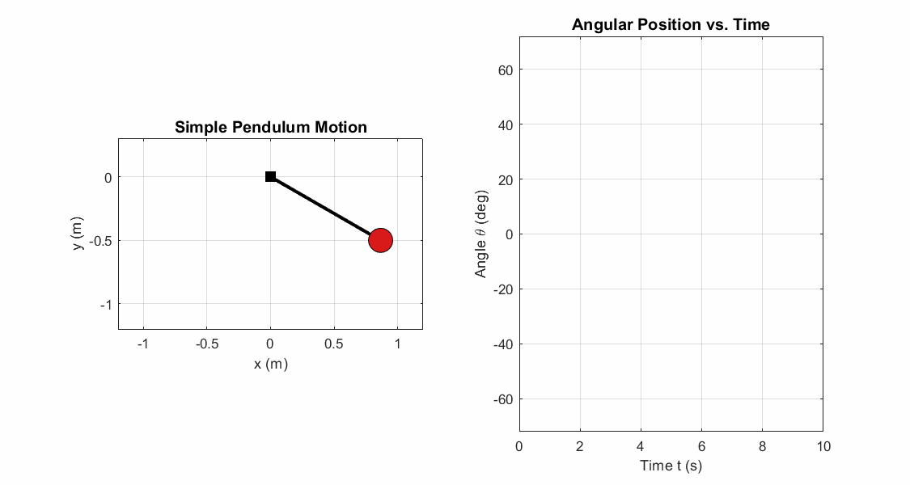
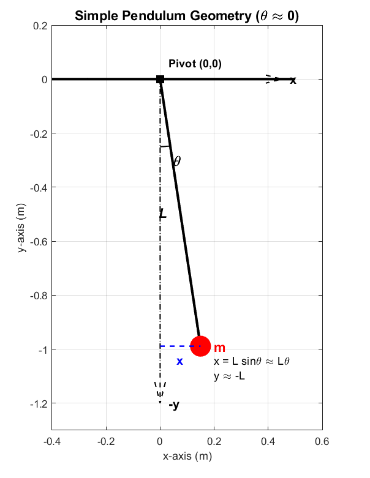
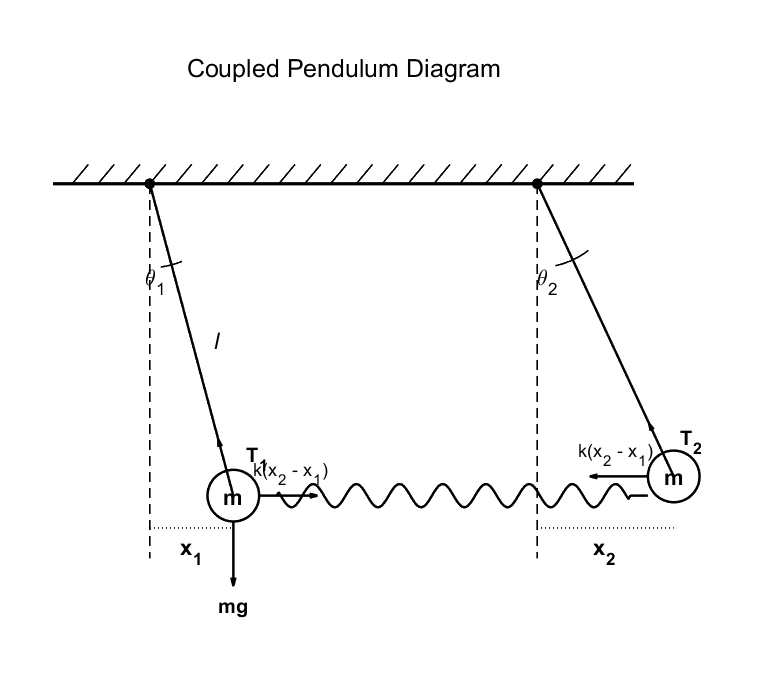
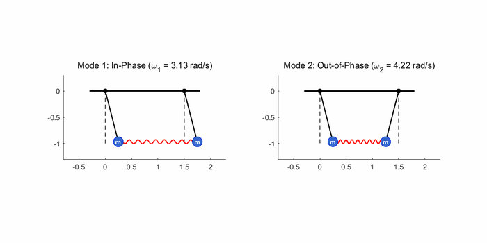
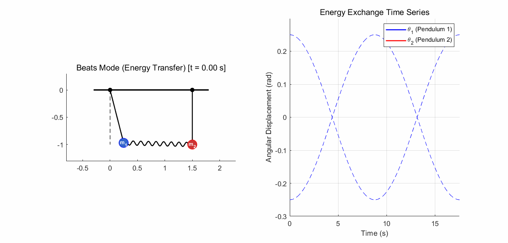
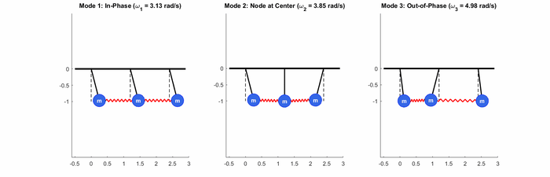

Hi! The weather has become much colder. The room where I am writing is so cold that I am shivering as I type. Dress warmly and take care not to catch a cold!

This post explores **eigenmodes**, also called normal modes. Understanding them first should make the upcoming discussion of phonons in solid-state physics a little easier. Let's begin.

## Simple pendulum motion

An ordinary simple pendulum moves as shown below.

The motion of a simple pendulum.

What forces act on this pendulum? Only the string tension and gravity. Writing the equations of motion for those forces lets us describe the pendulum's motion. For small oscillations, we obtain the following.

$$
m\ddot{x}=-T\sin\theta\simeq-mg\frac{x}{L}
$$

$$
m\ddot{y}=T\cos\theta-mg\approx0
$$

The small-angle approximation: sin(theta) is approximately theta near zero.

These equations use the **small-angle approximation**, $\theta\approx0$, for which $\sin\theta\approx\theta$. Solving the differential equation gives the pendulum's motion as follows.

$$
\ddot{x}+\frac{g}{L}x=0
$$

$$
x(t)=A\cos (\omega _0t+\phi )\ \ \left(\omega _0=\sqrt{\frac{g}{L}}\right)
$$

The point is this: once we know the forces acting on the pendulum, we can express them through its acceleration—the second derivative of position—and solve a differential equation for its motion.

## Two pendulums coupled by a spring

What happens if two pendulums are connected by a spring? Each pendulum now experiences not only tension and gravity, but also the spring's restoring force. Applying the small-angle approximation again gives the following equations of motion.

$$
m\ddot{x}_1=-\frac{mg}{l}x_1+k(x_2-x_1)
$$

$$
m\ddot{x}_2=-\frac{mg}{l}x_2-k(x_2-x_1)
$$

Two pendulums coupled by a spring.

Divide by $m$ and move all terms to one side:

$$
\ddot{x}_1+\left(\frac{g}{l}+\frac{k}{m}\right)x_1-\frac{k}{m}x_2=0
$$

$$
\ddot{x}_2+\left(\frac{g}{l}+\frac{k}{m}\right)x_2-\frac{k}{m}x_1=0
$$

In matrix form, this is

$$
\begin{bmatrix}\ddot{x}_1\\\ddot{x}_2\end{bmatrix}+\begin{bmatrix}\frac{g}{l}+\frac{k}{m}&-\frac{k}{m}\\-\frac{k}{m}&\frac{g}{l}+\frac{k}{m}\end{bmatrix}\begin{bmatrix}x_1\\x_2\end{bmatrix}=\begin{bmatrix}0\\0\end{bmatrix}
$$

Now suppose $x_1$ and $x_2$ are time-dependent functions with the same angular frequency $\omega$. In an eigenmode, the entire system undergoes simple harmonic motion at one common frequency. We make this assumption to find solutions of that particular form. The second derivatives can then be written as follows. The physical displacement is the real part of the complex expression.

$$
\begin{bmatrix}x_1(t)\\x_2(t)\end{bmatrix}=\begin{bmatrix}v_1\\v_2\end{bmatrix}e^{i\omega t}=\begin{bmatrix}v_1e^{i\omega t}\\v_2e^{i\omega t}\end{bmatrix}
$$

$$
\begin{bmatrix}\ddot{x}_1\\\ddot{x}_2\end{bmatrix}=-w^2\begin{bmatrix}x_1\\x_2\end{bmatrix}
$$

Substituting into the matrix equation and requiring a nonzero displacement gives the eigenvalue condition and the two normal-mode frequencies:

$$
\begin{bmatrix}\left(\frac{g}{l}+\frac{k}{m}\right)-\omega ^2&-\frac{k}{m}\\-\frac{k}{m}&\left(\frac{g}{l}+\frac{k}{m}\right)-\omega ^2\end{bmatrix}\begin{bmatrix}x_1\\x_2\end{bmatrix}=\begin{bmatrix}0\\0\end{bmatrix}
$$

$$
\begin{vmatrix}\left(\frac{g}{l}+\frac{k}{m}\right)-w^2&-\frac{k}{m}\\-\frac{k}{m}&\left(\frac{g}{l}+\frac{k}{m}\right)-w^2\end{vmatrix}=0
$$

$$
\omega _1=\sqrt{\frac{g}{l}}\ \ \ \ \omega _2=\sqrt{\frac{g}{l}+\frac{2k}{m}}
$$

## What do the eigenvalues mean?

What do these results tell us? The motions at $\omega_1$ and $\omega_2$ are shown below. More precisely, the eigenvalues of the dynamical matrix are $\omega_1^2$ and $\omega_2^2$; their positive square roots are the angular frequencies.

The normal mode at omega_1 (left) and the normal mode at omega_2 (right).

Any motion of this linear two-pendulum system can be expressed as a linear combination of these two modes, with suitable amplitudes and phases.

A superposition with equal mode weights, 1/sqrt(2), and a phase difference of pi. Energy is exchanged through the spring.

The modes at $\omega_1$ and $\omega_2$ therefore act as a basis for the system's motion. The analogy is to the [stationary-state](/stationary-state/) basis obtained by solving the [Schrödinger equation](/schrodinger-equation/). In this classical system, each mode has a definite frequency; its energy also depends on its amplitude, rather than being fixed by the frequency alone.

Within a single eigenmode, each pendulum oscillates with a constant amplitude. A superposition can instead produce the changing amplitudes shown in the example above. That motion is harder to interpret directly, but finding the eigenmodes breaks it into much simpler pieces. This reminds me of the [Fourier transform](/fourier-transform/).

The [eigenvectors](/eigenvalue-and-eigenvector/) of these two modes are also mutually orthogonal.

## How interaction changes the eigenbasis

We first looked at a pendulum without a coupling spring. If there were two such uncoupled pendulums, their motions would not influence one another; the independent pendulum coordinates would provide a basis for the system.

Connecting the pendulums with a spring couples their motions, so they begin to affect each other.

In other words, introducing an interaction changes the useful eigenbasis of the system. The new eigenvectors are the ones obtained from the [matrix](/matrix/) equation, and we use them to describe the motion of the coupled system as a whole.

## How many eigenmodes are there?

A system with two pendulums, each with one oscillating coordinate, has two eigenmodes; a system with three has three. Just as a two-dimensional vector space requires two basis vectors and a three-dimensional one requires three, adding an interaction changes the modes but does not change the number of independent coordinates.

A system of three pendulums has three normal modes.

By the same reasoning, a system of $N$ pendulums with one degree of freedom each has $N$ eigenmodes.

That is the basic idea of eigenmodes. In the MIT lecture below, Walter Lewin works through the equations and demonstrates the phenomenon experimentally. It is a wonderful lecture, and I recommend watching it when you have time.

[8.03 — Lecture 5: Coupled Oscillators, Resonance Frequencies, Superposition of Modes](https://www.youtube.com/watch?v=Ye92jN6FrlU)

<iframe width="560" height="315" src="https://www.youtube.com/embed/Ye92jN6FrlU" title="MIT 8.03 Lecture 5: Coupled Oscillators" frameborder="0" allow="accelerometer; autoplay; clipboard-write; encrypted-media; gyroscope; picture-in-picture" allowfullscreen></iframe>

That is all for this post. Thank you for reading!

> **Notation note:** The pendulum equations use the small-angle approximation. The dynamical-matrix eigenvalues are squared angular frequencies; unlike a quantum energy eigenstate, a classical normal mode does not have a unique energy independent of amplitude.

## Related reading

- [The Einstein Model for the Heat Capacity of a Solid](/einstein-model-heat-capacity/)
- [Phonons (1): Lattice Vibration](/phonons-1-lattice-vibration/)

---

*This post reflects my own understanding, so there may be errors. Questions are always welcome, so feel free to ask.*
