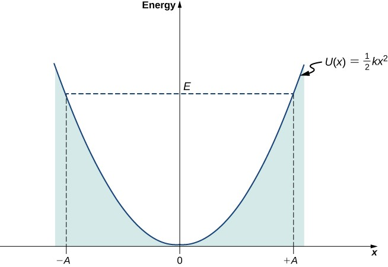
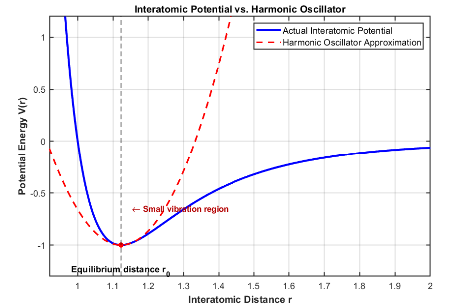
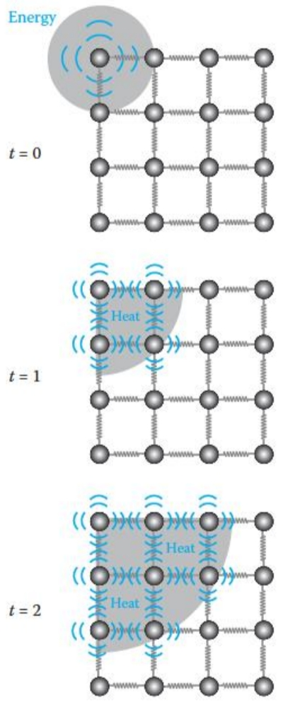
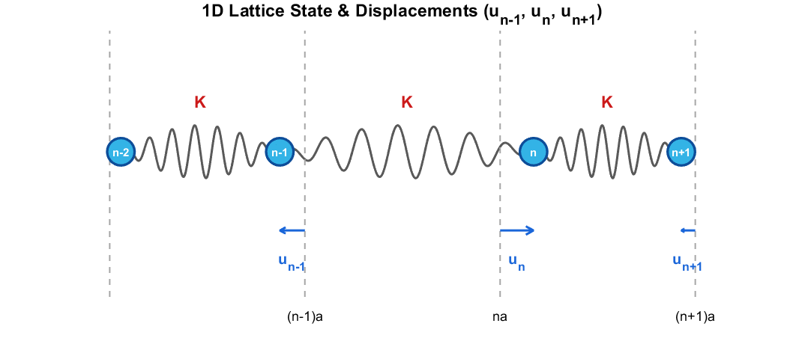
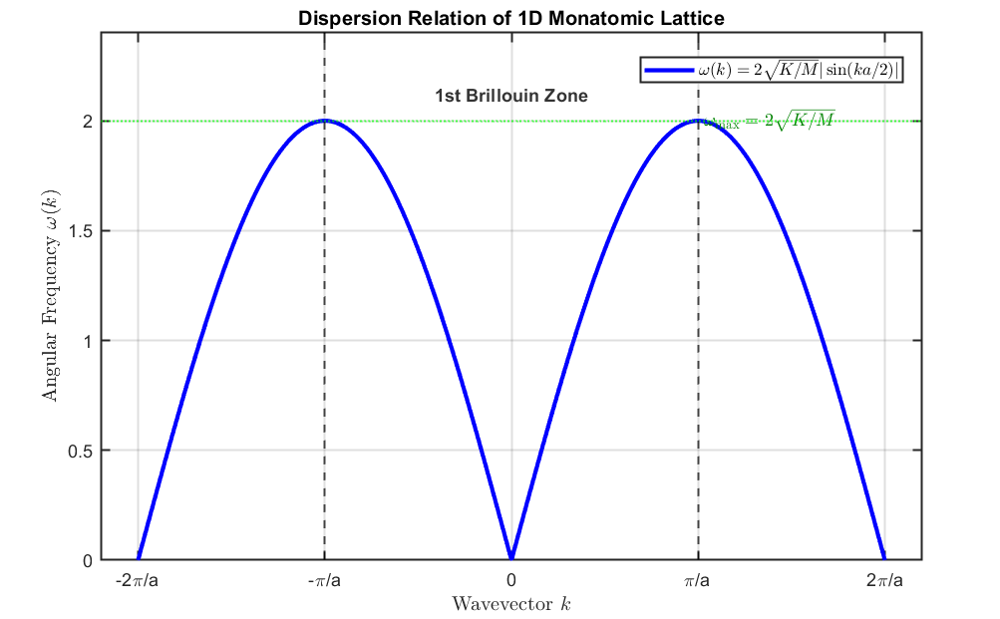
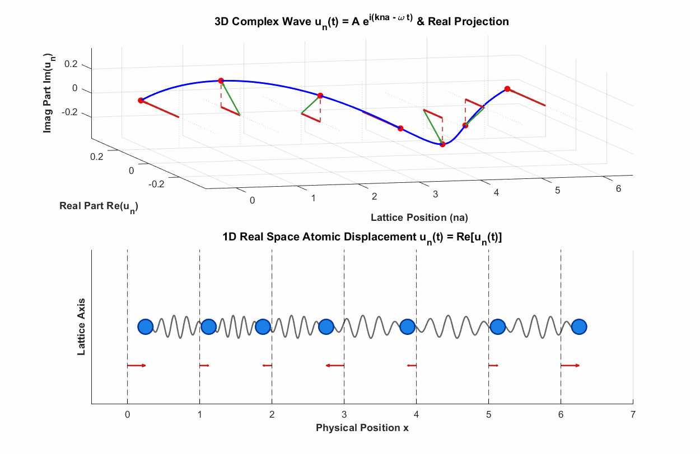
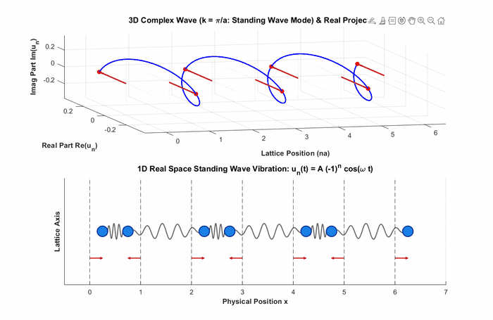
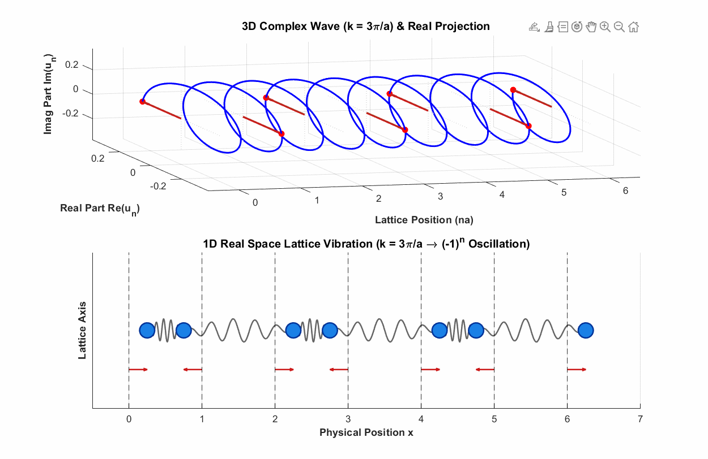
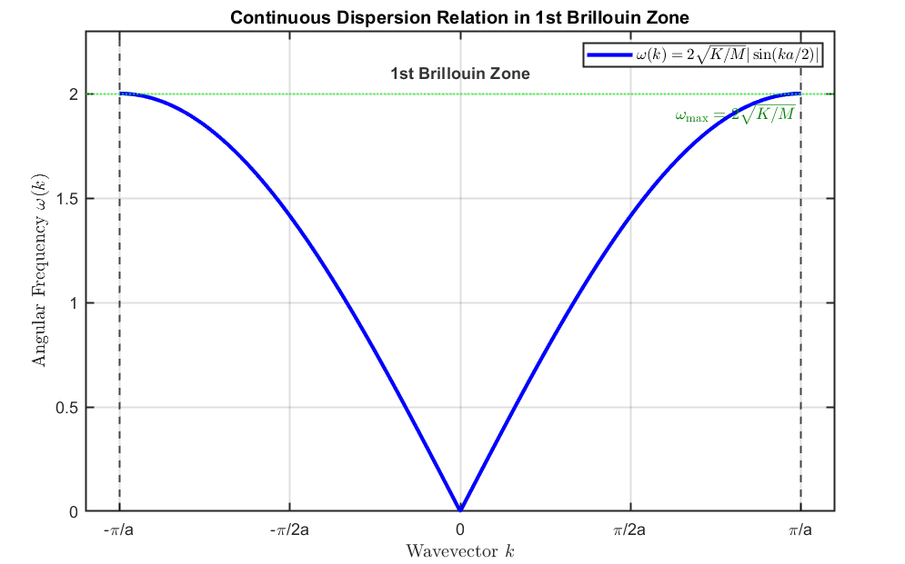
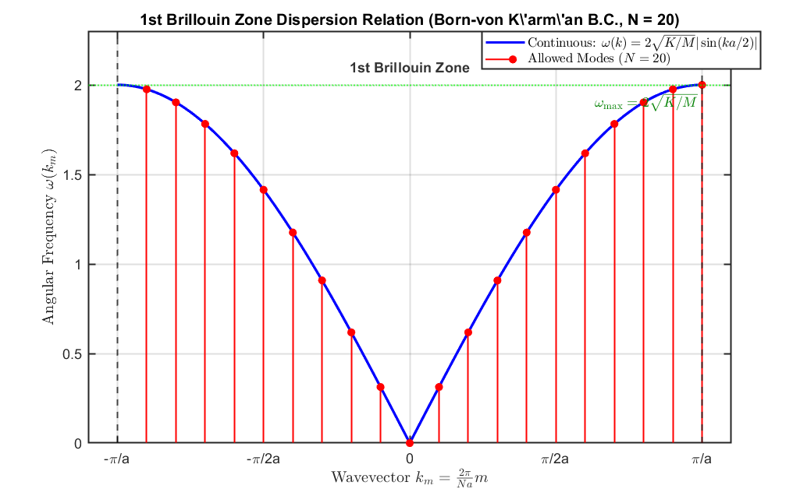

Hi! This post begins a discussion of phonons. If eigenmodes are unfamiliar, please read [Eigenmodes](/eigenmodes/) first.

For the connection between atomic bonds and harmonic oscillators, and the quantization of harmonic-oscillator energy, please read [The Einstein Model for the Heat Capacity of a Solid](/einstein-model-heat-capacity/).

Let's begin.

Electrons are among the most important subjects in solid-state physics, closely connected with electrical and thermal conductivity. But a model that considers only electrons does not account for the full observed thermal conductivity of a solid. It leaves out the contribution of **phonons**.

A phonon is an important **quasiparticle** used to describe heat transport in solids. Why a quasiparticle rather than an ordinary particle? It is not a separate fundamental constituent of the material: it describes a collective excitation of the lattice. Treating that excitation in particle-like terms makes the physics much easier to describe.

Before discussing phonons in detail, let us look at the vibrations they arise from.

## Lattice vibration

How does heat travel through a solid? Electrons can carry energy in states described by Bloch waves, but energy is also transmitted through atomic vibrations—**lattice vibrations**.

Atoms in a crystal are bound near their equilibrium lattice positions. Unlike mobile electrons influenced by the crystal's periodic potential, these atoms remain localized around those positions, although they can vibrate. Near equilibrium, the potential energy can be approximated by a harmonic-oscillator potential, and the atoms undergo approximately harmonic motion.

The parabolic potential-energy curve of a harmonic oscillator.

The interatomic potential (blue) and harmonic approximation (red dashed).

We can picture the interatomic restoring forces as springs connecting neighboring atoms, as in the figure below. Vibrations of this coupled system transmit energy.

Atomic vibrations and energy transmission through the lattice over time.

How does a system of connected springs behave?

## One-dimensional lattice vibration

Consider a one-dimensional lattice with a spring of force constant $K$ between each neighboring pair of atoms. The model looks like this:

A one-dimensional chain of atoms connected by springs of force constant K.

To describe the atoms' motion, we must write the equations of motion from the forces acting on them. Let the equilibrium position of atom $n$ be $na$, and let $u_n$ be its displacement from that position. Atom $n$ experiences a restoring force from its neighbor at $n+1$ and another from its neighbor at $n-1$. These forces are

$$
F_{\text{right}}=K(u_{n+1}-u_n)
$$

$$
F_{\text{left}}=-K(u_n-u_{n-1})=K(u_{n-1}-u_n)
$$

$$
F_n=F_{\text{right}}+F_{\text{left}}=K(u_{n+1}+u_{n-1}-2u_n)
$$

The net force $F_n$ equals the atomic mass times the acceleration, which is the second time derivative of $u_n$:

$$
M\frac{d^2u_n}{dt^2}=K(u_{n+1}+u_{n-1}-2u_n)
$$

We seek a traveling normal-mode solution of this differential equation:

$$
u_n(t)=Ae^{i(kna-\omega t)}
$$

$$
\frac{d^2u_n}{dt^2}=(-i\omega)^2Ae^{i(kna-\omega t)}=-\omega^2u_n(t)
$$

$$
-M\omega^2u_n(t)=K\left(Ae^{i(k(n+1)a-\omega t)}+Ae^{i(k(n-1)a-\omega t)}-2Ae^{i(kna-\omega t)}\right)=Ku_n(t)\left(e^{ika}+e^{-ika}-2\right)
$$

Using $e^{ika}+e^{-ika}=2\cos(ka)$ gives

$$
-M\omega ^2=K\left(2\cos (ka)-2\right)=-2K\left(1-\cos (ka)\right)
$$

$$
M\omega ^2=2K\cdot 2\sin ^2\left(\frac{ka}{2}\right)=4K\sin ^2\left(\frac{ka}{2}\right)
$$

$$
\omega ^2=\frac{4K}{M}\sin ^2\left(\frac{ka}{2}\right)
$$

$$
\omega (k)=2\sqrt{\frac{K}{M}}\left|\sin \left(\frac{ka}{2}\right)\right|
$$

This is the **dispersion relation** between angular frequency $\omega$ and wavevector $k$.

The dispersion relation between angular frequency and wavevector.

## What does the dispersion relation mean?

Let's examine the graph more closely. We found the solution by assuming the displacement had the following form:

$$
u_n(t)=Ae^{i(kna-\omega t)}
$$

Here $k$ controls the variation with position $x$, whereas $\omega$ controls the variation with time $t$.

Why does choosing $k$ determine $\omega$? In the equation of motion, the forces depend on the relative displacements of neighboring atoms. A mode pattern that produces greater spring deformation produces a larger restoring force per displacement and therefore a higher frequency. A pattern that deforms the springs less has a lower frequency. This is the same reason the two coupled-pendulum modes in Eigenmodes have different frequencies. The interaction fixes the relationship between $k$ and $\omega$.

The function $u_n(t)$ describes the normal modes labeled by $k$. For an infinite chain, $k$ can range continuously—for example, through $0.1$, $0.100000\ldots$, and neighboring values. We will impose a finite-system boundary condition later.

Representing these displacements in the complex plane gives the following picture.

The lattice normal mode at k = pi/(3a).

This example is the eigenmode with $k=\pi/(3a)$. When the phases at the lattice sites satisfy the expression for $u_n$, the atoms vibrate as shown. The real-axis projection of the complex rotation gives each atom's instantaneous physical displacement.

The zone-boundary lattice mode at k = pi/a.

This is the eigenmode with $k=\pi/a$. Neighboring atoms are in opposite phases, so the relative displacement between them is largest for a given amplitude. This is why $\omega$ reaches its maximum here.

## The first Brillouin zone: lattice aliasing

The dispersion graph above extends beyond the first Brillouin zone, $-\pi/a<k<\pi/a$. However, the values outside that interval do not give independent lattice-vibration patterns. Let us look at an example.

The next animation shows the mode with $k=3\pi/a$.

The lattice mode at k = 3pi/a, equivalent at atomic sites to k = pi/a.

Because $k=3\pi/a$, the phase varies much more rapidly between points in space. At the actual atomic sites, however, the displacements are exactly the same as for $k=\pi/a$. The atoms therefore obey the same equations of motion and execute the same motion. This is **lattice aliasing**.

The principle is similar to filming an airplane propeller and finding that it appears stationary at certain rotation speeds. If a camera samples 60 times per second, rotations of 60, 120, or 180 full turns per second can all appear stationary at the sampling times.

For lattice vibrations, it is therefore enough to consider one first Brillouin zone, from $-\pi/a$ to $\pi/a$, with the equivalent endpoints counted only once.

The dispersion relation restricted to the first Brillouin zone.

## Born–von Karman boundary conditions

See the earlier post on the Born–von Karman Boundary Condition.

No real solid contains infinitely many atoms. To describe a finite system, we impose a boundary condition, which makes the allowed values of $k$ discrete. For a chain of $N$ atoms, the Born–von Karman periodic boundary condition gives

$$
u_{n+N}(t)=u_n(t)
$$

$$
Ae^{i(k(n+N)a-\omega t)}=Ae^{i(kna-\omega t)}
$$

$$
e^{ikNa}=1
$$

$$
kNa=2m\pi
$$

$$
k_m=\frac{2\pi }{Na}m=\frac{2\pi }{L}m
$$

Only these discrete wavevectors are allowed. Marking them on the dispersion curve gives the following graph.

The discrete dispersion relation for N = 20 atoms.

Each discrete point corresponds to one eigenmode. A one-dimensional system of $N$ atoms has $N$ independent eigenmodes, and the $N$ allowed wavevectors in one first Brillouin zone label those modes.

So far, we have examined one-dimensional lattice vibration and the meaning of the dispersion relation it produces. In the next post, I will discuss what a phonon means and how to describe it mathematically. There is quite a lot to cover, so this discussion may take three or four posts.

That is all for now. Thank you for reading!

---

*This post reflects my own understanding, so there may be errors. Questions are always welcome, so feel free to ask.*
