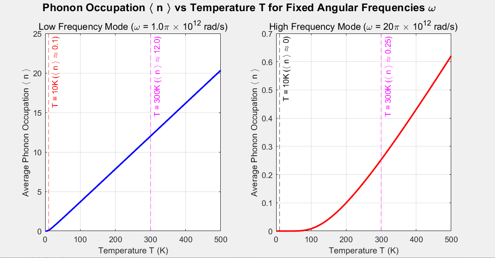
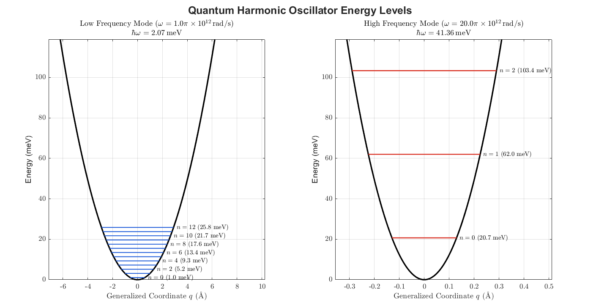

Continuing from the previous post, let's explore what phonons mean and take a quantitative look at them.

If you have not read the previous post, or if the Boltzmann and Bose–Einstein distributions are unfamiliar, please read these posts first:

- [Phonons (1): Lattice Vibration](/phonons-1-lattice-vibration/)
- [Bosons, Fermions, and Their Distributions](/bosons-and-fermions/)

## Mean energy of a harmonic oscillator

When atoms vibrate, the energy of an individual eigenmode can vary with the amplitude of the vibration.

The vibrational energy of a harmonic oscillator is quantized as $(n+1/2)\hbar\omega$, where $n$ is a nonnegative integer.

The probability of having each energy $(n+1/2)\hbar\omega$ follows the Boltzmann distribution: the higher the energy, the lower its occupation probability. If we call the probability of occupying the energy $(n+1/2)\hbar\omega$ $P_n$, then the mean energy of one eigenmode is the sum of each energy multiplied by its occupation probability—that is, the sum of $(n+1/2)\hbar\omega P_n$.

Written mathematically:

$$
E_n=\left(n+\frac{1}{2}\right)\hbar \omega
$$

$$
P_n=\frac{e^{-\frac{\left(n+1/2\right)\hbar \omega }{k_BT}}}{\sum _{m=0}^{\infty }e^{-\frac{\left(m+1/2\right)\hbar \omega }{k_BT}}}=\frac{e^{-\frac{n\hbar \omega }{k_BT}}}{\sum _{m=0}^{\infty }e^{-\frac{m\hbar \omega }{k_BT}}}=\left(1-e^{-\frac{\hbar \omega }{k_BT}}\right)e^{-\frac{n\hbar \omega }{k_BT}}
$$

$$
\left\langle E\right\rangle=\sum _{n=0}^{\infty }E_n\cdot P_n
$$

$$
\left\langle E\right\rangle =\sum _{n=0}^{\infty }\left(n+\frac{1}{2}\right)\hbar \omega \cdot \left(1-e^{-\frac{\hbar \omega }{k_BT}}\right)e^{-\frac{n\hbar \omega }{k_BT}}
$$

Simplifying the infinite geometric series gives

$$
\left\langle E\right\rangle =\left(\frac{1}{e^{\frac{\hbar \omega }{k_BT}}-1}+\frac{1}{2}\right)\hbar \omega
$$

This is the mean energy of **one eigenmode** with angular frequency $\omega$.

Using the Bose–Einstein distribution, we can write it as

$$
\left\langle E\right\rangle =\left(\left\langle n\right\rangle +\frac{1}{2}\right)\hbar \omega
$$

What does this mean?

## Phonons

This is where we introduce the concept of a **phonon**. For each eigenmode, we interpret the energy level $E_n$ as a state containing $n$ phonons, each with energy $\hbar\omega$.

For example, if a harmonic oscillator has energy $3\hbar\omega/2$, it is in a state containing **one phonon**. If its energy is $9\hbar\omega/2$, it is in a state containing **four phonons**.

We can therefore express the mean energy of that eigenmode in terms of its mean phonon occupation:

$$
\left\langle E\right\rangle =\left(\sum _{n=1}^{\ \infty }nP_n\ \right)\ \hbar \omega +\frac{1}{2}\ \hbar \omega
$$

$$
=\left(\left\langle n\right\rangle +\frac{1}{2}\right)\hbar \omega
$$

Let me explain that expression again. We have chosen to view the eigenmode's energy level $E_n$ as $n$ phonons of energy $\hbar\omega$ occupying that mode. The sum of each occupation probability $P_n$ multiplied by the phonon number $n$ is thus the **mean phonon number**, $\langle n\rangle$. Multiplying this by $\hbar\omega$ and adding the zero-point energy gives the mean energy of the eigenmode.

This mean occupation $\langle n\rangle$ depends on temperature and $\omega$, according to the Bose–Einstein distribution:

$$
\left\langle n\right\rangle =\frac{1}{e^{\frac{\hbar \omega }{k_BT}}-1}
$$

For a given eigenmode, the temperature determines its mean phonon number. Another eigenmode can have a different value of $\omega$, so it can also have a different $\langle n\rangle$.

*Mean phonon occupation $\langle n\rangle$ as a function of temperature $T$. Left: an eigenmode with smaller $\omega$. Right: an eigenmode with larger $\omega$.*

In the graph above, the left panel shows an eigenmode with small $\omega$, while the right panel shows one with large $\omega$.

First, compare the mean occupations at $T=10\,\mathrm{K}$ and $T=300\,\mathrm{K}$ in the left panel. For the low-frequency mode, $\langle n\rangle\approx0.1$ at $10\,\mathrm{K}$ and $\langle n\rangle\approx12$ at $300\,\mathrm{K}$. As the temperature rises, the mean occupation increases—in other words, the typical vibrational amplitude of the harmonic oscillator becomes larger.

Now compare those same temperatures in the right panel. For the high-frequency mode, $\langle n\rangle\approx0$ at $10\,\mathrm{K}$ and $\langle n\rangle\approx0.25$ at $300\,\mathrm{K}$. The occupation still increases with temperature, but even at the same temperature, a mode with larger $\omega$ has a much smaller $\langle n\rangle$ than one with smaller $\omega$.

This happens because a larger $\omega$ also means a larger spacing between the quantized energy levels of the harmonic oscillator.

The figure below shows harmonic oscillators with the same two frequencies as above, together with their energy-level spacings $\hbar\omega$.

*Left: $\omega=\pi\times10^{12}\,\mathrm{rad/s}$. Right: $\omega=20\pi\times10^{12}\,\mathrm{rad/s}$.*

Both graphs use the same energy scale. As you can see, the levels are much more closely spaced when $\omega$ is small.

At the same temperature, a larger $\omega$ makes the gaps between the energy levels $E_n$ wider. The Boltzmann probability distribution is then weighted toward levels with smaller $n$, so the oscillator is most likely to be found in a low-$n$ energy state.

In other words, the mean phonon occupation $\langle n\rangle$ given by the Bose–Einstein distribution decreases as $\omega$ increases.

This determines how the eigenmodes vibrate and is directly related to a material's heat capacity. I will explore that connection in more detail in the next post.

That is it for this post. Thank you for reading.

---

*This post reflects my own understanding, so there may be errors. Questions are always welcome, so feel free to ask.*
