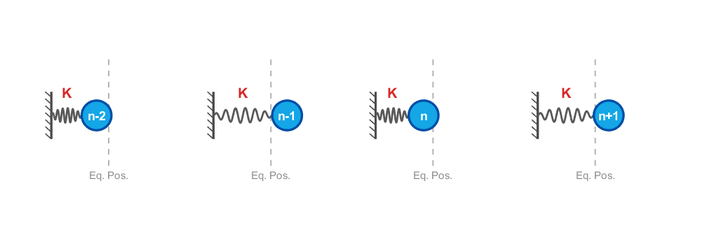
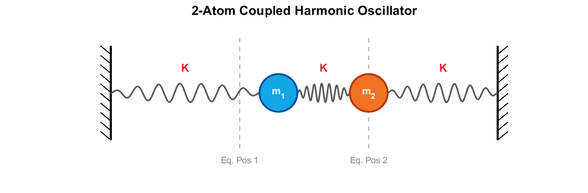
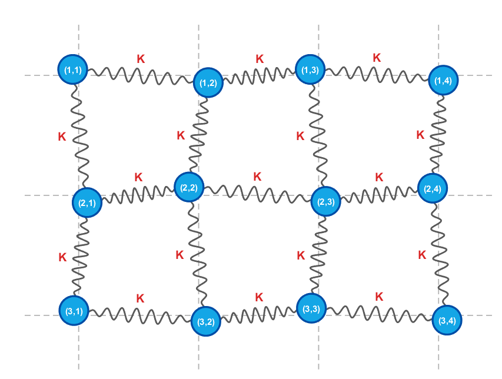
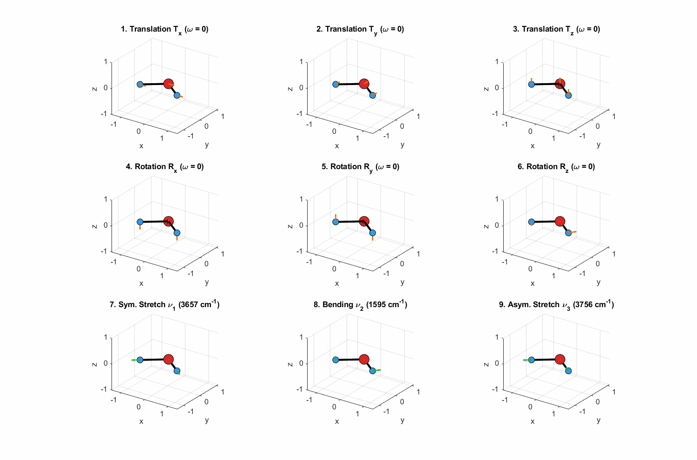
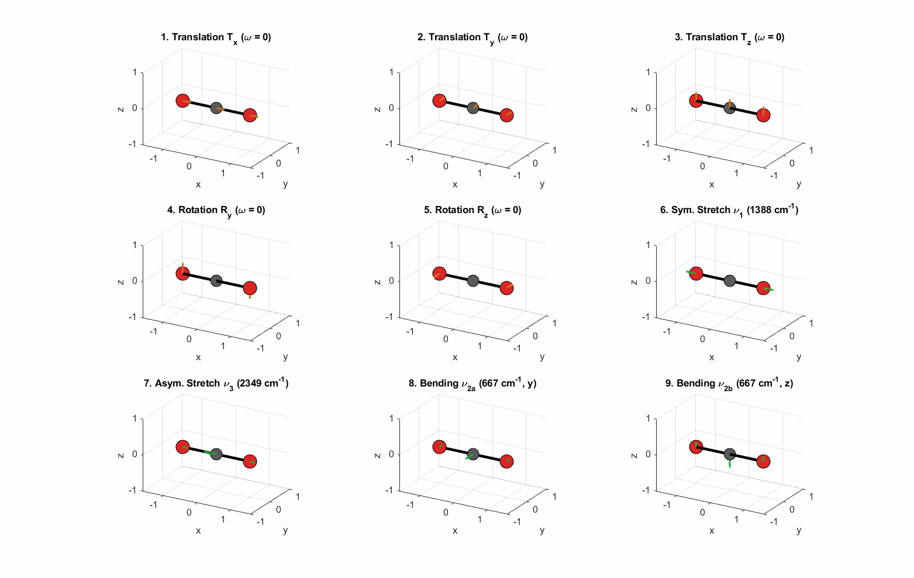

In this post, I will take a look at vibration modes. If these ideas are unfamiliar, please first read the post on eigenmodes and the section of the lattice-vibration post that explains the connection between harmonic oscillators and lattice vibrations.

- [Eigenmodes: Coupled Pendulums and Normal Modes](/eigenmodes/)
- [Phonons (1): Lattice Vibration](/phonons-1-lattice-vibration/)

## Vibration

What is vibration? Think of a harmonic oscillator. Vibration is motion caused by a restoring force acting on a displacement that changes with time.

This includes everything from the simplest spring motion to lattice vibrations inside the potential wells of a solid, as well as molecular vibrations within a molecule.

However, fully describing an arbitrary vibration in a real system with equations is, in practice, extremely difficult. For a simple spring with a single object of mass $m$ attached to it, we can describe the entire system mathematically. A solid made up of $N$ atoms is a different matter. These atoms interact and move in complicated ways, so setting up and solving every equation of motion individually is not a realistic approach.

## Eigenmodes

This is why we use the concept of an **eigenmode**, or normal mode. Eigenmodes are the mutually independent vibration patterns that make up a complicated vibration. They are much like basis vectors in linear algebra.

Remember how the Fourier transform lets us express a function as a superposition of the basis functions $e^{ikx}$? Eigenmodes work on the same principle. Any vibration can be expressed as a linear combination of eigenmodes.

There is a condition here: we must assume **harmonic motion**. I will discuss anharmonicity later. In the posts that follow, we will assume harmonic motion throughout.

Finding the eigenmodes is the same process as finding eigenvectors in linear algebra. Each oscillator has an equation of motion that includes its interactions with the others. When we write these equations as a matrix, interaction terms appear, so the matrix is not diagonal in the original basis.

The eigenvectors that describe the eigenmodes provide a new basis in which this matrix becomes diagonal.

### Equations of motion without interactions

Without interactions, every matrix element outside the diagonal is zero. That makes sense: however the neighboring atoms vibrate, they do not affect the atom in question, so only elements with indices of the form $ii$ are nonzero.

For a system of $N$ atoms that vibrate in only one dimension, with no interactions and the same angular frequency $\omega$ for each oscillator, the equations of motion have the following matrix form.

$$
m\begin{pmatrix}\ddot{x}_1\\\ddot{x}_2\\\vdots \\\ddot{x}_N\end{pmatrix}=-\begin{pmatrix}K&0&\cdots &0\\0&K&\cdots &0\\\vdots &\vdots &\ddots &\vdots \\0&0&\cdots &K\end{pmatrix}\begin{pmatrix}x_1\\x_2\\\vdots \\x_N\end{pmatrix}
$$

*Each atom vibrates independently, without being affected by the others.*

The matrix is already diagonal. The original coordinate directions themselves describe the eigenmodes, so no change of basis is needed.

### Equations of motion with interactions

As an example, consider objects of mass $m$ connected by springs.

As you can see, the motion does not follow a simple, regular pattern. Trying to analyze it directly in this form is complicated and unstructured. Let us separate it into eigenmodes, starting with the equations of motion.

$$
m\ddot{x}_1=-Kx_1-K(x_1-x_2)=-2Kx_1+Kx_2
$$

$$
m\ddot{x}_2=-Kx_2-K(x_2-x_1)=Kx_1-2Kx_2
$$

Writing these equations in matrix form gives the following.

$$
m\begin{pmatrix}\ddot{x}_1\\\ddot{x}_2\end{pmatrix}=-\begin{pmatrix}2K&-K\\-K&2K\end{pmatrix}\begin{pmatrix}x_1\\x_2\end{pmatrix}
$$

Notice the off-diagonal elements $-K$, in addition to the diagonal elements. These are the interaction terms introduced by connecting the objects with a spring. To eliminate these terms from the matrix representation, we define a new basis: the eigenvectors of this matrix. The calculation proceeds as follows.

$$
\mathbf{K}\mathbf{v}=\lambda
$$

$$
(\mathbf{K}-\lambda \mathbf{I})\mathbf{v}=0
$$

$$
\det (\mathbf{K}-\lambda \mathbf{I})=\det \begin{pmatrix}2K-\lambda &-K\\-K&2K-\lambda \end{pmatrix}=0
$$

$$
\lambda _1=K,\qquad \lambda _2=3K
$$

The eigenvectors corresponding to these eigenvalues are

$$
\mathbf{v}_1=\frac{1}{\sqrt{2}}\begin{pmatrix}1\\1\end{pmatrix}
$$

$$
\mathbf{v}_2=\frac{1}{\sqrt{2}}\begin{pmatrix}1\\-1\end{pmatrix}
$$

Changing to a basis made up of $\mathbf{v}_1$ and $\mathbf{v}_2$ lets us write the equations of motion with a diagonal matrix:

$$
\begin{pmatrix}Q_1\\Q_2\end{pmatrix}=\begin{pmatrix}\frac{x_1+x_2}{\sqrt{2}}\\\frac{x_1-x_2}{\sqrt{2}}\end{pmatrix}
$$

$$
m\begin{pmatrix}\ddot{Q}_1\\\ddot{Q}_2\end{pmatrix}=-\begin{pmatrix}K&0\\0&3K\end{pmatrix}\begin{pmatrix}Q_1\\Q_2\end{pmatrix}
$$

The matrix is now completely diagonal. These modes are mutually orthogonal, and we can call them eigenmodes. Any vibration can now be expressed as a linear combination of these eigenmodes.

The same reasoning applies not only to two atoms, but also to larger systems. Below are the equations of motion for five atoms, written in matrix form.

$$
m\begin{pmatrix}\ddot{x}_1\\\ddot{x}_2\\\ddot{x}_3\\\ddot{x}_4\\\ddot{x}_5\end{pmatrix}=-\begin{pmatrix}2K&-K&0&0&0\\-K&2K&-K&0&0\\0&-K&2K&-K&0\\0&0&-K&2K&-K\\0&0&0&-K&2K\end{pmatrix}\begin{pmatrix}x_1\\x_2\\x_3\\x_4\\x_5\end{pmatrix}
$$

Changing the basis to the eigenvectors of the matrix above transforms it as follows.

$$
\mathbf{v}_n=\frac{1}{\sqrt{3}}\begin{pmatrix}\sin \left(\frac{n\pi }{6}\right)\\\sin \left(\frac{2n\pi }{6}\right)\\\sin \left(\frac{3n\pi }{6}\right)\\\sin \left(\frac{4n\pi }{6}\right)\\\sin \left(\frac{5n\pi }{6}\right)\end{pmatrix}
$$

$$
m\begin{pmatrix}\ddot{Q}_1\\\ddot{Q}_2\\\ddot{Q}_3\\\ddot{Q}_4\\\ddot{Q}_5\end{pmatrix}=-\begin{pmatrix}(2-\sqrt{3})K&0&0&0&0\\0&K&0&0&0\\0&0&2K&0&0\\0&0&0&3K&0\\0&0&0&0&(2+\sqrt{3})K\end{pmatrix}\begin{pmatrix}Q_1\\Q_2\\Q_3\\Q_4\\Q_5\end{pmatrix}
$$

Just as in the case without interactions, the matrix is now completely diagonal. This means that the eigenmodes are completely independent: energy is not transferred from one eigenmode to another.

## Number of modes

Now let us look at how to count vibration modes. In a system of $N$ atoms, each atom contributes one coordinate to the equations of motion, giving an $N$-dimensional matrix and a total of $N$ eigenmodes. So far, however, we have considered vibration along only one axis.

With motion in just one dimension, there are exactly $N$ eigenmodes.

If motion in a second dimension is allowed, there are $2N$ eigenmodes.

For two-dimensional motion, we must consider vibrations along both the $x$- and $y$-axes. The matrix describing the equations of motion is therefore not $N$-dimensional: it has $N$ coordinates along $x$ and another $N$ along $y$, making it $2N$-dimensional.

The figure below shows oscillators arranged along the $x$- and $y$-directions.

The equations of motion for this case are shown below. These describe the interactions between the atoms' $x$ displacements and, separately, between their $y$ displacements.

$$
m\ddot{x}_{i,j}=K(x_{i+1,j}-x_{i,j})+K(x_{i-1,j}-x_{i,j})=K(x_{i+1,j}+x_{i-1,j}-2x_{i,j})
$$

$$
m\ddot{y}_{i,j}=K(y_{i,j+1}-y_{i,j})+K(y_{i,j-1}-y_{i,j})=K(y_{i,j+1}+y_{i,j-1}-2y_{i,j})
$$

$$
m\begin{pmatrix}\ddot{x}_1\\\ddot{x}_2\\\vdots \\\ddot{x}_N\\\ddot{y}_1\\\ddot{y}_2\\\vdots \\\ddot{y}_N\end{pmatrix}=-\begin{pmatrix}2K&-K&\cdots &0&0&0&\cdots &0\\-K&2K&\cdots &0&0&0&\cdots &0\\\vdots &\vdots &\ddots &\vdots &\vdots &\vdots &\ddots &\vdots \\0&0&\cdots &2K&0&0&\cdots &0\\0&0&\cdots &0&2K&-K&\cdots &0\\0&0&\cdots &0&-K&2K&\cdots &0\\\vdots &\vdots &\ddots &\vdots &\vdots &\vdots &\ddots &\vdots \\0&0&\cdots &0&0&0&\cdots &2K\end{pmatrix}\begin{pmatrix}x_1\\x_2\\\vdots \\x_N\\y_1\\y_2\\\vdots \\y_N\end{pmatrix}
$$

Here, only vibrations along the same axis interact. The interaction terms therefore appear next to the main diagonal, except at the boundary between the $x_N$ and $y_1$ coordinates. The zero elements in the $xy$ blocks tell us that there is no coupling between motion along $x$ and motion along $y$.

But another situation is possible. What if vibration along the $x$-axis also couples to vibration along the $y$-axis? Then the $xy$ blocks will contain nonzero elements as well.

$$
m\begin{pmatrix}\ddot{x}_1\\\ddot{x}_2\\\vdots \\\ddot{x}_N\\\ddot{y}_1\\\ddot{y}_2\\\vdots \\\ddot{y}_N\end{pmatrix}=-\begin{pmatrix}2K+2K'&-K&\cdots &0&0&\cdots &-\frac{1}{2}K'&\cdots &0\\-K&2K+2K'&\cdots &0&\vdots &0&\cdots &+\frac{1}{2}K'&\vdots \\\vdots &\vdots &\ddots &\vdots &-\frac{1}{2}K'&\vdots &\ddots &\vdots &\vdots \\0&0&\cdots &2K+2K'&0&+\frac{1}{2}K'&\cdots &\cdots &0\\0&\cdots &-\frac{1}{2}K'&\cdots &0&2K+2K'&-K&\cdots &0\\\vdots &0&\cdots &+\frac{1}{2}K'&\vdots &-K&2K+2K'&\cdots &0\\-\frac{1}{2}K'&\vdots &\ddots &\vdots &\vdots &\vdots &\vdots &\ddots &\vdots \\0&+\frac{1}{2}K'&\cdots &\cdots &0&0&\cdots &\cdots &2K+2K'\end{pmatrix}\begin{pmatrix}x_1\\x_2\\\vdots \\x_N\\y_1\\y_2\\\vdots \\y_N\end{pmatrix}
$$

Now nonzero entries appear not only next to the main diagonal, but also at positions with indices $x_i y_j$.

Thus, even for two-dimensional vibration, different interactions produce different matrices. Their eigenvectors are the eigenmodes that form a basis for the system. Because the matrix has dimensions $2N\times2N$, there are $2N$ eigenmodes.

The same reasoning gives $3N$ eigenmodes for three-dimensional motion.

## Molecular vibration

In my first-year general chemistry class, I learned that a nonlinear molecule has $3N-6$ vibrational modes, while a linear molecule has $3N-5$. At the time, I had absolutely no idea what that meant. Now I can see how directly it connects to what we have just discussed. But how are first-year students supposed to understand this before they have even learned linear algebra...? I really do wonder.

Anyway, why are some modes excluded?

Let us start with a nonlinear molecule. Water, the most familiar example, contains three atoms. The equations of motion for those atoms are determined by the attractive and repulsive interactions associated with their atomic orbitals. We will not calculate them here, but they give a total of $3N=9$ eigenmodes.

*The nine modes of an H2O molecule. The upper six modes are translations and rotations, rather than vibrations.*

The animation above shows the nine eigenmodes obtained by diagonalizing the matrix of the equations of motion. The top three show translation along the $x$-, $y$-, and $z$-axes. The middle three show rotation about those axes. For the translational modes, think back to the mode in which all the pendulums move in the same direction.

Any nonlinear molecule has $3N$ modes in total, including three translational and three rotational modes. That leaves $3N-6$ vibrational modes.

For a linear molecule, let us use carbon dioxide as an example. The animation below shows its modes.

*Rotation about the molecular x-axis does not produce a rotational eigenvector; an additional vibrational mode takes its place.*

There are again three translational modes. Unlike a nonlinear molecule, however, a linear molecule has only two rotational modes, about the $y$- and $z$-axes. If we try to rotate it about its molecular axis, here the $x$-axis, the atoms do not move.

When we actually find the eigenmodes, rotation about $x$ does not yield a rotational eigenvector. Instead, another mode—another eigenvector—appears. There are still $3N$ modes in total, but only three translations and two rotations. This leaves $3N-5$ vibrational modes, one more than for a nonlinear molecule.

The concept of eigenmodes is also used to calculate the specific heat of a solid. Each eigenmode has an associated energy scale, and this differs from mode to mode. It feels a little like the stationary states of the Schrödinger equation. At the same temperature, modes with a larger energy scale are less strongly excited, while those with a smaller energy scale are more strongly excited. I will explore this in detail in the post on the specific heat of solids.

That is all for this post. Thank you for reading through this long discussion!

---

*This post reflects my own understanding, so there may be errors. Questions are always welcome, so feel free to ask.*
