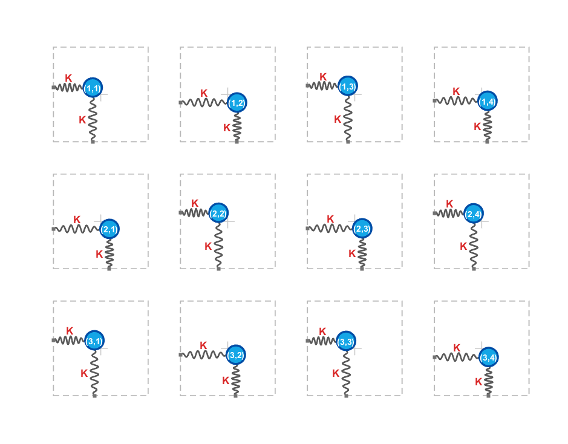
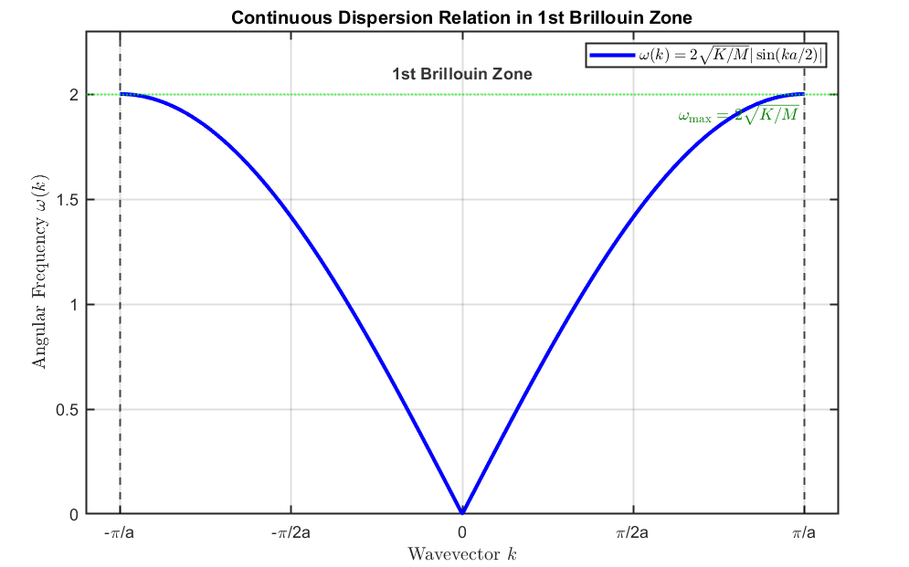

In this post, I will explore the connection between the quantized phonon energies discussed in the previous post and heat capacity. If you have not read the related posts, please read them first.

- [Phonons (1): Lattice Vibration](/phonons-1-lattice-vibration/) — the $k$–$\omega$ dispersion relation
- [Phonons (2): Phonons](/phonons-2/) — the mean energy of a harmonic oscillator
- [Vibration Modes](/vibration-modes/) — eigenmodes and the number of vibration modes
- [Density of States](/density-of-states/) — DOS

Let us begin.

## Heat capacity

The specific heat of a material is determined by how much its total energy changes with temperature. Mathematically, it is written as follows.

$$
C=\frac{1}{m}\frac{dU}{dT}
$$

Here, $m$ is the mass, $U$ is the material's total energy, and $T$ is temperature. The factor $m$ is simply the mass of the sample, rather than the part that describes its underlying thermal behavior.

We will focus on the $dU/dT$ term. This tells us how much the vibrational energy we discussed previously changes with temperature. This quantity is the **heat capacity**.

The vibrational energy is determined by the motion of the harmonic oscillators associated with the atoms in the solid.

## Heat capacity of a solid in the Einstein model

For a more detailed discussion, please read [Heat Capacity of Solids: The Einstein Model](/einstein-model-heat-capacity/).

One of the best-known models for describing the heat capacity of a solid is the **Einstein model**.

This model treats the atomic oscillators as independent, each vibrating with the characteristic angular frequency $\omega_E$. In two dimensions, it looks like the illustration below. There is no coupling between atoms: each one vibrates independently.

*The independent oscillators assumed in the Einstein model, illustrated in two dimensions.*

The mean energy of a harmonic oscillator, as defined in the previous post, is the following. See Phonons (2) for the derivation.

$$
\left\langle E\right\rangle =\left(\frac{1}{e^{\frac{\hbar \omega }{k_BT}}-1}+\frac{1}{2}\right)\hbar \omega
$$

This mean value is the average energy, at a particular temperature $T$, of a harmonic oscillator with angular frequency $\omega$.

### Number of modes

To find the total vibrational energy, we must multiply the mean energy of one harmonic oscillator by the total number of oscillators.

For a system containing $N$ atoms, the number of oscillators depends on whether the vibrations are one-, two-, or three-dimensional. Please refer to the Vibration Modes post for that discussion. In an ordinary three-dimensional solid, the atoms vibrate along all three axes, $x$, $y$, and $z$, giving $3N$ eigenmodes.

### Total energy

Each oscillator has mean energy $\langle E\rangle$, and there are $3N$ oscillators, so the total energy is $3N\langle E\rangle$. Remember that the Einstein model assumes the same angular frequency $\omega_E$ for every oscillator. In equations, this becomes

$$
U=3N\left\langle E\right\rangle =3N\left(\frac{1}{2}\hbar \omega _E+\frac{\hbar \omega _E}{e^{\hbar \omega _E/k_BT}-1}\right)
$$

Now let us calculate the $dU/dT$ term introduced above.

$$
\left(\frac{\partial U}{\partial T}\right)=3N\hbar \omega _E\frac{\partial }{\partial T}\left(\frac{1}{e^{\hbar \omega _E/k_BT}-1}\right)
$$

$$
=\frac{\partial }{\partial T}\left(\frac{1}{e^{\hbar \omega _E/k_BT}-1}\right)=-\frac{1}{\left(e^{\hbar \omega _E/k_BT}-1\right)^2}\cdot \frac{\partial }{\partial T}\left(e^{\hbar \omega _E/k_BT}\right)
$$

The temperature derivative of the exponential factor is

$$
\frac{\partial }{\partial T}\left(e^{\hbar \omega _E/k_BT}\right)=e^{\hbar \omega _E/k_BT}\cdot \left(-\frac{\hbar \omega _E}{k_BT^2}\right)
$$

Combining these expressions gives the following heat capacity.

$$
C=3Nk_B\left(\frac{\hbar \omega _E}{k_BT}\right)^2\frac{e^{\hbar \omega _E/k_BT}}{\left(e^{\hbar \omega _E/k_BT}-1\right)^2}
$$

This heat-capacity formula works well at high temperatures. When $T$ is sufficiently high, and therefore $k_BT$ is large, we can make the following approximation.

$$
\frac{\hbar \omega _E}{k_BT}\ll 1
$$

$$
e^{\hbar \omega _E/k_BT}\approx 1+\frac{\hbar \omega _E}{k_BT}\ \ \ \ \ \ \ \ \ \left(e^x\approx 1+x\right)
$$

$$
C=3Nk_B\left(\frac{\hbar \omega _E}{k_BT}\right)^2\frac{e^{\hbar \omega _E/k_BT}}{\left(e^{\hbar \omega _E/k_BT}-1\right)^2}\approx 3Nk_B\left(\frac{\hbar \omega _E}{k_BT}\right)^2\frac{1+\frac{\hbar \omega _E}{k_BT}}{\left[\left(1+\frac{\hbar \omega _E}{k_BT}\right)-1\right]^2}
$$

$$
=3Nk_B\left(1+\frac{\hbar \omega _E}{k_BT}\right)\approx 3Nk_B\quad
$$

Experiments indeed show that the heat capacity of a solid approaches $3Nk_B$ at high temperatures.

However, the Einstein model does not work well at low temperatures close to absolute zero.

Let us see why by looking at the Debye model, which improves on it.

## Debye model

Real atoms are connected to one another. If we describe their motion with equations of motion, their vibrations affect one another. We saw that these equations can be written in matrix form, with interaction terms appearing as off-diagonal elements. To handle this, we find the eigenmodes that diagonalize the matrix. These eigenmodes vibrate at a range of frequencies and are mutually orthogonal. Please refer to the Vibration Modes post for the details.

The relationship between an eigenmode's angular frequency and its wavenumber $k$ is the $k$–$\omega$ dispersion relation discussed in Phonons (1).

*The k–omega dispersion relation in the first Brillouin zone.*

Let us use this to calculate the heat capacity.

The mean energy of each eigenmode follows the formula for the mean energy of a harmonic oscillator.

$$
\left\langle E(\omega )\right\rangle =\frac{1}{2}\hbar \omega +\frac{\hbar \omega }{e^{\hbar \omega /k_BT}-1}
$$

As the dispersion relation above shows, the angular frequency $\omega$ differs from mode to mode according to $k$. Unlike the Einstein model, we must therefore add up the energies of the individual modes. There are $3N$ eigenmodes in total, so we can write

$$
U=\sum _{i=1}^{3N}\left\langle E\left(\omega _i\right)\right\rangle
$$

Using the density of states, this becomes

$$
U=\int _{\ }^{\ }g\left(\omega \right)\left\langle E\left(\omega \right)\right\rangle d\omega
$$

Rather than using the full dispersion relation above, the Debye model approximates the relationship between $\omega$ and $k$ as linear. They are then related by

$$
\omega =v_sk
$$

Now, following the derivation in the DOS post, we can use the dispersion relation between $k$ and $\omega$ to obtain the three-dimensional density of states as follows.

$$
N(k)=3\times \frac{V}{(2\pi )^3}\times \frac{4}{3}\pi k^3=\frac{Vk^3}{2\pi ^2}
$$

$$
\omega =v_sk
$$

$$
N(\omega )=\frac{V\omega ^3}{2\pi ^2v_s^3}
$$

$$
g(\omega )=\frac{dN\left(w\right)}{dw}=\frac{3V}{2\pi ^2v_s^3}\omega ^2
$$

To normalize this DOS, we use the fact that the total number of states—that is, the number of eigenmodes—is $3N$.

$$
\int _0^{\omega _D}g(\omega )\, d\omega =\frac{V\omega _D^3}{2\pi ^2v_s^3}=3N\Rightarrow \omega _D^3=\frac{6\pi ^2Nv_s^3}{V}
$$

$$
g(\omega )=\begin{cases}\frac{9N}{\omega _D^3}\omega ^2&(0\le \omega \le \omega _D)\\0&(\omega >\omega _D)\end{cases}
$$

Here, $\omega_D$ is the highest angular frequency in the dispersion relation, corresponding to $k=\pi/a$.

Substituting the expression for $g(\omega)$ into the expression for $U$ above gives the following results.

$$
U=\int _0^{\omega _D}\left(\frac{9N}{\omega _D^3}\omega ^2\right)\left(\frac{1}{2}\hbar \omega +\frac{\hbar \omega }{e^{\hbar \omega /k_BT}-1}\right)d\omega
$$

$$
x\equiv \frac{\hbar \omega }{k_BT}\ \ \ \ \ \ \ \Theta _D\equiv \frac{\hbar \omega _D}{k_B}
$$

$$
U=\frac{9}{8}N\hbar \omega _D+9Nk_BT\left(\frac{T}{\Theta _D}\right)^3\int _0^{\Theta _D/T}\frac{x^3}{e^x-1}\, dx
$$

$$
C=\left(\frac{\partial U}{\partial T}\right)=9Nk_B\left(\frac{T}{\Theta _D}\right)^3\int _0^{\Theta _D/T}\frac{x^4e^x}{(e^x-1)^2}\, dx
$$

### Heat capacity at high temperatures

At high temperatures, $x$ is close to zero, so we can approximate $e^x$ by $1+x$. Substituting this into the Debye heat-capacity expression lets us simplify it as follows.

$$
C\approx 9Nk_B\left(\frac{T}{\Theta _D}\right)^3\int _0^{\Theta _D/T}\frac{x^4\left(1+x\right)}{(1+x-1)^2}\, dx
$$

$$
=9Nk_B\left(\frac{T}{\Theta _D}\right)^3\int _0^{\Theta _D/T}x^2dx
$$

$$
=9Nk_B\left(\frac{T}{\Theta _D}\right)^3\cdot \frac{1}{3}\left(\frac{\Theta _D}{T}\right)^3=3Nk_B\quad
$$

### Heat capacity at low temperatures

At low temperatures, on the other hand, $\Theta_D/T$ tends to infinity. The following integral then approaches a constant, which can be evaluated using the Riemann zeta function.

$$
\int _0^{\infty }\frac{x^4e^x}{(e^x-1)^2},dx=\frac{4\pi ^4}{15}
$$

Substituting this value shows that the heat capacity is proportional to $T^3$:

$$
C\approx \frac{12\pi ^4}{5}Nk_B\left(\frac{T}{\Theta _D}\right)^3\propto T^3
$$

## How the Debye and Einstein models differ

Why did the Einstein model fail at low temperatures? The reason is that an oscillator's mean energy depends on $\omega$. When $\omega$ is very small, the spacing between energy levels is narrow, so the mode can have a relatively large phonon occupation even at low temperatures. For a large $\omega$, however, the energy-level spacing is wide. At low temperatures, the higher energy levels have very small occupation probabilities, leaving very few phonons in the mode. As $T$ increases, the heat capacity consequently rises steeply, in proportion to $T^3$.

At high temperatures, by contrast, modes with both small and large $\omega$ contain many phonons. The rate at which the phonon number increases with temperature is then approximately constant, so the heat capacity approaches a constant value.

The Einstein model assumes the same frequency $\omega_E$ for every oscillator. It therefore cannot account for the greater importance of very low-frequency eigenmodes at extremely low temperatures. This is why it does not work well in that regime, while it does work well at high temperatures, where modes across the frequency range are appreciably occupied.

In this post, we calculated the heat capacity of a solid using the eigenmodes and the $k$–$\omega$ dispersion relation derived from lattice vibrations in the earlier posts. I hope this helped show the close relationship between heat capacity and the energy occupation of eigenmodes.

That is all for this post. Thank you for reading through this long discussion!

---

*This post reflects my own understanding, so there may be errors. Questions are always welcome, so feel free to ask.*
