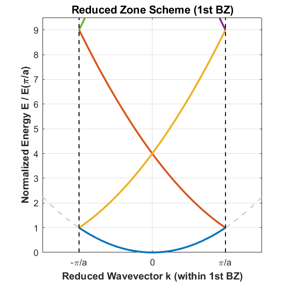
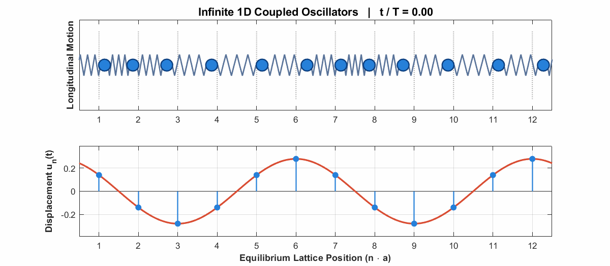
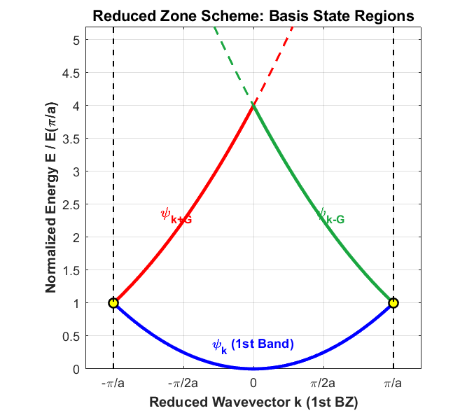
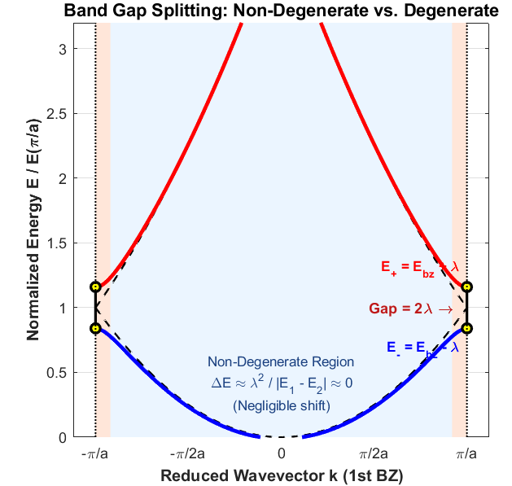
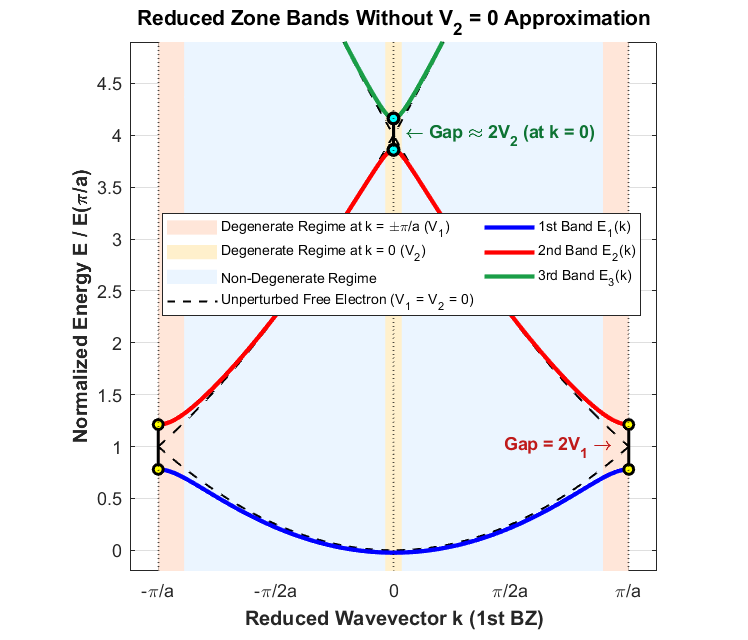

Hello! In this post, I will take a more intuitive look at why energy levels split, connecting the idea to eigenmodes. If eigenmodes and matrix diagonalization are unfamiliar, please read the following posts first.

[Eigenmodes](/eigenmodes/)

[Vibration Modes](/vibration-modes/)

With that, let's get started.

## Energy bands in the free-electron model

$$
\left[-\frac{\hbar ^2}{2m}\frac{d^2}{dx^2}+V(x)\right]\psi (x)=E\psi (x)
$$

The equation above is the one-dimensional Schrödinger equation. For a given potential function $V(x)$, we can find wavefunctions with energy $E$.

If $V(x)=0$, we have a free electron, with the following solution.

$$
-\frac{\hbar ^2}{2m}\frac{d^2\psi (x)}{dx^2}=E\psi (x)
$$

$$
\psi _k(x)=Ae^{ikx}+Be^{-ikx}\ \ \ \ \ \ \ \left(k=\frac{\sqrt{2mE}}{\hbar }\right)
$$

Plotting the energy against the wavevector $k$ gives the energy-band diagram below. Bands extending beyond the first Brillouin zone (1st BZ) can be folded back into it using the periodicity of reciprocal space.

*Free-electron energy bands in the first Brillouin zone.*

## Energy bands in the nearly-free-electron model

[Reciprocal Lattice](/reciprocal-lattice/)

We have just considered the case $V(x)=0$. Now suppose there is a small potential $V(x)$ with period $a$, producing a perturbation.

Using a Fourier series, we can express this potential as a sum over reciprocal-lattice vectors.

$$
V(x)=\sum _{n=-\infty }^{\infty }V_ne^{i\left(n\frac{2\pi }{a}\right)x}=\sum _{n=-\infty }^{\infty }V_ne^{iG_nx}
$$

In a periodic potential, the wavefunction has the form of a Bloch function. Thus, $\psi_k(x)$ can be written as follows.

$$
\psi _k(x)=e^{ikx}u_k(x)
$$

$$
=e^{ikx}\sum _{n=-\infty }^{\infty }C_me^{iG_mx}
$$

$$
=\sum _{n=-\infty }^{\infty }C_me^{i\left(G_m+k\right)x}
$$

Substituting these expressions for $\psi_k(x)$ and $V(x)$ into the one-dimensional Schrödinger equation gives

$$
\sum _{m=-\infty }^{\infty }\frac{\hbar ^2(k+G_m)^2}{2m}C_me^{i(k+G_m)x}+\sum _{n=-\infty }^{\infty }\sum _{m=-\infty }^{\infty }V_nC_me^{i(k+G_m+G_n)x}=\sum _{m=-\infty }^{\infty }EC_me^{i(k+G_m)x}
$$

This looks rather complicated, but collecting the terms for each component lets us rewrite it as a matrix equation.

$$
\begin{pmatrix}\ddots &\vdots &\vdots &\vdots &\ddots \\\cdots &\frac{\hbar ^2\left(k-G_1\right)^2}{2m}&V_{-1}&V_{-2}&\cdots \\\cdots &V_1&\frac{\hbar ^2k^2}{2m}&V_{-1}&\cdots \\\cdots &V_2&V_1&\frac{\hbar ^2(k+G_1)^2}{2m}&\cdots \\\ddots &\vdots &\vdots &\vdots &\ddots \end{pmatrix}\begin{pmatrix}\vdots \\C_{-1}\\C_0\\C_1\\\vdots \end{pmatrix}=E\begin{pmatrix}\vdots \\C_{-1}\\C_0\\C_1\\\vdots \end{pmatrix}
$$

The eigenvalues of this matrix determine the wavefunction's energy $E$.

## The connection to eigenmodes

The coupled oscillators discussed in the Vibration Modes post have a similar matrix structure.

*An infinite chain of coupled harmonic oscillators.*

The spring oscillations above are represented by the following matrix equation.

$$
\begin{pmatrix}\ddots &\vdots &\vdots &\vdots &\ddots \\\cdots &\frac{2K}{M}&-\frac{K}{M}&0&\cdots \\\cdots &-\frac{K}{M}&\frac{2K}{M}&-\frac{K}{M}&\cdots \\\cdots &0&-\frac{K}{M}&\frac{2K}{M}&\cdots \\\ddots &\vdots &\vdots &\vdots &\ddots \end{pmatrix}\begin{pmatrix}\vdots \\A_{n-1}\\A_n\\A_{n+1}\\\vdots \end{pmatrix}=\omega ^2\begin{pmatrix}\vdots \\A_{n-1}\\A_n\\A_{n+1}\\\vdots \end{pmatrix}
$$

As discussed in the Vibration Modes post, this is not a diagonal matrix. The interactions with the springs on either side introduce off-diagonal entries immediately next to the diagonal. Finding the eigenvalues means diagonalizing the matrix by transforming to a set of mutually orthogonal basis vectors.

$$
\begin{pmatrix}\ddots &\vdots &\vdots &\vdots &\ddots \\\cdots &\frac{4K}{M}\sin ^2\left(\frac{k_{-1}a}{2}\right)&0&0&\cdots \\\cdots &0&\frac{4K}{M}\sin ^2\left(\frac{k_0a}{2}\right)&0&\cdots \\\cdots &0&0&\frac{4K}{M}\sin ^2\left(\frac{k_1a}{2}\right)&\cdots \\\ddots &\vdots &\vdots &\vdots &\ddots \end{pmatrix}\begin{pmatrix}\vdots \\c_{k_{-1}}\\c_{k_0}\\c_{k_1}\\\vdots \end{pmatrix}=\omega ^2(k)\begin{pmatrix}\vdots \\c_{k_{-1}}\\c_{k_0}\\c_{k_1}\\\vdots \end{pmatrix}
$$

*The matrix of eigenmodes obtained by diagonalization.*

$$
\begin{pmatrix}\ddots &\vdots &\vdots &\vdots &\ddots \\\cdots &\frac{\hbar ^2\left(k-G_1\right)^2}{2m}&V_{-1}&V_{-2}&\cdots \\\cdots &V_1&\frac{\hbar ^2k^2}{2m}&V_{-1}&\cdots \\\cdots &V_2&V_1&\frac{\hbar ^2(k+G_1)^2}{2m}&\cdots \\\ddots &\vdots &\vdots &\vdots &\ddots \end{pmatrix}\begin{pmatrix}\vdots \\C_{-1}\\C_0\\C_1\\\vdots \end{pmatrix}=E\begin{pmatrix}\vdots \\C_{-1}\\C_0\\C_1\\\vdots \end{pmatrix}
$$

The nearly-free-electron matrix derived earlier works in the same way. Here, the terms $V_n$ represent the coupling between wavefunctions through the potential. They can be expressed as

$$
V_n=\left\langle \psi _{k+G_n}|V(x)|\psi _k\ \right\rangle
$$

Diagonalizing this matrix gives orthogonal eigenvectors and eigenvalues, with no coupling terms remaining in the new basis. These eigenvectors provide the basis wavefunctions for the system, and their eigenvalues give the corresponding energies. The resulting eigenvalues therefore differ from those for $V(x)=0$.

## Perturbation theory

How much do the eigenvalues split when such a potential is introduced? The answer differs depending on whether the energies are degenerate or non-degenerate. Perturbation theory is one way to approximate this change.

Let's consider an example. Suppose two eigenstates with energies $E_1$ and $E_2$ are coupled. We can separate the Hamiltonian into the diagonal matrix of the uncoupled eigenmodes and an off-diagonal matrix representing the interaction.

$$
H^0=\begin{pmatrix}E_1&0\\0&E_2\end{pmatrix}
$$

$$
H^{\prime}=\begin{pmatrix}0&\lambda \\\lambda &0\end{pmatrix}
$$

$$
H=H^0+H^{\prime}=\begin{pmatrix}E_1&\lambda \\\lambda &E_2\end{pmatrix}
$$

Adding these two matrices gives the Hamiltonian for the complete interacting system. Using $\psi_1$ and $\psi_2$ as the basis, we can write

$$
\Psi =c_1\psi _1+c_2\psi _2
$$

$$
H\Psi =E\Psi
$$

$$
\begin{pmatrix}E_1&\lambda \\\lambda &E_2\end{pmatrix}\begin{pmatrix}c_1\\c_2\end{pmatrix}=E\begin{pmatrix}c_1\\c_2\end{pmatrix}
$$

This is a simplified description of two states, $\psi_1$ and $\psi_2$, coupled by an interaction term $\lambda$. Let's find the eigenvalues. Moving $E$ to the left-hand side and setting the determinant to zero gives

$$
\det \begin{pmatrix}E_1-E&\lambda \\\lambda &E_2-E\end{pmatrix}=(E_1-E)(E_2-E)-\lambda ^2=0
$$

$$
E^2-(E_1+E_2)E+E_1E_2-\lambda ^2=0
$$

$$
E_{\pm }=\frac{E_1+E_2}{2}\pm \frac{\sqrt{\left(E_1-E_2\right)^2+4\lambda ^2}}{2}
$$

We can use a Taylor expansion to distinguish two regimes: one where the energy difference inside the square root is much larger than the coupling, and one where it is much smaller.

$$
\sqrt{1+x}\approx 1+\frac{1}{2}x\ \ \ at\ |x|\ll 1
$$

$$
1.\ |E_1-E_2|\gg 2|\lambda |
$$

$$
\sqrt{(E_1-E_2)^2+4\lambda ^2}=(E_1-E_2)\sqrt{1+\frac{4\lambda ^2}{(E_1-E_2)^2}}
$$

$$
\approx (E_1-E_2)\left(1+\frac{1}{2}\cdot \frac{4\lambda ^2}{(E_1-E_2)^2}\right)=(E_1-E_2)+\frac{2\lambda ^2}{E_1-E_2}
$$

The energies in this case are approximately

$$
E_+\approx \frac{E_1+E_2}{2}+\frac{1}{2}\left(E_1-E_2+\frac{2\lambda ^2}{E_1-E_2}\right)=E_1+\frac{\lambda ^2}{E_1-E_2}
$$

$$
E_-\approx \frac{E_1+E_2}{2}-\frac{1}{2}\left(E_1-E_2+\frac{2\lambda ^2}{E_1-E_2}\right)=E_2-\frac{\lambda ^2}{E_1-E_2}
$$

The shifts of the two energies are small. The coupling $\lambda$ is already small, and $E_1-E_2$ is nonzero. In this regime, the coupling produces only a small change in the eigenmode energies, and the eigenmodes can still be approximated by the original wavefunctions. This is non-degenerate perturbation theory.

$$
2.\ |E_1-E_2|\ll 2|\lambda |
$$

$$
\sqrt{(E_1-E_2)^2+4\lambda ^2}=2|\lambda |\sqrt{1+\frac{(E_1-E_2)^2}{4\lambda ^2}}
$$

$$
\approx 2|\lambda |\left(1+\frac{1}{2}\cdot \frac{(E_1-E_2)^2}{4\lambda ^2}\right)=2|\lambda |+\frac{(E_1-E_2)^2}{4|\lambda |}
$$

The final term is much smaller than the $2|\lambda|$ term, so we can neglect it. The energies then become

$$
E_+\approx \frac{E_1+E_2}{2}+|\lambda |
$$

$$
E_-\approx \frac{E_1+E_2}{2}-|\lambda |
$$

Here, we see a noticeable splitting of the energy levels. This is the degenerate-perturbation regime.

If $E_1=E_2$, the eigenvectors and eigenvalues are obtained as follows.

$$
let\ E_1=E_2=E_0
$$

$$
H=\begin{pmatrix}E_0&\lambda \\\lambda &E_0\end{pmatrix}
$$

$$
E_+=E_0+\lambda
$$

$$
E_-=E_0-\lambda
$$

$$
\Psi _+=\frac{1}{\sqrt{2}}\psi _1+\frac{1}{\sqrt{2}}\psi _2
$$

$$
\Psi _-=\frac{1}{\sqrt{2}}\psi _1-\frac{1}{\sqrt{2}}\psi _2
$$

In non-degenerate perturbation theory, the energy shifts are second order in $\lambda$; in degenerate perturbation theory, the splitting is first order. That is why, for a weak coupling, the non-degenerate shifts are comparatively small while the degenerate splitting is much more pronounced.

## Perturbation in energy bands

Now let's return to the eigenvalue problem for the energy-band matrix. Away from the boundary of the first Brillouin zone, the energy shifts associated with the coupled-state problem are very small. The coupled wavefunctions have different energies, so non-degenerate perturbation theory applies. Although they share the same crystal momentum $k$, their plane-wave wavevectors differ by reciprocal-lattice vectors, giving them appreciably different unperturbed energies. The resulting shifts are small enough that we can approximate them as zero.

The situation is different near the boundary of the first Brillouin zone. There, the coupled states have almost the same energy. The yellow points in the figure below mark these states near the zone boundary.

*The states $\psi_{k-G}$ and $\psi_k$ coupled at the yellow points.*

In this case, we need degenerate perturbation theory. Writing the coupling as $\lambda$, the energy levels split by $2\lambda$ at the degeneracy. We can represent this on the band diagram as follows.

*Dashed curves: energy bands without coupling. Solid blue and red curves: the coupled bands, separated by a band gap of $2\lambda$.*

The corresponding eigenvectors are

$$
\Psi _{\pm }=\frac{\psi _k\pm \psi _{k-G}}{\sqrt{2}}
$$

$$
\Psi _+(x)=\frac{\psi _k(x)+\psi _{k-G}(x)}{\sqrt{2}}=\sqrt{\frac{2}{L}}\cos \left(\frac{\pi }{a}x\right)
$$

$$
\Psi _-(x)=\frac{\psi _k(x)-\psi _{k-G}(x)}{\sqrt{2}}=i\sqrt{\frac{2}{L}}\sin \left(\frac{\pi }{a}x\right)
$$

The original plane-wave basis functions, of the form $e^{ikx}$, combine through the coupling to form sine and cosine standing waves.

This is not limited to the first-zone boundary. At any $k$, states with the same crystal momentum and similar energies can undergo degenerate mixing and energy splitting. We can also see this in the diagram below.

*Energy splitting at $k=0$ and $k=\pi/a$.*

In this post, I tried to explain the origin of energy splitting in band structures more fundamentally, through matrix diagonalization and perturbation theory using Taylor expansions. We also saw why the most pronounced splitting occurs in the degenerate regime.

That's all for this post. Thank you for reading!

*This post reflects my own understanding, so there may be errors. Questions are always welcome, so feel free to ask.*
