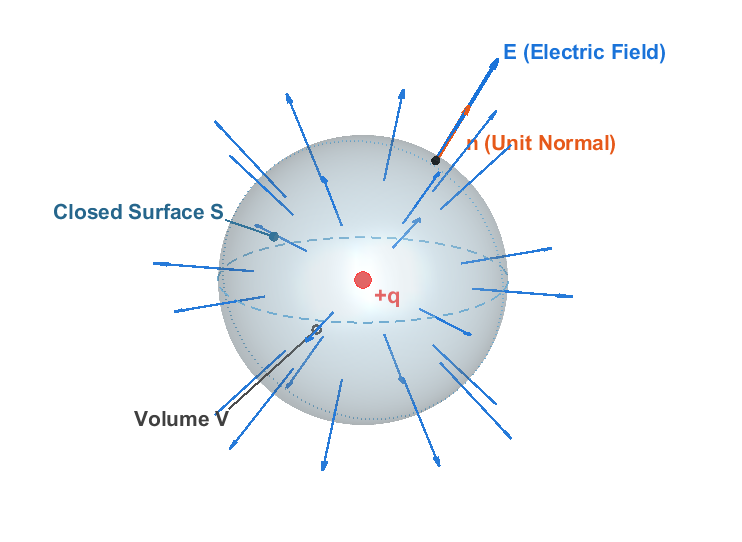
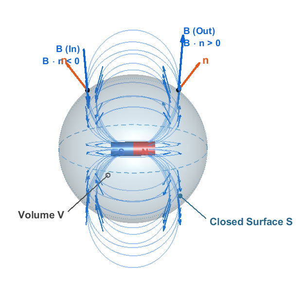
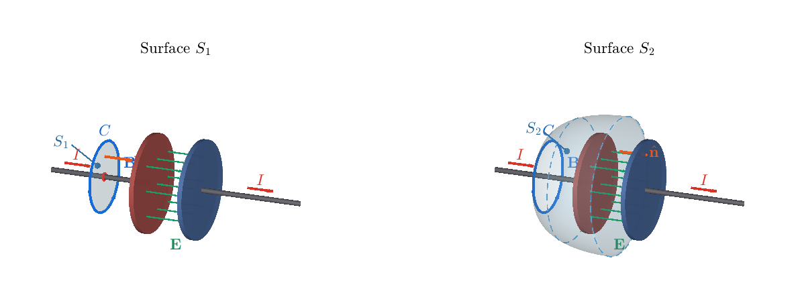
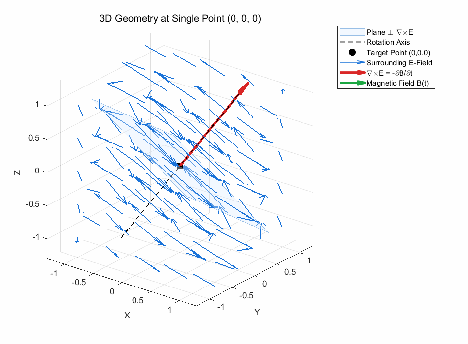
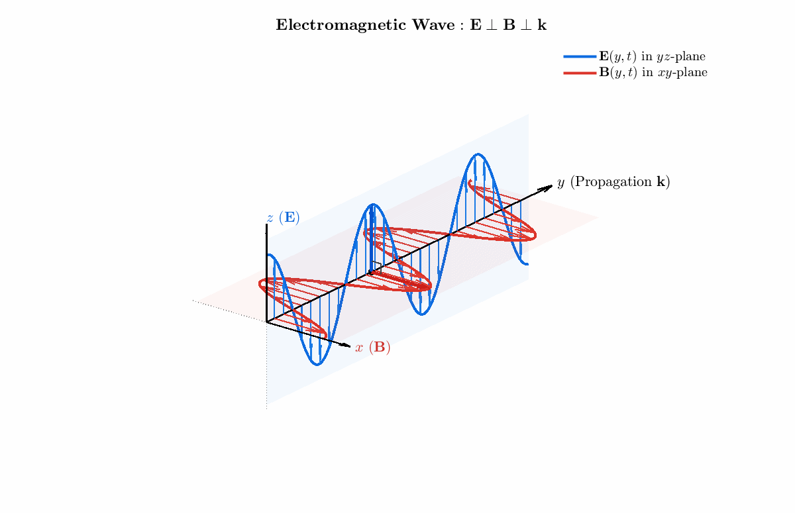
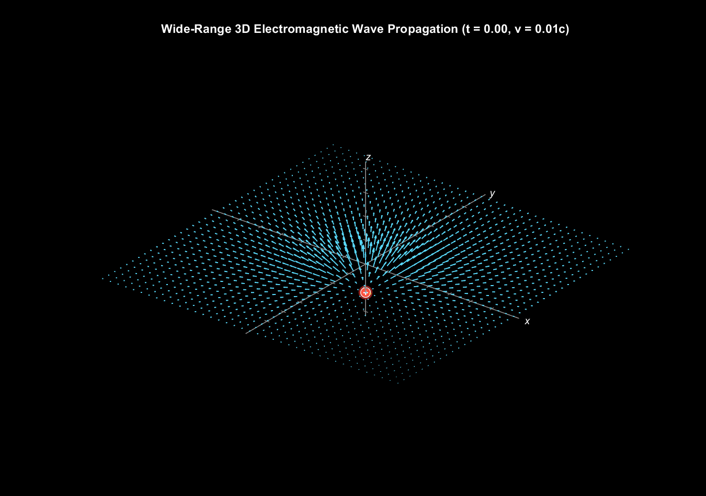
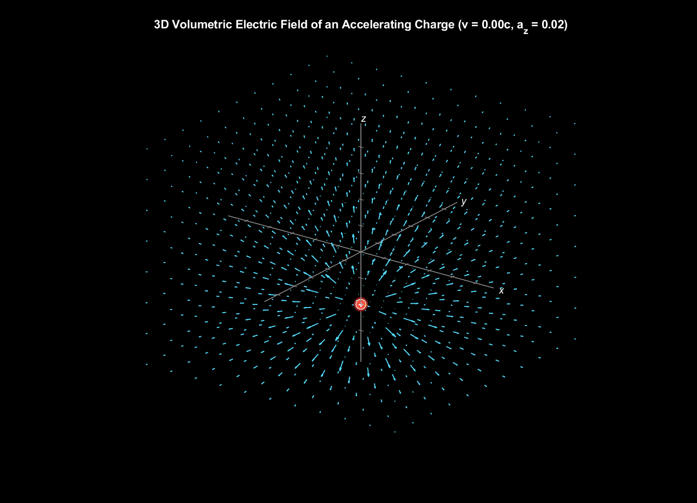
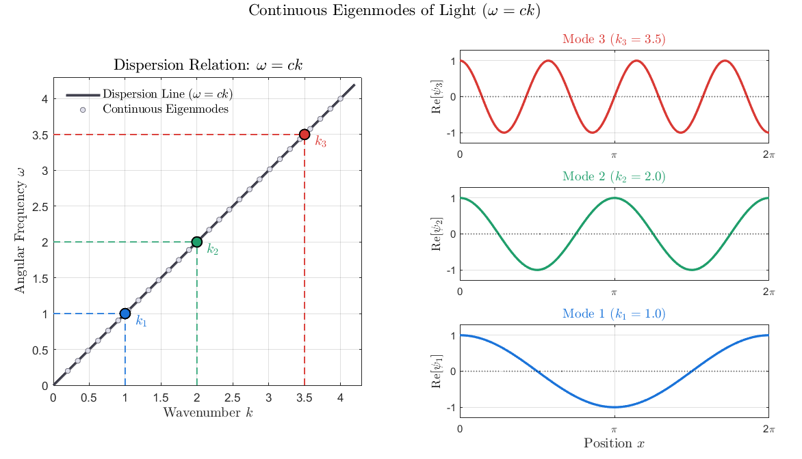

Hi everyone! In this post, I'd like to discuss Maxwell's equations. I don't yet have a complete understanding of electromagnetism, so please bear in mind that there may be mistakes.

If divergence and curl are unfamiliar, please read [Divergence and Curl](https://oasisforhaanee.github.io/divergence-and-curl/) first.

Let's begin!

## Maxwell's equations

The following four equations are Maxwell's equations.

$$
\nabla \cdot \mathbf{E}=\frac{\rho }{\varepsilon _0}
$$

$$
\nabla \cdot \mathbf{B}=0
$$

$$
\nabla \times \mathbf{E}=-\frac{\partial \mathbf{B}}{\partial t}
$$

$$
\nabla \times \mathbf{B}=\mu _0\mathbf{J}+\mu _0\varepsilon _0\frac{\partial \mathbf{E}}{\partial t}
$$

Let's look at what each equation means.

$$
1.\ \ \nabla \cdot \mathbf{E}=\frac{\rho }{\varepsilon _0}\ \left(Gauss's\ law\right)
$$

Maxwell's first equation says that, if we take a very small volume V around a point in the electric field, the divergence there is proportional to the charge density within that volume. To see why, let's start with the definition of divergence.

$$
\nabla \cdot \mathbf{E}=\lim _{V\to 0}^{ }\frac{1}{V}\iint _{\ S}^{\ }\mathbf{E}\cdot \hat{\mathbf{n}}\, dS
$$

This is the definition of divergence. Imagine a small balloon sitting in an electric field.

We add up the electric field passing outward through the balloon's surface—the closed surface S—in the direction of the outward normal n. Mathematically, we integrate the dot product over S, then divide by the balloon's volume V. In other words, divergence is the **net outward electric flux per unit volume**. Let's build some intuition with a diagram.

The geometry used in the definition of divergence.

Looking back at the formula, V is the sphere's volume, S is its surface, E is the electric field extending radially from charge q, and n is the outward unit normal to the sphere. Taking the limit as V approaches zero gives div E. Let's work through the calculation.

Because E points radially outward, it is parallel to the unit normal n on a sphere centered on the charge. The field is written as follows.

$$
\mathbf{E}=\frac{1}{4\pi \varepsilon _0}\frac{q}{r^2}\hat{\mathbf{r}}\, \ \ \ \ \ \ \ \ \ \ \ \ \ \ \left(\hat{\mathbf{r}}=\hat{\mathbf{n}}\, \right)
$$

$$
\mathbf{E}\cdot \hat{\mathbf{n}}=\frac{1}{4\pi \varepsilon _0}\frac{q}{r^2}\hat{\mathbf{r}}\cdot \hat{\mathbf{n}}\, =\frac{1}{4\pi \varepsilon _0}\frac{q}{r^2}\hat{\mathbf{n}}\cdot \hat{\mathbf{n}}\,
$$

Substituting this directly into the divergence formula gives:

$$
\nabla \cdot \mathbf{E}=\lim _{r\to 0}^{ }\frac{\iint _{S\ }^{\ }\left(\frac{1}{4\pi \varepsilon _0}\frac{q}{r^2}\hat{\mathbf{n}}\right)\cdot \hat{\mathbf{n}}\, dS}{\frac{4}{3}\pi r^3}=\lim _{r\to 0}^{ }\frac{4\pi r^2\cdot \frac{1}{4\pi \varepsilon _0}\frac{q}{r^2}}{\frac{4}{3}\pi r^3}=\lim _{V\to 0}^{ }\frac{q}{\varepsilon _0V}=\frac{\rho }{\varepsilon _0}
$$

Here, q/V is the charge density, giving the first of Maxwell's equations.

$$
2.\ \nabla \cdot \mathbf{B}=0
$$

Maxwell's second equation states that the divergence of the magnetic field is always zero. Unlike electric charges, which can exist as positive or negative charges, isolated north or south magnetic poles—magnetic monopoles—do not appear in this description.

We can illustrate this as follows.

The incoming and outgoing magnetic flux are equal.

As the diagram shows, even for an infinitesimal volume, the outward magnetic flux and inward magnetic flux balance exactly. The net flux is always zero. This holds throughout the magnetic field.

This equation also lets us express B in another way.

$$
\nabla \cdot \mathbf{B}=0
$$

$$
\mathbf{B}=\nabla \times \mathbf{A}
$$

If div B = 0, we can express B as the curl of a vector field. That field is the **vector potential A**. You can think of the magnetic vector potential A as playing a role analogous to the electric potential V. I'll discuss this in more detail in another post.

$$
3.\ \nabla \times \mathbf{E}=-\frac{\partial \mathbf{B}}{\partial t}\ \left(Faraday's\ law\right)
$$

Maxwell's third equation describes electromagnetic induction. In electrostatics, where charges are stationary, curl E is zero.

[Why Is the Curl of an Electrostatic Field Zero?](https://oasisforhaanee.github.io/electrostatic-field-zero-curl/)

When charges accelerate, however, we need laws and equations beyond those of electrostatics.

Faraday established this law experimentally rather than deriving it purely mathematically. So rather than trying to derive the law, let's start from it and explore what it tells us.

Substitute the expression B = curl A that we found earlier.

$$
\nabla \times \mathbf{E}=-\frac{\partial }{\partial t}(\nabla \times \mathbf{A})
$$

$$
\nabla \times \left(\mathbf{E}+\frac{\partial \mathbf{A}}{\partial t}\right)=\mathbf{0}
$$

A vector field whose curl is zero throughout the region can be expressed as the gradient of a scalar field: the line integral of a scalar gradient around a closed curve is zero. The scalar field here is the electric potential V. We can therefore write:

$$
\mathbf{E}+\frac{\partial \mathbf{A}}{\partial t}=-\nabla V
$$

$$
\mathbf{E}=-\nabla V-\frac{\partial \mathbf{A}}{\partial t}
$$

This gives us an expression for the electric field associated with moving charges as well. Compared with electrostatics, we now have a time derivative of A—an additional term related to the magnetic field. The equation shows that changing magnetic fields and electric fields are connected.

$$
4.\ \nabla \times \mathbf{B}=\mu _0\mathbf{J}+\mu _0\varepsilon _0\frac{\partial \mathbf{E}}{\partial t}\ \left(Ampere's\ law+Maxwell\right)
$$

Maxwell's fourth equation is related to Ampère's law. The original law says that a flowing electric current produces a magnetic field, expressed as:

$$
\nabla \times \mathbf{B}=\mu _0\mathbf{J}
$$

But there are situations where this equation does not work on its own. The diagram below shows a capacitor being charged. For the same closed curve C, Stokes' theorem requires the surface integral of curl B to be the same for the surfaces in the left and right diagrams.

$$
\iint _{S_1\ }^{\ }\left(\nabla \times \mathbf{B}\right)\cdot\hat{\mathbf{n}}\,dS=\iint _{S_2\ }^{\ }\left(\nabla \times \mathbf{B}\right)\cdot\hat{\mathbf{n}}\,dS=\oint _{\ C}^{\ }\mathbf{B}\cdot d\mathbf{l}
$$

If we substitute Ampère's law into this expression, the following integrals should also be equal.

$$
\iint _{S_1\ }^{\ }\left(\nabla \times \mathbf{B}\right)\cdot\hat{\mathbf{n}}\,dS=\iint _{S_2\ }^{\ }\left(\nabla \times \mathbf{B}\right)\cdot\hat{\mathbf{n}}\,dS
$$

$$
=\iint _{\ S_1}^{\ }\mu _0\mathbf{J}\cdot \hat{\mathbf{n}}\, dS=\iint _{\ S_2}^{\ }\mu _0\mathbf{J}\cdot \hat{\mathbf{n}}\, dS
$$

Current density J passes through surface S1, so its integral is nonzero. But no current passes through surface S2, so that integral is zero—a contradiction! There is no conduction current flowing through the gap between the capacitor plates. To resolve this, Maxwell supplemented the equation as follows.

$$
\nabla \times \mathbf{B}=\mu _0\mathbf{J}+\mu _0\varepsilon _0\frac{\partial \mathbf{E}}{\partial t}
$$

Although no current flows across the gap, charge accumulates on the plates, changing the electric field with time. With this additional term, the result is the same whichever spanning surface we choose.

This equation, too, shows that the magnetic field is related to changes in the electric field.

## Solutions of Maxwell's equations

Maxwell's equations are, literally, equations. Equations have solutions, and those solutions should carry significant physical meaning.

To simplify things, let's consider a vacuum with no charges. The equations become:

$$
\nabla \cdot \mathbf{E}=0
$$

$$
\nabla \cdot \mathbf{B}=0
$$

$$
\nabla \times \mathbf{E}=-\frac{\partial \mathbf{B}}{\partial t}
$$

$$
\nabla \times \mathbf{B}=\mu _0\varepsilon _0\frac{\partial \mathbf{E}}{\partial t}
$$

With no charges present, the charge-density and current-density terms disappear from the first and fourth equations.

Now look at the third and fourth equations. The expressions for E and B are coupled. Let's combine them, starting by taking the curl of both sides of the third equation.

$$
\nabla \times (\nabla \times \mathbf{E})=\nabla \times \left(-\frac{\partial \mathbf{B}}{\partial t}\right)
$$

The del operator acts on spatial coordinates, while the derivative inside acts on time. Because the space and time variables are independent, we can interchange the operations.

$$
\nabla \times (\nabla \times \mathbf{E})=-\frac{\partial }{\partial t}(\nabla \times \mathbf{B})
$$

We can rewrite curl(curl E) using the following identity. Expanding the curls explicitly gives this result.

$$
\nabla \times (\nabla \times \mathbf{E})=\nabla (\nabla \cdot \mathbf{E})-\nabla ^2\mathbf{E}
$$

The first Maxwell equation gives div E = 0, so the first term on the right vanishes.

$$
\nabla \times (\nabla \times \mathbf{E})=-\nabla ^2\mathbf{E}
$$

Now substitute Maxwell's fourth equation for curl B.

$$
-\frac{\partial }{\partial t}(\nabla \times \mathbf{B})=-\frac{\partial }{\partial t}\left(\mu _0\varepsilon _0\frac{\partial \mathbf{E}}{\partial t}\right)=-\mu _0\varepsilon _0\frac{\partial ^2\mathbf{E}}{\partial t^2}
$$

Putting everything together gives:

$$
\nabla ^2\mathbf{E}=\mu _0\varepsilon _0\frac{\partial ^2\mathbf{E}}{\partial t^2}
$$

This has exactly the form of a wave equation. The wave equation and a solution of this partial differential equation are:

$$
\nabla ^2\psi =\frac{1}{v^2}\frac{\partial ^2\psi }{\partial t^2}
$$

$$
\left(v:\ phase\ velocity\right)
$$

$$
\psi \left(\mathbf{r},t\right)=Ae^{i\left(\mathbf{k}\cdot \mathbf{r}-wt\right)}
$$

The electric-field solution therefore takes the form:

$$
\mathbf{E}(\mathbf{r},t)=\mathbf{E}_0e^{i(\mathbf{k}\cdot \mathbf{r}-\omega t)}
$$

We can obtain the magnetic-field solution in exactly the same way.

$$
\nabla \times \mathbf{B}=\mu _0\varepsilon _0\frac{\partial \mathbf{E}}{\partial t}
$$

$$
\nabla \times (\nabla \times \mathbf{B})=\nabla \times \left(\mu _0\varepsilon _0\frac{\partial \mathbf{E}}{\partial t}\right)
$$

$$
\nabla \times (\nabla \times \mathbf{B})=\mu _0\varepsilon _0\frac{\partial }{\partial t}(\nabla \times \mathbf{E})
$$

$$
\nabla (\nabla \cdot \mathbf{B})-\nabla ^2\mathbf{B}=\mu _0\varepsilon _0\frac{\partial }{\partial t}(\nabla \times \mathbf{E})
$$

$$
-\nabla ^2\mathbf{B}=\mu _0\varepsilon _0\frac{\partial }{\partial t}(\nabla \times \mathbf{E})
$$

$$
-\nabla ^2\mathbf{B}=\mu _0\varepsilon _0\frac{\partial }{\partial t}\left(-\frac{\partial \mathbf{B}}{\partial t}\right)
$$

$$
\nabla ^2\mathbf{B}=\mu _0\varepsilon _0\frac{\partial ^2\mathbf{B}}{\partial t^2}
$$

$$
\mathbf{B}(\mathbf{r},t)=\mathbf{B}_0e^{i(\mathbf{k}\cdot \mathbf{r}-\omega t)}
$$

Thus, the wave equations and their solutions for the electric and magnetic fields are:

$$
\nabla ^2\mathbf{E}=\mu _0\varepsilon _0\frac{\partial ^2\mathbf{E}}{\partial t^2}
$$

$$
\nabla ^2\mathbf{B}=\mu _0\varepsilon _0\frac{\partial ^2\mathbf{B}}{\partial t^2}
$$

$$
\mathbf{E}(\mathbf{r},t)=\mathbf{E}_0e^{i(\mathbf{k}\cdot \mathbf{r}-\omega t)}
$$

$$
\mathbf{B}(\mathbf{r},t)=\mathbf{B}_0e^{i(\mathbf{k}\cdot \mathbf{r}-\omega t)}
$$

Returning to Maxwell's third and fourth equations, the curl of E determines the direction of the change in B, while the curl of B determines the direction of the change in E. For these waves, the directions in which E and B oscillate are perpendicular.

A schematic of the plane in which E oscillates (blue), the direction of curl E (red), and the direction in which B oscillates (green). This is not an actual electromagnetic wave.

It helps illustrate why the oscillations of E and B are perpendicular.

In other words, the electric and magnetic waves are spatially orthogonal. We can visualize their motion as follows.

E is blue and B is red. They are perpendicular in space and propagate in phase.

In the wave equation, v is the phase velocity, equal to the angular frequency divided by the wave number. We can therefore calculate the speed of this wave:

$$
\frac{1}{v^2}=\mu _0\epsilon _0
$$

$$
v=\frac{1}{\sqrt{\mu _0\epsilon _0}}\approx 2.998\times 10^8\, \text{m/s}=c
$$

That number looks very familiar! It is the speed of light. The solution we have found is light itself.

Light propagates through oscillations of electric and magnetic fields. That is why we call it an **electromagnetic wave**.

To generate this light, the charge must accelerate. When a charge accelerates, its electric field changes, which changes the magnetic field, which in turn changes the electric field... Through this process, an electromagnetic wave is generated and propagates outward.

Electromagnetic-wave propagation from an accelerating charge in a two-dimensional electric field (circular wavefronts).

Electromagnetic-wave propagation from an accelerating charge in a three-dimensional electric field (spherical wavefronts).

## Maxwell's equations and eigenmodes

The concept of an eigenmode comes up again and again in physics. I found a connection here, too: electromagnetic waves are solutions of a wave equation.

The wave equation is a partial differential equation, with solutions $e^{i(kr-\omega t)}$ serving as eigenfunctions. If we allow continuous values of k, light has infinitely many such modes. Since the ratio of angular frequency to wave number is fixed at c, the dispersion relation is $\omega=kc$, and the distinct mode functions are orthogonal.

Smaller wave numbers correspond to lower frequencies. The graph on the right shows the modes corresponding to the points on the left.

According to this dispersion relation, a smaller k means a smaller angular frequency and a longer wavelength. These are the familiar radio waves, visible light, gamma rays, and so on. Modes with k near zero have long wavelengths, like radio waves, whereas modes far from zero have short wavelengths, like gamma rays.

The eigenvalues of these modes should also have an important meaning. But that seems to bring in the concept of photons, which I don't feel ready to explain yet. I'll return to it another time.

If you'd like to explore the motion of electromagnetic waves in more detail, take a look at the following video from 3Blue1Brown. I often watched this channel while studying linear algebra, too. Its visual depiction of rippling vector fields is especially helpful for developing intuition.

**How wiggling charges give rise to light**

<iframe width="560" height="315" src="https://www.youtube.com/embed/aXRTczANuIs" title="How wiggling charges give rise to light" frameborder="0" allowfullscreen></iframe>

In this post, we explored the four Maxwell equations and how to obtain their wave solutions. Earlier, we assumed a charge-free vacuum and dropped some terms. In the next post, I'd like to look at what including those terms means physically.

That's all for now. Thank you for reading!

*This post reflects my own understanding, so there may be errors. Questions are always welcome, so feel free to ask.*
