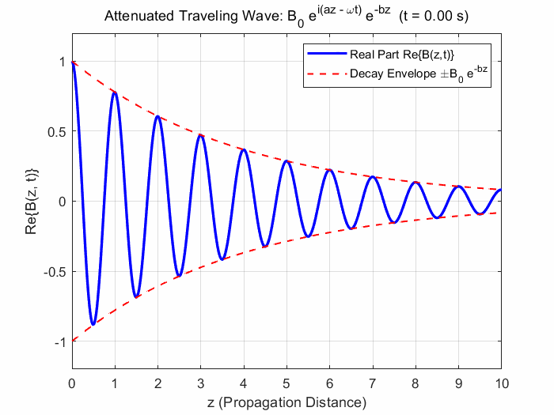
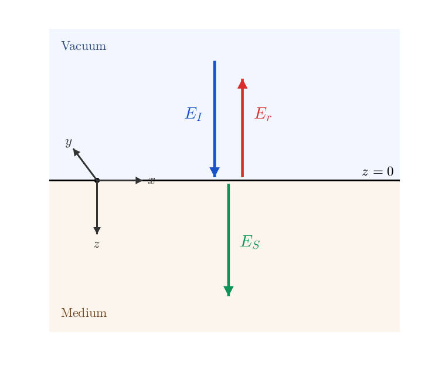
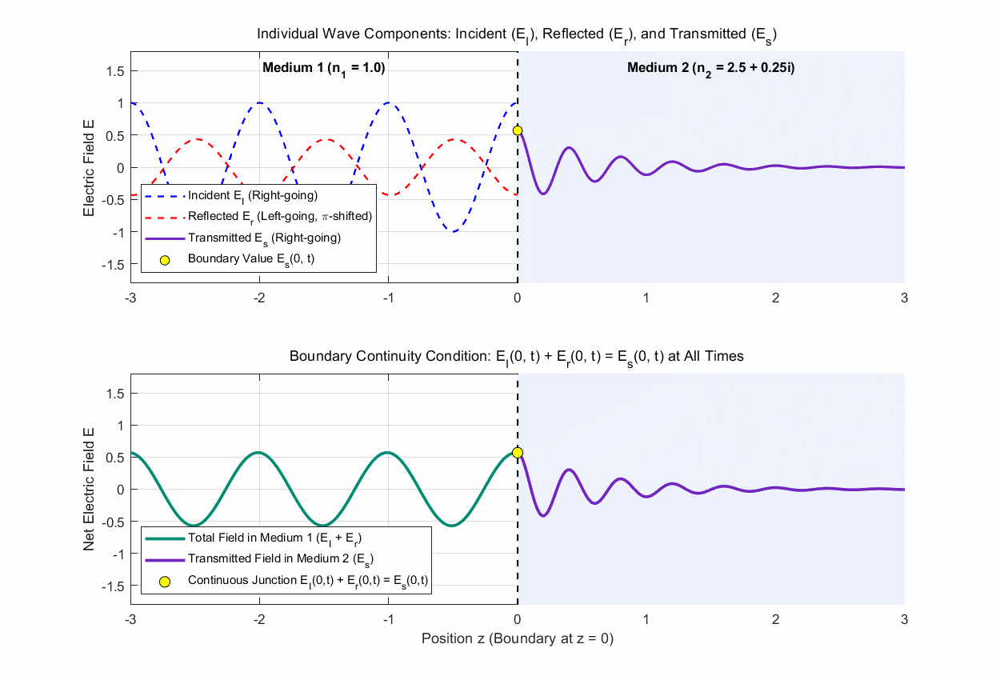

Hi everyone! In this post, I'd like to explore the optical properties of materials. These properties are directly related to light—that is, electromagnetic waves—so understanding Maxwell's equations is essential.

If Maxwell's equations are unfamiliar, please read [Maxwell's Equations](https://oasisforhaanee.github.io/maxwells-equations/) first.

Let's begin!

## Optical properties

What does it mean for a material to be transparent? Most intuitively, it means that light passes through it “well.” But what does that mean physically?

When light encounters a medium, not all of it passes straight through. Some is reflected at the interface, and some is absorbed as it travels through the material. The light that survives both processes and emerges is the transmitted light. The greater this transmitted fraction, the more transparent we consider the material.

To understand a material's optical properties, we need to know how much it reflects and absorbs. Both processes are determined by the interaction between electromagnetic waves and matter.

$R+A+T=1$

Here R is reflectivity, A is absorptance, and T is transmittance. Energy must be conserved, so the reflected, absorbed, and transmitted fractions add up to one. Reflection and absorption depend on the properties of the medium the light encounters.

## Maxwell's equations in a medium

In my previous post on Maxwell's equations, we assumed a vacuum and omitted the current-density term in the fourth equation. That term becomes important when describing electromagnetic waves in a material.

Let's solve the equations again, this time in a medium rather than a vacuum. In the fourth equation, replace the vacuum permeability and permittivity with those of the medium.

$$
\nabla \times \mathbf{B}=\mu \mathbf{J}+\mu \varepsilon \frac{\partial \mathbf{E}}{\partial t}
$$

Express the current density in terms of E and take the curl of both sides. For a homogeneous medium with constant material parameters, this gives:

$$
\mathbf{J}=\sigma \mathbf{E}
$$

$$
\nabla \times \mathbf{B}=\mu \sigma \mathbf{E}+\mu \varepsilon \frac{\partial \mathbf{E}}{\partial t}
$$

$$
\nabla \times \left(\nabla \times \mathbf{B}\right)=\nabla \left(\nabla \cdot \mathbf{B}\right)-\nabla ^2\mathbf{B}=\mu \sigma \left(\nabla \times \mathbf{E}\right)+\mu \varepsilon \frac{\partial \left(\nabla \times \mathbf{E}\right)}{\partial t}
$$

$$
\text{Using }\nabla \times \mathbf{E}=-\frac{\partial \mathbf{B}}{\partial t}
$$

$$
\nabla ^2\mathbf{B}=\mu \sigma \frac{\partial \mathbf{B}}{\partial t}+\mu \varepsilon \frac{\partial ^2\mathbf{B}}{\partial t^2}
$$

Assume that the wave propagates along the z axis and substitute a plane-wave solution for B. We obtain:

$$
\mathbf{B}=\mathbf{B_0}e^{i(\tilde{k}z-\omega t)}
$$

$$
\nabla ^2\mathbf{B}=\mu \sigma \frac{\partial \mathbf{B}}{\partial t}+\mu \varepsilon \frac{\partial ^2\mathbf{B}}{\partial t^2}
$$

$$
-\tilde{k}^2\mathbf{B}=-\mu \varepsilon \omega ^2\mathbf{B}-i\omega \mu \sigma \mathbf{B}
$$

$$
\tilde{k}^2=\mu \varepsilon \omega ^2+i\omega \mu \sigma
$$

The wave number is complex! Substituting it back into the magnetic-field solution shows the meaning of its real and imaginary parts. Let the complex wave number be a + bi:

$$
\text{Let }\tilde{k}=a+bi
$$

$$
\mathbf{B}=\mathbf{B_0}e^{i(\tilde{k}z-\omega t)}
$$

$$
=\mathbf{B_0}e^{i(\left(a+bi\right)z-\omega t)}
$$

$$
=\mathbf{B_0}e^{i\left(az-\omega t\right)}\cdot e^{-bz}
$$

The first exponential gives the phase of the wave, while the factor $e^{-bz}$ means that the amplitude decreases as z increases.

The envelope becomes smaller as z increases. This attenuation is associated with b, whereas a determines the phase velocity through the phase $az-\omega t$.

We can find a and b from the following equations.

$$
\tilde{k}=a+bi
$$

$$
\tilde{k}^2=\left(a^2-b^2\right)+\left(2ab\right)i
$$

$$
=\mu \varepsilon \omega ^2+i\omega \mu \sigma
$$

$$
a^2-b^2=\mu \varepsilon \omega ^2\ \ \ \ \ \ \ 2ab=\omega \mu \sigma
$$

Solving these simultaneous equations gives:

$$
a=\omega \sqrt{\frac{\mu \varepsilon }{2}}\left(\sqrt{1+\left(\frac{\sigma }{\omega \varepsilon }\right)^2}+1\right)^{1/2}\qquad
$$

$$
b=\omega \sqrt{\frac{\mu \varepsilon }{2}}\left(\sqrt{1+\left(\frac{\sigma }{\omega \varepsilon }\right)^2}-1\right)^{1/2}
$$

Normalizing the complex wave number by its vacuum value gives the complex refractive index, which characterizes the material. Here $k_0$ is the wave number in vacuum.

$$
\frac{\tilde{k}}{k_0}=\frac{a+bi}{\omega /c}=n+i\kappa \Rightarrow n=\frac{ac}{\omega },\quad \kappa =\frac{bc}{\omega }
$$

Here n is the refractive index, and κ—kappa, not k—is the **extinction coefficient**. Each material has its own values of n and κ at a given frequency.

## Absorptance

Let's return to the plane-wave solution and consider its meaning.

$$
\mathbf{B}=\mathbf{B_0}e^{i\left(az-\omega t\right)}\cdot e^{-bz}
$$

After traveling a distance z, the intensity has decreased by the following factor. The squared modulus means multiplication by the complex conjugate, so the phase factor cancels.

$$
\frac{I(z)}{I(0)}=\left|\frac{B(z)}{B(0)}\right|^2=e^{-2bz}
$$

The intensity lost during propagation is absorbed by the material. Thus, for light that has already entered the medium, the absorbed fraction over a distance z is one minus the surviving intensity fraction:

$$
A_{\mathrm{internal}}(z)=1-\frac{I(z)}{I(0)}=1-e^{-2bz}
$$

This attenuation is usually expressed using the absorption coefficient α, related to b as follows.

$$
e^{-2bz}=e^{-\alpha z}
$$

$$
\alpha =2b
$$

Using the expression for b derived earlier, we can also write:

$$
\alpha =2b=\frac{2\kappa \omega }{c}=\frac{4\pi \kappa }{\lambda _0}
$$

## Reflectivity

When light is incident normally on an interface, it must satisfy boundary conditions.

Maxwell's third equation connects curl E to the time derivative of B. Since curl involves spatial derivatives, a discontinuity in the tangential electric field would introduce a singular term. In the usual interface problem considered here, the tangential electric field is continuous.

Similarly, Maxwell's fourth equation relates curl B to the time derivative of E, but it also contains a current term. The corresponding boundary condition involves the auxiliary magnetic field H, defined by B = μH: its tangential component is continuous when there is no free surface current. I don't yet feel that I fully understand the auxiliary field, so I'll return to it in a future post about oblique incidence.

### Boundary condition 1: continuity of the electric field

The diagram above shows an incident wave arriving from vacuum, its reflected wave, and the transmitted electric-field wave. The interface is at z = 0. The incident and reflected waves occupy z < 0, while the transmitted wave occupies z > 0.

At the boundary, the sum of the incident and reflected fields must match the transmitted field, because the two waves are superposed on the incident side.

Let's express this mathematically. For simplicity, take z < 0 to be vacuum. The incident wave is:

$$
E_I(z,t)=E_Ie^{i(kz-\omega t)}=E_Ie^{i\left(\frac{\omega }{c}z-\omega t\right)}
$$

The reflected wave has the same frequency, but its propagation direction is reversed and its amplitude is different:

$$
E_R(z,t)=E_Re^{i\left(-\frac{\omega }{c}z-\omega t\right)}
$$

The transmitted wave in the other medium can be written using that medium's complex refractive index:

$$
E_S(z,t)=E_Se^{i(\tilde{k}z-\omega t)}\qquad \left(\text{where }\frac{\tilde{k}}{\omega /c}=n+i\kappa \right)
$$

Now consider continuity at z = 0. On the vacuum side, the incident and reflected fields are superposed; on the other side, only the transmitted field is present. The boundary condition is:

$$
E_I(0,t)+E_R(0,t)=E_S(0,t)
$$

Substituting the wave expressions gives:

$$
E_Ie^{i\left(\frac{\omega }{c}\cdot 0-\omega t\right)}+E_Re^{i\left(-\frac{\omega }{c}\cdot 0-\omega t\right)}=E_Se^{i(\tilde{k}\cdot 0-\omega t)}
$$

$$
E_Ie^{-i\omega t}+E_Re^{-i\omega t}=E_Se^{-i\omega t}
$$

$$
E_I+E_R=E_S
$$

This is our first boundary condition.

### Boundary condition 2: continuity of the auxiliary magnetic field

Next, let's consider H. Faraday's law relates E and B as follows.

$$
\nabla \times \mathbf{E}=-\frac{\partial \mathbf{B}}{\partial t}
$$

$$
\left(\frac{\partial E_z}{\partial y}-\frac{\partial E_y}{\partial z}\right)\hat{\mathbf{i}}+\left(\frac{\partial E_x}{\partial z}-\frac{\partial E_z}{\partial x}\right)\hat{\mathbf{j}}+\left(\frac{\partial E_y}{\partial x}-\frac{\partial E_x}{\partial y}\right)\hat{\mathbf{k}}=-\frac{\partial \mathbf{B}}{\partial t}
$$

Choose an x-polarized wave propagating along z. Then E has no y or z component, and its x component depends only on z and time. The curl equation simplifies to:

$$
\frac{\partial E_x}{\partial z}\hat{\mathbf{j}}=-\frac{\partial B_y}{\partial t}\hat{\mathbf{j}}
$$

Substituting the harmonic time dependence of the magnetic field gives:

$$
\frac{\partial E_x}{\partial z}=-(-i\omega B_y)=i\omega B_y=i\omega \mu H_y
$$

$$
H_y=\frac{1}{i\omega \mu }\frac{\partial E_x}{\partial z}
$$

For H to be continuous at the interface, its limiting values on the two sides must agree. The permeability is μ₀ on the vacuum side and μ₁ on the material side:

$$
\frac{1}{\mu _0}\frac{\partial E_x}{\partial z}\left(z<0\right)=\frac{1}{\mu _1}\frac{\partial E_x}{\partial z}\left(z>0\right)
$$

Substituting the electric-field expressions into this condition gives:

$$
\frac{1}{\mu _0}\frac{\partial }{\partial z}\left(E_Ie^{i\left(\frac{\omega }{c}z-\omega t\right)}+E_Re^{i\left(-\frac{\omega }{c}z-\omega t\right)}\right)=\frac{1}{\mu _1}\frac{\partial }{\partial z}\left(E_Se^{i(\tilde{k}z-\omega t)}\right)
$$

$$
\text{Substitute }z=0
$$

$$
\frac{1}{\mu _0}\left(\frac{\omega }{c}E_I-\frac{\omega }{c}E_R\right)=\frac{1}{\mu _1}\tilde{k}E_S
$$

Divide by the vacuum wave number and write $\mu_r=\mu_1/\mu_0$. The result is:

$$
E_I-E_R=\frac{n+i\kappa }{\mu _r}E_S\quad
$$

This is our second boundary condition.

### Combining the boundary conditions

Let's solve the two conditions together.

$$
E_I+E_R=E_S
$$

$$
E_I-E_R=\frac{n+i\kappa }{\mu _r}E_S\quad
$$

The incident and reflected amplitudes become:

$$
E_I=\frac{n+i\kappa +\mu _r}{2\mu _r}E_S
$$

$$
E_R=\frac{\mu _r-(n+i\kappa )}{2\mu _r}E_S
$$

Finally, taking the squared modulus of their amplitude ratio gives the intensity ratio—the reflectivity R:

$$
R=\left|\frac{E_R}{E_I}\right|^2=\left|\frac{\frac{\mu _r-(n+i\kappa )}{2\mu _r}E_S}{\frac{n+i\kappa +\mu _r}{2\mu _r}E_S}\right|^2=\frac{(n-\mu _r)^2+\kappa ^2}{(n+\mu _r)^2+\kappa ^2}
$$

For many materials at optical frequencies, the relative permeability is approximately one. With that approximation:

$$
R=\frac{(n-1)^2+\kappa ^2}{(n+1)^2+\kappa ^2}
$$

## Transmittance

Transmittance is the fraction of incident intensity remaining after reflection and absorption. In a single-pass model, neglecting reflection at an exit surface and multiple internal reflections, a thickness d gives:

$$
T=\frac{I_t}{I_0}=(1-R)e^{-\alpha d}=1-R-A
$$

The following animation illustrates both the boundary conditions at the reflecting interface and attenuation inside the medium. I hope it helps make the picture more intuitive.

Incident wave: blue dashed line. Reflected wave: red dashed line. Transmitted wave: solid blue line.

The lower plot shows the superposition of the incident and reflected waves, illustrating the continuity of the electric field at the boundary.

## Conclusion

What does all of this mean? As we saw earlier, n and κ characterize a material at a given frequency. They determine its optical response: reflectivity at an interface, and the absorption coefficient governing attenuation with distance. Together with the thickness and interface conditions, they determine how much light is absorbed or transmitted.

For example, glass has a very small extinction coefficient and a refractive index of about 1.5 in the visible range. This gives a reflectivity of approximately 0.04 at a vacuum–glass interface. For an illustrative absorption coefficient of 0.457 per meter, the intensity inside the glass follows:

$$
\frac{I}{I_0}=e^{-\alpha d}=e^{-0.457d}=(0.6332)^d
$$

$$
\left(d\text{ in meters}\right)
$$

For a one-meter thickness in this example, 4% of the incident light is reflected at the entrance. Of the remaining 96%, about 63.32% survives propagation through the glass, before accounting for any exit-surface reflection. Its small extinction coefficient allows much more light to penetrate than in strongly absorbing materials.

For comparison, consider aluminum with illustrative optical constants κ = 7.5 and n = 1.4. These give a reflectivity of about 0.9. Using an absorption coefficient of 0.1714 per nanometer, the intensity attenuation is:

$$
\frac{I}{I_0}=e^{-\alpha d}=e^{-0.1714d}=(0.8425)^d\quad
$$

$$
(d\text{ in nanometers})
$$

Aluminum both absorbs light much more strongly than glass and has a high reflectivity. This helps explain why it is opaque. These example optical constants and absorption coefficients depend on wavelength and on the particular material sample; they are not universal constants for every glass or aluminum sample.

Opacity is not determined only by strong absorption inside a material—a large κ. Reflection at the interface matters too. Even with a small extinction coefficient, a material can transmit little light if most of the incident light is reflected at its surface.

Because κ and the absorption coefficient vary with wavelength, we can also design materials that selectively absorb or transmit particular wavelength bands.

By choosing materials from optical-constant databases and designing their structure, we can target a desired absorption, reflection, or transmission response. Studying these concepts has helped me understand the optical properties of materials a little better.

That's all for this post. Thank you for reading!

*This post reflects my own understanding, so there may be errors. Questions are always welcome, so feel free to ask.*

Reference: David J. Griffiths, *Introduction to Electrodynamics*, 5th ed., Cambridge University Press, 2023, Section 9.3, “Electromagnetic Waves in Matter.”
